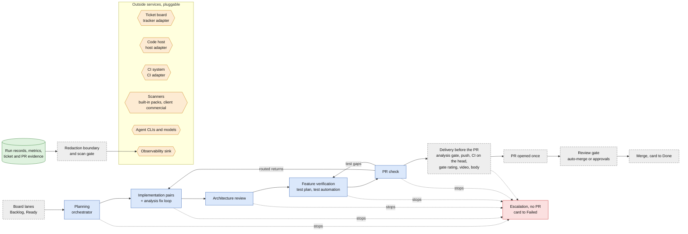
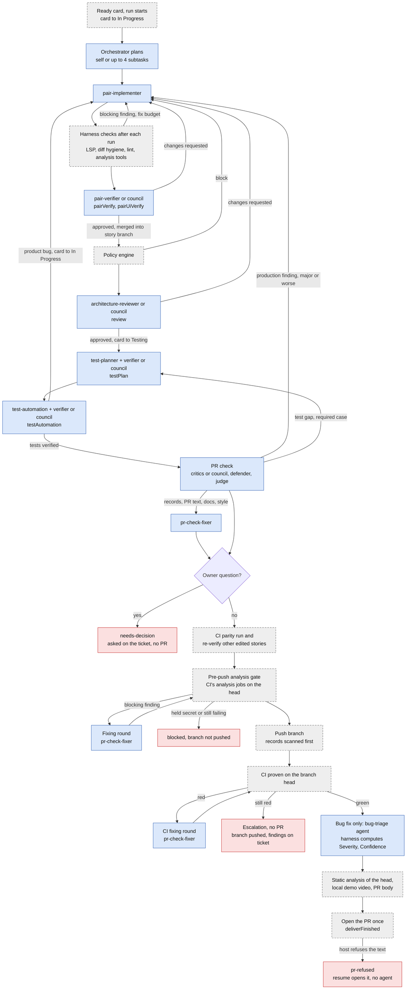
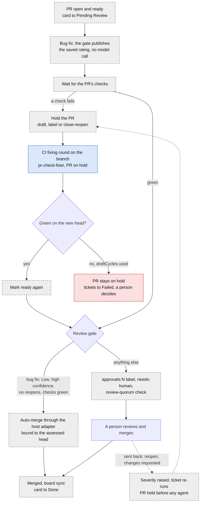
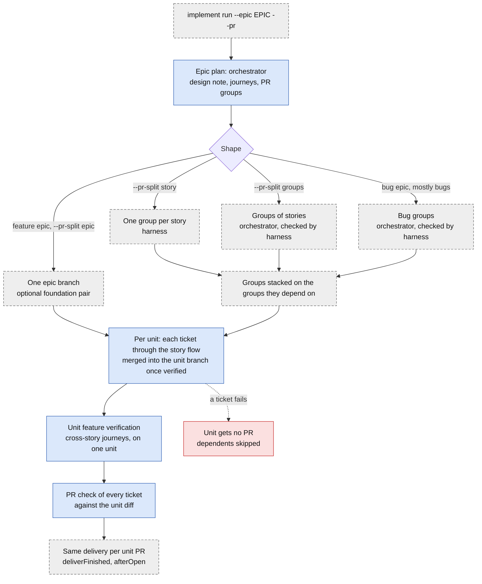
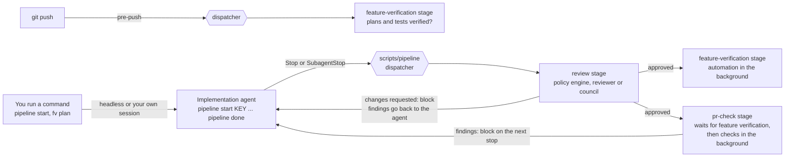
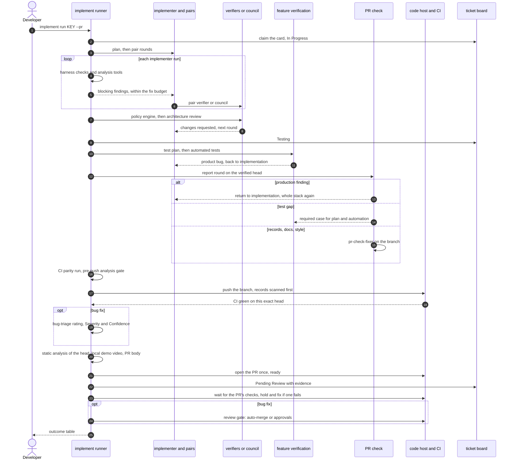
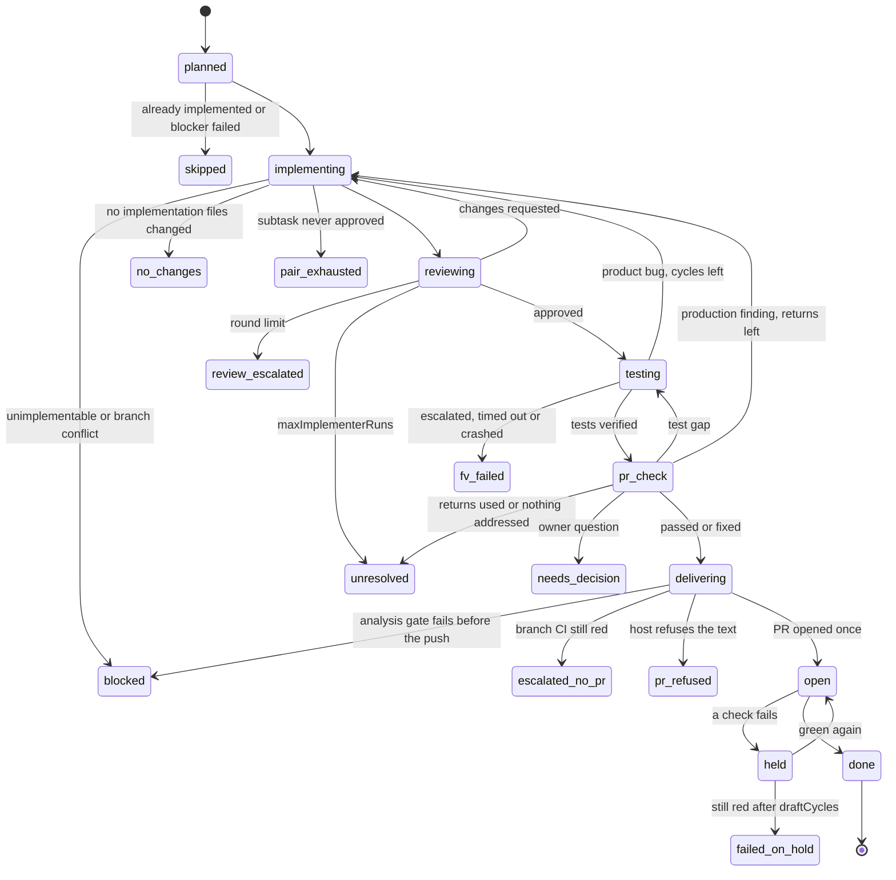

# AI development pipeline

Agents take a ticket from the board to a pull request with reviewed code and verified tests, and the harness delivers that pull request. The pipeline is a set of independent **stages**, each with its own CLI, config, tests and docs, tied together by one **dispatcher** that every agent tool and git hook calls, and by the implement runner that drives a ticket from start to delivery.

## The generated pipeline

This is what a repository gets once the factory is installed and `implement run <KEY> --pr` (or `--epic <EPIC> --pr`) starts. Three diagrams: an overview, then the steps before the pull request opens and after it opens. The epic route follows in [Epics](#epics).

**Legend.** Blue boxes are agents (a fresh headless process each time). Grey dashed boxes are harness code: deterministic, no agent, no model call. Orange are outside services, each reached through a pluggable adapter. Green are records. Red are exits where the ticket stops and a person decides.

### Overview



**Board.** A ticket waits in Backlog until a person moves it to Ready and starts a run. The run claims the card (In Progress); the harness moves it to Testing when the architecture review approves, back to In Progress when feature verification or the PR check sends the change back, to Pending Review when the PR opens, to Failed when the ticket stops, and to Done when the PR merges (`board sync`). The board is whichever tracker the repository uses (GitHub Issues and Projects, Jira, Azure Boards, GitLab Issues, Linear or a `custom` adapter); see [board.md](board.md).

**Planning and implementation.** The `implementer` agent is the orchestrator: it plans the ticket into at most four subtasks or keeps it (self mode). Each subtask is a pair: a `pair-implementer` writes it in its own worktree, and a fresh, read-only `pair-verifier` (or `pair-ui-verifier` for UI subtasks) checks it. After every implementer run the harness runs its own checks on the change (language server errors, whitespace-only hunks, the repository's lint on changed lines) and, with [static analysis](analysis.md) configured, the analysis tools; blocking findings go back to the implementer within a fix budget that spends no review round. See [implement.md](implement.md).

**Verification.** The architecture review runs the policy engine first (deterministic) and then a fresh `architecture-reviewer`. Feature verification writes a test plan (`test-planner`, checked by `test-plan-verifier`) and automated tests (`test-automation`, checked by `test-automation-verifier`); a test that finds a product bug sends the change back to implementation. Any verifier seat can instead be a [council](council.md) of members from several CLIs and models (stages `pairVerify`, `pairUiVerify`, `review`, `testPlan`, `testAutomation`, `prCheck`).

**PR check.** Critics (or council members), a defender and a judge debate the change against its ticket; the harness, not the judge, computes the score. Upheld findings are routed by what would resolve them: the production change goes back to the implementer and through the whole stack again, test gaps go to test planning and automation as required cases, and records, PR text, docs and style stay with `pr-check-fixer`. See [pr-check.md](pr-check.md).

**Delivery.** One function (`deliverFinished`) opens every pipeline PR and one (`afterOpen`) marks it ready. Before the open: CI's analysis jobs run on the head locally, the branch is pushed, CI must be green on that exact head, a bug fix is rated by the review gate, the demo video is produced on this machine, and the body is written whole. The PR then opens once. After the open only deterministic steps run, unless a check fails: then the PR is held first. See [implement.md](implement.md#the-pr-opens-finished).

**Review gate.** A bug-fix PR that is Low risk with high confidence and green checks auto-merges through the host adapter, bound to the head the gate assessed; anything else waits for the number of approvals its severity requires. A feature PR waits for a person. See [review-gate.md](review-gate.md).

**Records.** Every stage writes JSON lines to `.factory/metrics/`, the runner keeps run records under `.factory/state/`, and the evidence goes on the ticket and in the PR body. Everything written or published passes the redaction boundary, and records are scanned again before they are committed or pushed. See [observability.md](../observability.md).

### Before the PR opens



**Implementation pairs and the analysis loop.** The harness validates the orchestrator's plan (owned files, dependencies, at most `implement.maxSubtasks`), runs at most `maxConcurrentPairs` pairs at once and merges approved subtasks into the story branch. A pair that is not approved after `maxPairRounds` escalates to the orchestrator once (rewrite or takeover), then the ticket ends `pair-exhausted`. The analysis loop runs at pair level and at story level after every implementer run; a secret that is gone from the files but still in unpushed commits is folded out of those commits by the harness, never by an agent.

**Council.** Without a `council` section every stage seats its single verifier. With one, the members sit in parallel, each with a lens; a fixer declares which lines fixed which finding, the harness seals those declarations against the fixing diff, and a later scope objection to a sealed line is settled by an adjudication sitting of the blocking members, not by the harness. See [council.md](council.md).

**Routed returns.** `implement.prCheck.returnToImplementation` sets how many returns a ticket gets (`maxReturns`, default 2) and the least severity that returns (`minSeverity`, default `major`). A finding sent back with nothing addressed, to the place that should resolve it, ends the ticket `unresolved`; one sent to the wrong place is re-routed once for free. Below `minSeverity`, and for findings confined to tests, docs or records, `pr-check-fixer` fixes them on the branch (`implement.prCheck.fixUntil`, `bugFixUntil`).

**Demo video.** With the repository's `demoVideo` feature on, the harness records the changed e2e specs in demo mode on a test-stack slot, narrates and subtitles them locally, keeps secrets out of the picture, captions and narration, and stores the result for this head. A failed recording is never published; a failed step is a note in the PR body, never a reason to hold the PR. See [pr-demo-video.md](pr-demo-video.md).

**Pre-push analysis gate and branch CI.** CI's analysis jobs run on a clean checkout of the head, with CI's own script, before anything is pushed. The pushed branch must then pass every pipeline a branch push runs, completed and green on that exact SHA; a skipped run is not a pass. A red head gets `implement.ciFixRounds` fixing rounds (default 1). If the base moved meanwhile it is merged in and the new head is proven again. On a CI system without branch pipelines the PR opens as a draft and is marked ready only when its own checks are green.

### After the PR opens



**The review gate.** Before the PR opens, the read-only `bug-triage` agent rates each bug ticket (Impact, Complexity, Fix risk) from the branch's change; the harness computes Severity and Confidence from those ratings and the pipeline's own records. At the open the gate publishes the saved rating on the PR, the tickets and the board. It auto-merges only when every condition holds and the delivery check has run on the PR's head; otherwise it sets the approvals the severity needs (`implement.reviewGate.approvals`), and the `review-quorum` check counts distinct approvals on the latest push. `implement.autoMerge.enabled: false` turns auto-merge off. A feature PR gets no rating and waits for a person under the repository's own branch rules.

**Failure exits.**

| Exit | When | What remains |
| --- | --- | --- |
| Escalation, no PR | any stage before the open stops (plan rejected, pair exhausted, review escalated, unresolved, feature verification failed, PR check escalated or incomplete, CI still red on the branch) | the branch pushed when it got that far, the findings on the ticket, the card in Failed with up to three questions from the `escalation-questions` agent ([escalations.md](escalations.md)) |
| `needs-decision` | the PR check raised a question only the owner can answer | the question on the ticket, no PR |
| `blocked` before the push | the pre-push analysis gate still fails, or a secret the commit gate held is still in the worktree | nothing pushed |
| `pr-refused` | every stage passed and CI proved the head, but the code host refused the PR's text even with the shortest body | the proven head and the PR's title and body; `implement resume` opens the PR with no agent |
| Draft and fix | a check fails after the open | the PR held (draft, label or close-reopen) while the fixing round runs, ready again only when green |
| Interrupted | a crash, kill or reboot at any step | the run record's phase; `implement resume` continues from it and never opens a PR twice |

**Where records go.**

| Record | Where |
| --- | --- |
| Run records | `.factory/state/implement/<KEY>.json` (phase) and `<KEY>.result.json` (outcome, push, green, open and ready times, holds, ready audit), logs in `.factory/state/logs/` |
| Metrics | `.factory/metrics/<stream>.jsonl.d/<branch>.jsonl`, committed with the branch's work and merged with it; the main checkout spools to `.factory/state/metrics-spool/`. A configured sink ships them ([observability.md](../observability.md)) |
| Evidence | the ticket (findings, questions, Pending Review evidence, the epic's evidence comment), the PR body (review, tests, council tables, static analysis, CI evidence, gate rating, video, API summary) and the gate's notice |
| Redaction and scan gate | every writer and poster goes through the redaction boundary (`scripts/pipeline/lib/redact.mjs`); staged records are redacted and scanned before a commit, the records a push carries are scanned before the push, and the sink adapter checks each record again. A hit that redaction cannot remove blocks the write ([analysis.md](analysis.md#secrets-in-records-and-posts-redaction)) |

### Epics



An epic is delivered in units. A feature epic is one unit by default: one branch `epic/<slug>` and one PR. `--pr-split story` (or `implement.epic.prSplit`) gives one PR per story, `--pr-split groups` one PR per group of stories the orchestrator chooses. An epic whose tickets are mostly bugs is always split into bug groups (`--grouping` overrides). A group that needs another group's tickets is stacked on that group's branch. When a feature epic is split, every cross-story journey is verified once, on the last group in dependency order that holds a journey story, stacked on every other group that holds one. Each unit's PR goes through the same delivery as a single ticket's. See [implement.md](implement.md#epic-delivery).

## Stages

| Stage | Folder | What it does | Docs |
| --- | --- | --- | --- |
| `implement` | `scripts/implement/` | Implements tickets headlessly: a worktree and branch per ticket, the implementer as orchestrator planning up to four subtasks for verifier pairs (implementer + fresh verifier per subtask, each in its own worktree, merged back by a Node harness), then the review, feature verification and PR check stages below, then the delivery of the PR. An epic is delivered in units: one epic branch and PR by default, or one PR per story or per group of stories (`--pr-split`), and a bug epic one PR per group of bugs. Runs as many tickets at once as free memory allows (`--parallel auto`). `factory experiment` compares delivery modes on the same epic | [implement.md](implement.md), [experiments.md](experiments.md) |
| `review` | `scripts/review/` | Architecture review of the implementation: the policy engine, then a fresh reviewer (or a council), looping with the implementation agent until approved | [review.md](review.md) |
| `feature-verification` | `scripts/feature-verification/` | Story to verified test plan (workflow 1); approved implementation to verified automated tests (workflow 2) | [feature-verification.md](feature-verification.md) |
| `pr-check` | `scripts/pr-check/` | Adversarial critics (or council members), defender and judge score the work against its ticket (acceptance criteria, flow, UI design, style, video evidence). On the branch before the PR: upheld findings are routed back to implementation, to feature verification, or to its fixer; on demand, a fixer loops it to 10/10 | [pr-check.md](pr-check.md) |
| `review-gate` | `scripts/review-gate/` | For a bug fix: before the PR exists, a read-only triage agent rates each ticket from the branch's change; the harness computes Severity and Confidence, and at the open it publishes them on the PR, the tickets and the board without another model call | [review-gate.md](review-gate.md) |
| `board` | `scripts/board/` | Moves the ticket's card on the tracker's board as pipeline events happen (In Progress, Testing, back to In Progress on a product bug or a PR check return, Pending Review with evidence, Failed), keeps its epic's lane and evidence comment in step | [board.md](board.md) |

Pull requests also get generated sections in their description, produced on the machine that runs the pipeline after the CI proof and before the open (`scripts/pr-video/`, [pr-demo-video.md](pr-demo-video.md)); no CI job records them:

- **Demo video**, for changes to the frontend: the videos of the e2e specs the change adds or changes, recorded in demo mode on the test stack, narrated and subtitled.
- **API changes**, for changes to the backend (with or without a frontend change): one entry per HTTP endpoint added, changed or removed. Each entry gives the method and route (from the route-mapping diff), the request parameters and body, the responses (from the stack's OpenAPI documents) and example calls recorded from the specs (`E2E_API_LOG=1`), with secrets redacted.

## Stage order up to the pull request

A pull request is the finished result: **when it opens, no agent of the pipeline has work left on it** ([implement.md](implement.md#the-pr-opens-finished)).

1. Implementation (pairs or self), the harness checks and static analysis with its fix loop after every implementer run, the pair verifier or council.
2. The architecture review.
3. Feature verification (plan and automated tests).
4. The PR check on the branch (critics or council, defender, judge; production findings go back to implementation, test gaps to feature verification; the fixer handles records, docs and polish).
5. Owner questions asked on the ticket (no PR); the CI parity run; other tickets' plans or tests this change edited verified again.
6. CI's analysis jobs on the head, locally, before the push.
7. The branch is pushed and its own CI must be green on that exact head; a CI fixing round works against those runs.
8. The review gate's rating (bug fixes), the static analysis of the delivered head, the local demo video and the API summary.
9. The PR body is written whole, and the PR opens, ready.

After the open only deterministic steps run: the gate's merge decision, required checks, auto-merge, board moves and notices. If something goes wrong after the open, the PR goes back to draft (or is held) before any agent works on it again. The reference pipeline checks a PR after it opens; this order is a deliberate difference.

Stages run in the order listed in `scripts/pipeline/stages.json`. All of them are Node 20 scripts with no dependencies, and they drive a headless agent CLI: Claude Code by default, or Copilot CLI or Codex (`PIPELINE_AGENT_CLI=copilot|codex`), or any command (`PIPELINE_AGENT_CMD`, prompt on stdin). A council member or an implement role can use another CLI than the default.

| Guide | For |
| --- | --- |
| [setup.md](setup.md) | prerequisites and first-time setup, locally or on a CI runner |
| [writing-stories.md](writing-stories.md) | story authors: the file format and sections the agents rely on |
| [agents.md](agents.md) | every agent: what starts it, what it sees, its access, model and lessons |
| [council.md](council.md) | seating a council of verifiers from several CLIs and models in any verification stage (opt-in) |
| [analysis.md](analysis.md) | static analysis (opt-in): tools that prove findings run before the members sit, a fix loop that spends no review round, CI's required scans, licences for paid client work |
| [escalations.md](escalations.md) | what to do when a story fails or a loop escalates to a human |
| [review-gate.md](review-gate.md) | reviewers and repository owners: how a bug-fix PR is rated, when it auto-merges, what triggers review, reopens, and the repository settings it relies on |

### Hooks in an interactive session

When you (or an agent you drive) implement a story by hand, the same stages run from the agent tool's hooks:



## Pipeline inputs: tickets on the board

Stories, bugs, epics and research spikes are tickets on the [story board](board.md); each ticket's body carries the complete story. The pipeline reads them through one loader (`scripts/pipeline/lib/tickets.mjs`) from a local cache in `.factory/state/board/<KEY>/` (`story.md`, `meta.json`, `mockups/`), filled by `factory board fetch <KEY>` or on demand when a command names a key. Write new stories with `board new` ([writing-stories.md](writing-stories.md)). Test plans stay in the repository (`.factory/plans/<slug>/`).

## Implementing stories

```bash
factory implement run --epic checkout-redesign --dry-run   # order, branches, bases
factory implement run SHOP-3 SHOP-4 [--parallel 2] [--pr]
factory implement status
factory implement resume                    # after a crash: continue the last run
```

Each story gets its own worktree and branch; the implementer plans it into subtasks that verifier pairs implement and check in their own worktrees, then the architecture review loop, verified tests, the PR check and the delivery run. A story "Blocked by" another story in the batch runs after it, stacked on its branch. See [implement.md](implement.md).

## Story board

Every ticket has a card on the story board (Backlog, Ready, In Progress, Testing, Pending Review, Failed, Done): a GitHub Project (`board.projectNumber`), or the board of the repository's tracker (`tracker.lanes` maps the lanes to its columns or statuses). Tickets wait in Backlog until they are ready. An engineer starts the pipeline by hand for one ticket or a whole epic; the run claims each card (In Progress), and the card follows the pipeline: Testing once the review approves and feature verification starts, back to In Progress when feature verification finds a product bug or the PR check sends the change back, Pending Review with the PR and evidence when the PR opens, Failed (with the reason, findings and questions) when it cannot finish, Done when the PR merges. A bug-fix PR then goes through the [review gate](review-gate.md): it auto-merges when it is Low risk with high confidence (`implement.autoMerge.enabled` turns that off), and otherwise waits for a person's approval; a person sending a bug fix back (moving its card, reopening the issue, requesting changes) raises its severity and re-runs it. Each epic follows its stories and collects their evidence in one comment. Automatic pickup was removed and will be reworked later. See [board.md](board.md).

```bash
factory implement run --epic <EPIC> --pr   # or one ticket: implement run <KEY> --pr
factory board sync                         # merged tickets to Done, epic lanes, gate re-evaluation
```

### One story, end to end



How a story reaches its [outcome](implement.md#outcomes):



## Using it as an implementation agent

When you (or an agent you drive yourself) implement a story by hand instead:

```bash
factory start SHOP-3   # begin a story (or work on a branch named after it)
factory done            # line of work complete: the stages run when the turn ends
factory status [SHOP-3]
```

`start` records the active story and tells each stage (the review resets its rounds, the PR check its runs). `done` marks the work complete; nothing reviews or tests the work until then, so an agent can stop mid-story without triggering anything.

## Lifecycle events

| When | Hook | Dispatcher call | Stages | Cost |
| --- | --- | --- | --- | --- |
| `pipeline start` | (command) | `story-start` | review, feature-verification, pr-check, board (claims the card: In Progress) | none |
| Any agent tool call | `PreToolUse` (Gemini `BeforeTool`) | `hook pre-tool` | story guard (see below) | none |
| Agent session start/resume | `SessionStart` | `hook session-start` | implement, review, feature-verification, pr-check | none |
| Agent turn ends | `Stop` and `SubagentStop` | `hook stop` | review, then feature-verification, then pr-check, then board (Testing, back to In Progress on a product bug, Pending Review once the tests are verified after `pipeline done`) | LLM, only after `pipeline done` |
| Commit or merge | `.githooks/post-commit`, `.githooks/post-merge` | `git-hook post-commit\|post-merge` | feature-verification: lessons after a merge, only with `git config fv.autoLessons true` (stories are not committed, so commits never start a plan) | LLM if opted in |
| `board fetch` brings a changed story | (command) | - | feature-verification plans it in the background, only with `git config fv.autoPlan true` | LLM if opted in |
| Push | `.githooks/pre-push` | `git-hook pre-push` | feature-verification (existing plans and tests for touched stories are verified and current) | none |
| Push of a pipeline branch, and pull request | the factory's CI jobs for `ci.provider` (on GitHub Actions `factory-gate.yml`, `factory-feature-verification-check.yml` and, with analysis on, `factory-analysis.yml`; [hosts-and-trackers.md](../hosts-and-trackers.md#ci-systems)) | `factory check`, `factory lint`, the policy self-check, the feature verification check, the analysis jobs | all | none |
| A bug fix is delivered (single bug or bug-epic group) | the delivery (`deliverFinished`, `scripts/implement/lib/post-publish.mjs`) | `review-gate.mjs assess` before the open, `review-gate.mjs publish` at the open, `regate` after the PR's checks ([review gate](review-gate.md)) | review-gate (triage agent before the PR; at and after the open: auto-merge, wait or review, no model call) | LLM (one `bug-triage` run per PR) |
| `board sync` (start of every `implement run`, by hand, `implement requeue`) | (command) | - | board, review-gate (human reopens, gated PRs evaluated again, `pr-review` records) | none |
| Pull request opened, pushed, labeled or reviewed | the `review-quorum` CI job (`factory-review-quorum.yml` on GitHub Actions) | `review-gate/quorum.mjs` from the base branch | the `review-quorum` check: approvals reach the PR's `approvals:N` | none |
| The delivery, after CI proved the head and before the open (feature `demoVideo`) | (the runner) | `pr-video.mjs local`: test stack + changed specs in demo mode, narration, render, secret checks, storage ([demo videos](pr-demo-video.md)) | none | none |
| Manual (local, or the retro CI job by hand) | `factory-retro.yml` on GitHub Actions | `retro calibrate`, `fv metrics`, `retro run` (the lessons PR goes through the same delivery as every pipeline PR; a factory proposal is pushed as a branch for a person) | feature-verification, retro | LLM |

No agent starts on its own when stories or epics are added or changed: agent work starts only from a command (`implement run`, `pipeline start`, `fv plan`, `fv automate`) or from `pipeline done` in a session you started. `scripts/setup.sh` already points `core.hooksPath` at `.githooks`. `PIPELINE_DISABLE=1` turns every hook off. Agents spawned by the pipeline run with `PIPELINE_CHILD=1`, so their own Stop hooks and git hooks do nothing and cannot recurse. Stage-specific switches (for example `FV_SKIP=1 git push`, `git config fv.autoPlan true`) are listed in each stage's docs.

## Safety rails

| Rail | What it prevents |
| --- | --- |
| Fresh, read-only reviewers and verifiers | an agent grading its own work or seeing the producer's reasoning |
| Round limits and escalations (`.factory/state/escalations/`) | endless loops; hard decisions go to a human |
| Approved-hash gating | testing or PR-checking code that changed after the review |
| Script-computed PR check scores | an agent arguing its way to 10/10 |
| [Story guard](#story-guard) | agents reading stories, epics and mockups they were not given |
| `PIPELINE_CHILD=1` | spawned agents re-triggering hooks recursively |
| `pre-push` hook and CI | unverified plans or tests reaching the remote |
| Lessons via pull request | unreviewed changes to agent behavior (and to the review gate's approvals policy) |
| [PR bot](setup.md#the-pipelines-pr-bot): PRs authored by `dev-bot-<login>` | a developer unable to approve the pipeline's PRs (GitHub never lets a PR's author approve it), so they merge without a real review |
| [Review gate](review-gate.md): harness-computed severity, `review-quorum`, sticky review | a bug fix merging without a person unless it is Low risk with high confidence; an agent rating its way past review |
| `PIPELINE_DISABLE=1`, `FV_SKIP=1`, `PR_CHECK_SKIP=1` | escape hatches for humans |

## Story guard

Agents ignore the ticket cache (`storyGuard.folders` in `scripts/pipeline/config.json`: `.factory/state/board/`, plus the legacy story folder until `board migrate --delete-local` removes it) except for what was handed to the pipeline:

- the cache folder of the story given to `pipeline start <KEY>` (recorded in `.factory/state/active-story`): its `story.md` and its own `mockups/`, and
- the tickets given to `pipeline implement run` (their cache folders, and the epic's own folder for `--epic`), passed to every worker and agent it starts as `PIPELINE_STORY_SOURCES` (cache folders, or ticket keys). The implement harness adds each story's own key for every agent of its run.

A handed ticket is a key, wherever it is cached: its folder in the main checkout, the story worktree and each subtask worktree (which carry copies) is open, and the same path of any other ticket is closed, in this checkout's cache or any other checkout's. So a pair implementer sees its story's own mockups (and an epic run's epic mockups) and nothing else; a symlink inside a handed folder that points at another ticket is denied too (the guard checks the real path).

`hook pre-tool` denies any other read, search, listing, edit or shell command that names a path in those folders, including for agents the pipeline starts (`PIPELINE_CHILD=1`); only `PIPELINE_DISABLE=1` lifts it. The feature verification and review agents get their story text in the prompt, so they never need the cache, the PR check hands its agents exactly its story's folder, and the session-start context names only the active story. `.factory/state/` is gitignored, so `graphify query` cannot surface tickets. A recursive search of the whole repo (for example `grep -r Coupon .`) does not name the folder and can still reach it; the instructions in `AGENTS.md` and its siblings cover that case. Humans are not affected: the guard is an agent hook only. To let an agent write or groom stories, have it use `board new` / `board publish`, or start it with `PIPELINE_DISABLE=1`.

### Read guard

The same PreToolUse hook keeps every agent the pipeline starts (`PIPELINE_CHILD=1`) inside its own repository. It denies reading, searching or editing:

- the factory install;
- other agents' session stores (`~/.claude*/projects`, `~/.codex/sessions`, `~/.gemini`);
- any other git repository on the machine (for example another checkout of a related project);
- paths an operator lists in `FACTORY_GUARD_DENY` (`:`-separated) or the repository lists in `storyGuard.denyPaths`.

The repository's main checkout and its worktrees stay readable. So do toolchains and caches outside any repository, and running the factory's own tools from the install.

### Network guard

The same hook keeps pipeline agents on this repository's GitHub (`board.repo`, else the `origin` remote). It denies:

- `gh` aimed at another repository (`-R`/`--repo`, `gh api repos/<other>/…`, a GraphQL `repository(owner:…, name:…)`, `gh repo view|clone|fork <other>`), and `gh search` or `gh api search/…`, which search all of GitHub;
- `git clone|fetch|pull|ls-remote`, curl, wget and web fetches of another repository's GitHub URLs (`github.com`, `api.github.com`, `raw.githubusercontent.com`, `codeload.github.com`);
- any URL on a host in `storyGuard.denyHosts` (or `FACTORY_GUARD_DENY_HOSTS`, `:`-separated);
- web searches that name a repository in `storyGuard.denyRepos` (or `FACTORY_GUARD_DENY_REPOS`).

Documentation sites, package registries and the application's own stack stay reachable. `storyGuard.networkOpen: true` turns the network guard off.

## The dispatcher

`scripts/pipeline/pipeline.mjs` runs each stage's CLI as a separate process, so a stage that crashes cannot take down the others or the agent.

- **Stop:** stages run in order with the hook payload on stdin. A stage prints nothing, a `systemMessage`, or a Claude-format `{"decision": "block", "reason": ...}`. The first block ends the dispatch, so later stages run only once earlier gates pass; that is how automation waits for the review. Messages are joined. A stage that fails becomes a message, never a broken turn.
- **SessionStart:** each stage prints plain text. The dispatcher adds the active story and open escalations, joins the text and wraps it once: top-level `additionalContext` (Copilot reads only this) plus `hookSpecificOutput` (Claude Code, Cursor). `--nested` emits only the nested form, for Codex, which rejects unknown keys.
- **Git hooks:** stage output goes straight to the terminal. Only `pre-push` can fail, and it fails if any stage fails.
- **`status` and `metrics`:** each stage's own command, grouped by stage (`metrics --json` returns `{ "<stage>": ... }`).

## Agent tool coverage

`.claude/settings.json` is the single source of truth for agent hooks: the dispatcher's `SessionStart`, `Stop` and `SubagentStop` hooks, the story guard (`PreToolUse`, every tool), and the graphify `--strict` guard that denies the first raw grep or file read until `graphify query` has run. Several tools load that file themselves, so they get no file of their own; adding one would run every hook twice.

| Tool | Hook file | Covers | Trust step |
| --- | --- | --- | --- |
| Claude Code | `.claude/settings.json` | all | accept the project's hooks when prompted |
| GitHub Copilot CLI and VS Code agent | `.claude/settings.json` (this repository has no `.github/hooks/` file) | all | add the repo to `trustedFolders` in `~/.copilot/config.json` |
| Cursor | `.claude/settings.json` (third-party hooks, on by default) | all; Cursor has no `Glob` hook | leave Cursor's third-party (Claude) hooks setting on, the default |
| Windsurf / Devin | `.claude/settings.json` | pipeline hooks; the graphify guard matchers don't match its lowercase tool names, so the guard is advisory via `AGENTS.md` | none |
| OpenAI Codex | `.codex/hooks.json` | all; the graphify check and the story guard cover `Bash` only, Codex's only search tool | trust the project, then approve the hooks in `/hooks` |
| Gemini CLI | `.gemini/settings.json` via `scripts/hooks/gemini-adapter.mjs` | all, `AfterAgent` stands in for `Stop` (no subagent hook) | approve the project hooks when prompted |

`gemini-adapter.mjs` translates Gemini's hook payload and output contract to Claude's, so Gemini runs the same commands.

Not covered: the Copilot cloud agent (its sandbox has no `graphify` or agent CLIs, and a `.github/hooks/` file would duplicate every hook in Copilot CLI), and Cline, Kiro and OpenCode (no way for a hook to block a turn from ending). For those, the git hooks and CI still enforce the stage checks.

## Agent definitions for Copilot and Claude Code

`agents/<name>.agent.md` is the single source for every agent, including `implementer`. Copilot reads it directly, and the stages build their prompts from it. `scripts/sync-agents.mjs` renders each one to `.claude/agents/<name>.md`, so you can run the same agent from Claude Code. The generated copies add Claude-only settings from `scripts/agents-claude.json` (read-only tools for the reviewer and the verifiers, `isolation: worktree` for the implementer) and tell the agent to read its lessons file.

- Edit only `agents/`, then run `factory render`.
- If you write a new agent in `.claude/agents/`, `factory render` moves it into `agents/` and moves its Claude-only frontmatter to `scripts/agents-claude.json`.
- CI (`factory check`) fails when the two folders differ.

Every agent ends its final message with `AGENT_RESULT: {json}`, which the stage parses.

## Shared code and state

`scripts/pipeline/lib/` holds what every stage uses: config loading, git helpers, the ticket loader (`tickets.mjs`, story lookup from the board cache), per-story state, escalations, the agent runner and background runs.

- **Config:** `scripts/pipeline/config.json` (directories, base ref, agent CLI and default model, which paths count as implementation) is merged with the stage's own `scripts/<stage>/config.json`. Environment overrides: `PIPELINE_AGENT_CLI`, `PIPELINE_AGENT_CMD`, `PIPELINE_BASE_REF`, `PIPELINE_ROOT`.
- **State:** `.factory/state/` (not committed) holds the active story, one `stories/<KEY>.json` per story with a section per stage, locks, background logs (`logs/`) and escalations (`escalations/<KEY>-<stage>.md`, which the next agent session is told about).
- **Recovery:** every stage survives a crash, kill or reboot. Its runs record their pid and the boot they started in, and hold a lock for the whole run, so a pid reused after a reboot is never mistaken for the run. A run that died is found on the next session start or Stop hook, or by `pipeline resume`, and continues from its last saved round. The shared rules are in `scripts/pipeline/lib/recovery.mjs`: each run is retried `recovery.maxAttempts` times (default 3), waiting `recovery.backoffSec` (60 s) and then twice as long each time, then escalated; `pipeline resume <KEY> --force` restarts an escalated run.

  | Stage | What is saved | Picked up by |
  | --- | --- | --- |
  | implement | the batch (`batch.json`) and each story's progress; an orchestrated story's subtask worktrees | announced at session start; `pipeline resume` restarts the batch in the background; a resumed orchestrated story cleans up its subtask worktrees and continues without planning again ([implement](implement.md#interrupted-runs)) |
  | review | the round in progress (`review.inProgress`) | the next Stop reruns the round ([review](review.md#interrupted-reviews)) |
  | feature-verification | plan and automation round and feedback | session start, Stop, `pipeline resume` ([feature-verification](feature-verification.md#crash-recovery)) |
  | pr-check | Stop-hook waiter in the story state; manual runs in `progress.json` after each critique and fix | session start, Stop, `pipeline resume` ([pr-check](pr-check.md#interrupted-checks)) |
  | lessons and factory retro (`fv lessons`) | `lessons-run.json`: phase, branch and process | the next `fv lessons`, session start, `pipeline resume` ([feature-verification](feature-verification.md#crash-recovery)) |

- **Disk:** the build output, stack images, engine installs and worktrees runs leave behind are pruned at the start and end of every `implement run`, and a run refuses to start or pauses when free space is below `prune.minFreeGb` (see [disk](disk.md); `factory prune --dry-run` lists what would go).
- **Metrics:** `.factory/metrics/*.jsonl` (committed; `merge=union` keeps every record across branches). Each stage owns its files. `decisions.jsonl` is shared: every stage records why its agents decided what they did (the implement orchestrator its plans, escalations and pair verdicts) (`scripts/pipeline/lib/decisions.mjs`, see [feature-verification](feature-verification.md#decision-log)), and the weekly lessons run turns it into lessons and proposed factory changes. `decision-outcomes.jsonl` also carries the [review gate](review-gate.md)'s `reopen`, `pr-review` and `revert` records, from which the retro proposes changes to the approvals policy for bug-fix PRs. `token-usage.jsonl` is also shared: every agent run's tokens, models, cache hits and cost, reported per ticket and epic by `pipeline costs` (see [costs](costs.md)).

## Adding a stage

1. Create `scripts/<stage>/<stage>.mjs` using the shared lib (`loadConfig('<stage>')`, `runMain`, `readPayload`). Implement the events it needs: `hook stop` (print nothing, a `systemMessage`, or a block), `hook session-start` (print plain text), `hook story-start <KEY>`, `git-hook <event>` (exit nonzero only on `pre-push` to fail the push), plus `status [story]` and `metrics [--json]`. A stage whose runs can be cut short also implements `resume [story] [--force] [--background]` and lists it in `commands`: it restarts its runs that died, in the background, and returns at once (`pipeline resume` calls every stage in turn). Use `runDied` and `nextAttempt` from `scripts/pipeline/lib/recovery.mjs` so every stage retries and escalates the same way.
2. Add it to `scripts/pipeline/stages.json` in the right order, listing its `hooks`, `gitHooks` and `commands`. A stage that must wait for another reads that stage's section of the story state (as `feature-verification` reads `review.approvedHash`).
3. Put its tests in `scripts/<stage>/test/`; `npm run test:pipeline` and CI pick them up. For a PR gate, add a job to the CI templates (`templates/ci/<provider>/`) and a parity entry (`scripts/implement/lib/ci-parity.mjs`, [ci-parity.md](ci-parity.md)).
4. Document it in `docs/ai-pipeline/<stage>.md` and add it to the table above. No agent tool config changes are needed.

## Commands

```bash
factory start|done|status [KEY]
factory resume [KEY] [--force]       # continue every stage's runs that died (crash, kill, reboot)
factory implement [run] <KEY|dir|story.md>... | --epic <EPIC> [--parallel N|auto] [--base <ref>] [--pr] [--force] [--dry-run]
factory implement resume [--parallel N|auto] [--pr]
factory implement status [KEY]
factory experiment run --epic <EPIC> [--modes epic,story] [--repeat N] [--sequential] [--base <ref>]  # see experiments.md
factory experiment grade|report <id> [--json]
factory bot setup|status          # the PR bot dev-bot-<gh login> (see setup.md#the-pipelines-pr-bot)
factory stages
factory metrics [--json] [--since 2026-01-01]
factory costs [KEY] [--epic <epic>] [--since <date>] [--json|--markdown]  # tokens, cache hits and cost per stage, ticket and epic
factory hook stop|session-start [--nested]|pre-tool
factory git-hook post-commit|post-merge|pre-push
factory pr-check run --pr 42 [--no-fix]   # adversarial PR check until 10/10
factory review-gate assess|publish|regate|status|explain|enforce  # review gate for bug-fix PRs (see review-gate.md)
factory pr-video local|embed|specs|scope|publish|api|cleanup  # demo videos and API summary, produced on this machine (pr-demo-video.md)
factory board setup|pick|mine|move|review|status   # see board.md
npm run test:pipeline                     # dispatcher and stage tests (fake agent, no LLM)
```
