# AI development pipeline

**Who reads this:** everyone. Reader A (new to it) can stop after the map, before its node table, which is
reference. This page shows the whole pipeline the factory installs on one map, defines its terms, and links
every page that explains a step.

## The pipeline map

Every flow is on this map: a single ticket, a bug fix (with the UI and backend evidence branches), a feature
epic (one PR, or split with `--pr-split`), a bug epic, a resume after a crash, and the requeue after a person
answers a stopped ticket. Diamonds are decision points. Blue boxes are agents, grey boxes are the harness, red
is a stop that waits for a person. Each node's id leads to its row in the table below.
The [pipeline explorer](../pipeline-explorer.html) (open the file in a browser) draws the same map, with the
same ids, for any configuration you set, and walks the outcomes you pick.

```mermaid
flowchart TD
  run["run: Start the run"]:::harness
  resume{"resume: implement resume / requeue"}:::harness
  claim{"claim: Sync the board, claim the card"}:::harness
  entry{"entry: One ticket or an epic?"}:::harness
  reopenHold{"reopenHold: Hold the open PR"}:::harness
  requeue[/"requeue: A person resolves or reopens it"/]:::person
  epicPlan{"epicPlan: Epic plan"}:::agent
  shape["shape: Delivery units"]:::harness
  foundation{"foundation: Foundation pair"}:::agent
  plan{"plan: Orchestrator plans"}:::agent
  pairs["pairs: Implementer"]:::agent
  harnessChecks{"harnessChecks: Harness checks"}:::harness
  verifier{"verifier: Pair verifier"}:::agent
  policy{"policy: Policy engine"}:::harness
  review{"review: Architecture review"}:::agent
  testPlan{"testPlan: Test plan"}:::agent
  fv{"fv: Test automation"}:::agent
  unit["unit: Merged into the unit branch"]:::harness
  doneNoPr[("doneNoPr: Run ends: done, no PR")]:::rec
  journeys{"journeys: Unit feature verification"}:::agent
  unitPrCheck["unitPrCheck: Unit PR check"]:::agent
  prCheck{"prCheck: PR check"}:::agent
  parity{"parity: Publish, CI parity, re-verify"}:::harness
  analysisGate{"analysisGate: Pre-push analysis gate"}:::harness
  push{"push: Push the branch"}:::harness
  ownerQ{"ownerQ: Owner question or unfinished check?"}:::harness
  branchCi{"branchCi: CI proven on the branch head"}:::harness
  ciFixRound{"ciFixRound: CI fixing round"}:::agent
  bug{"bug: A bug fix?"}:::harness
  triage{"triage: Bug triage"}:::agent
  evidence["evidence: Demo video"]:::harness
  uiPair{"uiPair: UI bug: before / after videos"}:::harness
  apiEvidence{"apiEvidence: Backend bug: request evidence"}:::harness
  apiChanges["apiChanges: API changes section"]:::harness
  open{"open: Open the PR, or update the held one"}:::harness
  gatePublish{"gatePublish: Gate publishes the rating"}:::harness
  checks{"checks: Wait for the PR's checks"}:::harness
  hold{"hold: Hold the PR"}:::harness
  holdFix{"holdFix: CI fixing round on hold"}:::agent
  ready{"ready: Release the hold, mark ready"}:::harness
  runDone[("runDone: Run ends: outcome done")]:::rec
  gate{"gate: Review gate decides"}:::harness
  autoMerge["autoMerge: Auto-merge"]:::harness
  approval{"approval: A person reviews"}:::person
  merged["merged: Merged: card to Done"]:::harness
  sentBack["sentBack: Sent back: reopen recorded"]:::harness
  prRefused(["prRefused: pr-refused"]):::fail
  failed(["failed: Failed: no PR, or the PR held; card to Failed with up to three questions"]):::fail
  run --> claim
  resume -->|"implementer continues on the branch"| pairs
  resume -->|"approved code: tests restart"| testPlan
  resume -->|"delivery again, saved title and body / rated again first"| analysisGate
  resume -->|"PR adopted / CI wait (--stopped) / hold released when green"| checks
  resume -->|"a person resolved it / reopened, its PR still open"| requeue
  reopenHold -->|"confirmed"| entry
  requeue -->|"board sync to Ready, then the claim"| claim
  claim -->|"claimed"| entry
  claim -->|"its PR open, --pr: held first"| reopenHold
  entry -->|"--epic: delivered in units"| epicPlan
  entry -->|"one ticket"| plan
  epicPlan -->|"design note"| shape
  shape --> foundation
  foundation -->|"none or built"| plan
  plan -->|"self or subtasks"| pairs
  pairs --> harnessChecks
  harnessChecks -->|"clean"| verifier
  harnessChecks -.->|"blocking finding"| pairs
  verifier -->|"merged into the story branch"| policy
  verifier -.->|"verifier requests changes"| pairs
  policy -->|"pass"| review
  policy -.->|"block"| pairs
  review -->|"approved: card to Testing"| testPlan
  review -.->|"changes requested"| pairs
  testPlan -->|"verified"| fv
  fv -->|"a unit ticket: merged into the unit"| unit
  fv -->|"verified"| prCheck
  fv -->|"verified, no --pr: done, no PR"| doneNoPr
  fv -.->|"product bug found by a test"| pairs
  unit --> journeys
  journeys -->|"verified"| unitPrCheck
  unitPrCheck --> parity
  unitPrCheck --> doneNoPr
  prCheck -->|"no upheld finding / minor findings: pr-check-fixer"| parity
  prCheck -.->|"production finding: to implementation"| pairs
  prCheck -.->|"test gap: to test planning"| testPlan
  parity -->|"green"| analysisGate
  analysisGate -->|"pass"| push
  analysisGate -->|"analysis finding"| analysisGate
  push -->|"pushed"| ownerQ
  ownerQ -->|"no"| branchCi
  branchCi -->|"green"| bug
  branchCi -->|"CI red on the branch"| ciFixRound
  branchCi -.->|"base moved"| branchCi
  ciFixRound -->|"green"| bug
  bug -->|"bug fix"| triage
  bug -->|"feature"| evidence
  triage -->|"assessed"| evidence
  evidence --> uiPair
  uiPair -->|"shown / a note in the section"| apiEvidence
  apiEvidence -->|"shown / a note in the section"| apiChanges
  apiChanges --> open
  open -->|"opened / same PR, body refreshed"| gatePublish
  open -->|"host refuses the PR text"| prRefused
  gatePublish -->|"saved before the open / not readable: not assessed, no agent"| checks
  checks -->|"a hold to release: ready when green"| ready
  checks -->|"green"| runDone
  checks -->|"a check fails after the open"| hold
  hold -->|"confirmed"| holdFix
  holdFix -->|"green"| ready
  holdFix -.->|"cycles left: another round"| holdFix
  ready -->|"confirmed"| runDone
  runDone --> gate
  gate -->|"auto-merge"| autoMerge
  gate -->|"approvals:N, needs-human / feature PR: host rules"| approval
  autoMerge --> merged
  approval -->|"approves and merges"| merged
  approval -->|"reviewer sends it back"| sentBack
  sentBack -->|"requeue or run again, PR still open"| requeue
  reopenHold & claim & epicPlan & foundation & plan & verifier & review & testPlan & fv & journeys & prCheck & parity & analysisGate & push & ownerQ & branchCi & ciFixRound & triage & uiPair & apiEvidence & open & checks & hold & holdFix & ready -.-> failed
  classDef agent fill:#dbe8fb,stroke:#2f5fb3,color:#111
  classDef harness fill:#eeeeee,stroke:#666,stroke-dasharray:5 3,color:#111
  classDef rec fill:#dff2df,stroke:#2e7d32,color:#111
  classDef fail fill:#fbe0e0,stroke:#c62828,color:#111
  classDef ext fill:#fdebd3,stroke:#c77700,color:#111
  classDef person fill:#f3e5f5,stroke:#7b1fa2,color:#111
```

<!-- pipeline-spine:start -->

<!-- pipeline-spine:end -->

The map and the table are generated from [pipeline-flow.json](../pipeline-flow.json) (`node scripts/docs/build-explorer.mjs --mermaid`); the explorer has every step, and each id here is the id it shows.

Two things are not on the map. In an interactive agent session, `factory done` lets the session's Stop hook run
the same stages ([hooks](../internals.md#hooks-and-lifecycle-events)). An agent provider outage pauses a batch:
no card moves, and `factory implement resume` continues the unfinished batch once the provider is back
([implement.md](implement.md#resume-and-interrupted-runs)).

| Id | Step | Agent or harness | Settings | Page |
| --- | --- | --- | --- | --- |
| `run` | Start the run | harness | `--pr`, `implement.delivery` | [implement.md](implement.md#what-happens) |
| `resume` | implement resume / requeue: implementing, approved, refused, gate-failed, adopted, ci-wait, held, resolved, reopened | harness | none | [implement.md](implement.md#resume-and-interrupted-runs) |
| `claim` | Sync the board, claim the card: claimed, skipped | harness | `tracker.type` | [board.md](board.md#the-state-machine) |
| `entry` | One ticket or an epic? | harness | `implement.delivery` | [implement.md](implement.md#delivery-modes) |
| `reopenHold` | Hold the open PR: confirmed, unconfirmed | harness | `implement.preOpen.afterOpen` | [review-gate.md](review-gate.md#human-reopens) |
| `requeue` | A person resolves or reopens it | person | none | [escalations.md](escalations.md#questions-and-the-resolve-checkbox) |
| `epicPlan` | Epic plan: ok, failed | `implementer` | `implement.epic.grouping`, `implement.epic.prSplit` | [implement.md](implement.md#epic-delivery) |
| `shape` | Delivery units | harness | `implement.epic.grouping`, `implement.epic.prSplit`, `implement.delivery` | [implement.md](implement.md#delivery-modes) |
| `foundation` | Foundation pair: ok, failed | `pair-implementer`, `pair-verifier` | none | [implement.md](implement.md#epic-delivery) |
| `plan` | Orchestrator plans: planned, rejected | `implementer` | none | [implement.md](implement.md#plan) |
| `pairs` | Implementer | `pair-implementer`, `implementer` | none | [implement.md](implement.md#what-happens) |
| `harnessChecks` | Harness checks: clean, finding | harness | `analysis`, `analysis.fixLoop.bounces` | [implement.md](implement.md#static-analysis-in-the-pair-rounds) |
| `verifier` | Pair verifier: approved, changes, exhausted | `pair-verifier`, `pair-ui-verifier` | `council.stages.pairVerify`, `council.stages.pairUiVerify`, `implement.maxPairRounds` | [implement.md](implement.md#ui-verification) |
| `policy` | Policy engine: pass, block | harness | none | [review.md](review.md#the-policy-step-engine-and-policy) |
| `review` | Architecture review: approved, changes, escalated | `architecture-reviewer` | `council.stages.review`, `review.maxRounds` | [review.md](review.md#the-policy-step-engine-and-policy) |
| `testPlan` | Test plan: verified, failed | `test-planner`, `test-plan-verifier` | `council.stages.testPlan` | [feature-verification.md](feature-verification.md#workflow-1-story-to-test-plan) |
| `fv` | Test automation: verified, product-bug, failed | `test-automation`, `test-automation-verifier` | `council.stages.testAutomation`, `implement.maxBugFixCycles` | [feature-verification.md](feature-verification.md#workflow-2-implementation-to-automated-tests) |
| `unit` | Merged into the unit branch | harness | none | [implement.md](implement.md#epic-delivery) |
| `doneNoPr` | Run ends: done, no PR | record | `--pr` | [escalations.md](escalations.md#outcomes) |
| `journeys` | Unit feature verification: verified, failed | `test-planner`, `test-automation`, `verifiers` | `implement.epic.featureVerification` | [implement.md](implement.md#epic-delivery) |
| `unitPrCheck` | Unit PR check | `pr-check critics`, `defender`, `judge`, `pr-check-fixer` | `implement.epic.prCheck`, `council.stages.prCheck` | [pr-check.md](pr-check.md#several-tickets-an-epic) |
| `prCheck` | PR check: pass, production, tests, light, unresolved | `pr-check critics`, `defender`, `judge` | `council.stages.prCheck`, `implement.prCheck.returnToImplementation.enabled`, `implement.prCheck.returnToImplementation.maxReturns` | [pr-check.md](pr-check.md#findings-about-the-production-change-go-back-to-implementation) |
| `parity` | Publish, CI parity, re-verify: ok, failed | harness, may call `pr-check-fixer`, `feature verification` | none | [ci-parity.md](ci-parity.md) |
| `analysisGate` | Pre-push analysis gate: pass, finding, blocked | harness | `analysis` | [analysis.md](analysis.md#ci) |
| `push` | Push the branch: pushed, failed | harness | none | [analysis.md](analysis.md#secrets-in-records-and-posts-redaction) |
| `ownerQ` | Owner question or unfinished check?: none, question, incomplete | harness | none | [implement.md](implement.md#the-pr-opens-finished) |
| `branchCi` | CI proven on the branch head: green, red, base-moved | harness | `implement.ciWait`, `ci.provider`, `implement.ciFixRounds` | [implement.md](implement.md#the-pr-opens-finished) |
| `ciFixRound` | CI fixing round: green, red | `pr-check-fixer` | `implement.ciFixRounds` | [implement.md](implement.md#the-pr-opens-finished) |
| `bug` | A bug fix? | harness | none | [review-gate.md](review-gate.md#assessment) |
| `triage` | Bug triage: assessed, failed | `bug-triage` | none | [review-gate.md](review-gate.md#assessment) |
| `evidence` | Demo video | harness, may call `demo-narrator` | `features.demoVideo`, `video.script.scope` | [pr-demo-video.md](pr-demo-video.md#how-it-works) |
| `uiPair` | UI bug: before / after videos: shown, missing | harness, may call `demo-narrator` | `video.bugPair.requireBefore`, `video.script.scope` | [pr-demo-video.md](pr-demo-video.md#bugs-before-and-after-the-fix) |
| `apiEvidence` | Backend bug: request evidence: shown, missing | harness, may call `demo-narrator` | `video.bugPair.requireBefore` | [pr-demo-video.md](pr-demo-video.md#backend-bugs-the-requests-before-and-after-the-fix) |
| `apiChanges` | API changes section | harness | `features.demoVideo` | [pr-demo-video.md](pr-demo-video.md#api-changes) |
| `open` | Open the PR, or update the held one: updated, opened, refused, failed | harness | `host.type`, `ci.provider`, `implement.ciWait` | [implement.md](implement.md#the-pr-opens-finished) |
| `gatePublish` | Gate publishes the rating: saved, missing | harness | none | [review-gate.md](review-gate.md#assessment) |
| `checks` | Wait for the PR's checks: green, failed, unknown | harness | `implement.ciWait`, `implement.preOpen.draftCycles`, `implement.ciFixRounds` | [implement.md](implement.md#after-the-open) |
| `hold` | Hold the PR: confirmed, unconfirmed | harness | `implement.preOpen.afterOpen`, `implement.preOpen.draftCycles` | [implement.md](implement.md#after-the-open) |
| `holdFix` | CI fixing round on hold: green, again, failed | `pr-check-fixer` | `implement.preOpen.draftCycles`, `implement.ciFixRounds` | [implement.md](implement.md#after-the-open) |
| `ready` | Release the hold, mark ready: confirmed, unconfirmed | harness | `implement.preOpen.afterOpen` | [implement.md](implement.md#after-the-open) |
| `runDone` | Run ends: outcome done | record | none | [implement.md](implement.md#after-the-open) |
| `gate` | Review gate decides: auto-merge, approvals, person | harness | `implement.autoMerge.enabled`, `implement.reviewGate.approvals.Low`, `implement.reviewGate.approvals.Medium` | [review-gate.md](review-gate.md#the-gate) |
| `autoMerge` | Auto-merge | harness | `implement.autoMerge.enabled`, `host.type` | [review-gate.md](review-gate.md#auto-merge) |
| `approval` | A person reviews: merged, sent-back | person | none | [review-gate.md](review-gate.md#enforcement-the-review-quorum-check) |
| `merged` | Merged: card to Done | harness | none | [board.md](board.md#board-sync) |
| `sentBack` | Sent back: reopen recorded | harness | none | [review-gate.md](review-gate.md#human-reopens) |
| `prRefused` | pr-refused | exit | `host.type` | [implement-reference.md](implement-reference.md#a-host-that-refuses-the-prs-text) |
| `failed` | Failed: no PR, or the PR held; card to Failed with up to three questions: `skipped` (`skipped`); `epicFailed` (`plan-rejected`, `foundation-failed`); `implFailed` (`plan-rejected`, `pair-exhausted`, `blocked`, `no-changes`, `merge-conflict`, `limit-agent-runs`, `limit-wall-clock`); `reviewFailed` (`review-escalated`, `unresolved`); `fvFailed` (`fv-product-bug`, `fv-escalated`, `fv-blocked-on-plan`, `fv-crashed`, `fv-timed-out`); `unitFailed` (`stories-failed`, `epic-fv-<status>`, `fv-reverify-failed`); `unresolved` (`unresolved`); `notDelivered` (`not-delivered`); `blocked` (`blocked`); `needsDecision` (`needs-decision`); `prcIncomplete` (`pr-check-incomplete`, `pr-check-escalated`); `ciRed` (`ci-red`, `ci-flaky`, `ci-unverified`, `ci-conflict`, `ci-escalated`); `gateAssessFailed` (`gate-assessment-failed`); `videoBlocked` (`demo-video-blocked`); `heldFailed` (`ci-red`, `ci-flaky`, `ci-unverified`, `ci-conflict`, `ci-escalated`); `holdFailed` (`hold-failed`); `releaseUnconf` (`release-unconfirmed`) | harness, `escalation-questions` | none | [escalations.md](escalations.md) |

Two smaller diagrams sit on their own pages: the verifier-pair loop ([implement.md](implement.md#what-happens))
and the PR check's debate ([pr-check.md](pr-check.md)). The board lanes are in [board.md](board.md).

## Glossary

| Term | Meaning |
| --- | --- |
| **Agent** | an AI coding tool (Claude Code, Copilot CLI, Codex or any command) started headless for one job, with a fresh context; definitions are in `agents/` ([agents.md](agents.md)) |
| **Harness** | the factory's own code that runs the loops, checks and delivery: deterministic, no model call |
| **Orchestrator** | the `implementer` agent when it plans a ticket into subtasks and integrates them |
| **Verifier pair** | one agent writes a subtask, a second, read-only agent that never saw the writer's reasoning checks it |
| **Council** | several verifiers on different tools and models sitting in one verifier's seat ([council.md](council.md)) |
| **Lens** | what a critic or council member judges: acceptance, flow, design, style, video, correctness, security, test value |
| **Delivery** | everything between the last agent stage and the open PR: scans, push, CI proof, rating, video, body, open |
| **Unit** | what one PR delivers: a ticket, an epic, a PR group of an epic, or a bug group |
| **Hold** | an open PR put back to draft (or labelled, or closed and reopened; never closed on Bitbucket) while an agent works on it again, confirmed by re-reading the PR |
| **Review gate** | the harness step that auto-merges a low-risk bug fix or asks for the approvals its severity needs ([review-gate.md](review-gate.md)) |
| **Escalation** | a stop that needs a person: the ticket goes to Failed with findings and questions ([escalations.md](escalations.md)) |
| **Outcome** vs **lane** | a run *outcome* (`done`, `blocked`, ...) is how a run ended; a board *lane* (Ready, Pending Review, Done) is where the card is. Run outcome `done` means the run completed successfully. A PR may be open (often while the card waits in Pending Review), already merged, or not needed: without `--pr` the change is verified on its branch and no PR opens, and a bug group with nothing left to deliver opens none |
| **Ticket board (tracker)** | the repository's issue tracker and its lanes: GitHub Projects, Jira, Azure Boards, GitLab Issues or Linear ([board.md](board.md)) |

## The stages

`scripts/pipeline/stages.json` lists them in order: **implement** ([implement.md](implement.md)), **review**
([review.md](review.md)), **feature-verification** ([feature-verification.md](feature-verification.md)),
**pr-check** ([pr-check.md](pr-check.md)), **board** ([board.md](board.md)) and **retro** ([retro.md](retro.md)).
The review gate ([review-gate.md](review-gate.md)) and the demo video ([pr-demo-video.md](pr-demo-video.md)) run
inside the delivery. Each stage is its own Node CLI with its own config and tests, and drives a headless agent
CLI: Claude Code by default, Copilot CLI or Codex (`PIPELINE_AGENT_CLI`), or any command (`PIPELINE_AGENT_CMD`).
The same stages also run from an interactive session's hooks (`factory start`, `factory done`; [internals.md](../internals.md#hooks-and-lifecycle-events)).

## After the PR opens

After the open, no agent changes the code unless a check fails or a person sends the PR back, and then only while
the PR is confirmed on hold: a hold the host does not confirm stops the run before any agent
([implement.md](implement.md#after-the-open)). [Known limits](#known-limits) lists the agents that can still run.

## Safety rails

| Rail | What it prevents |
| --- | --- |
| Fresh, read-only verifiers and reviewers | an agent grading its own work |
| Round limits and escalations | endless loops; hard decisions go to a person |
| Approved-hash gating | testing or PR-checking code that changed after the review |
| Scores computed by the harness | an agent arguing its way to 10/10 |
| Story, read and network guards | agents reading tickets, repositories or sites they were not given ([internals.md](../internals.md#guards)) |
| Redaction and scan gates | secrets in records, posts and videos ([analysis.md](analysis.md#secrets-in-records-and-posts-redaction)) |
| PR bot identity on GitHub | the developer being unable to approve the pipeline's PRs ([setup.md](setup.md#the-pipelines-pr-bot)) |
| Review gate, `review-quorum` | a risky bug fix merging without a person |
| `PIPELINE_DISABLE=1`, `FV_SKIP=1`, `PR_CHECK_SKIP=1` | escape hatches for people |

## Known limits

Behaviour that falls short of the design, stated once; each is described where it applies.

- **An agent after the open.** A failure after the open starts the `escalation-questions` agent, which writes
  questions on the ticket and changes no code ([implement.md](implement.md#after-the-open)).
- **Resume is not agent-free.** Resuming a delivery whose PR did not open re-runs the delivery steps, so the
  narrator can run again, triage runs (before the open) when no rating was saved, and a fixing round runs if the
  scans or CI fail again. A `gate-assessment-failed` on a PR that was already open re-runs every agent stage, on
  hold. A resume keeps its finished stages even when a person pushed in between; only CI proves the new head
  ([implement.md](implement.md#resume-and-interrupted-runs)).
- **Backend reproduction evidence.** A class merely named `ExpectError` is trusted as a failed assertion;
  `expect.poll` and `toPass` failures do not count. With an `e2e/fixtures.ts` from 0.2.92, a soft assertion gets
  the general refusal, not the `factory render` advice
  ([pr-demo-video.md](pr-demo-video.md#what-the-reproduction-check-proves)).
- **Card data** is masked only in backend request evidence, and not in every body shape there; tickets, plans and
  PR text keep it ([pr-demo-video.md](pr-demo-video.md#backend-bugs-the-requests-before-and-after-the-fix)).
- **Video secret checks** sample the page's text and input values at each step; the finished frames are not
  scanned ([pr-demo-video.md](pr-demo-video.md#secrets-never-show)).
- **Bitbucket Cloud** cannot bind a merge to a commit; the harness re-reads the head just before merging. Its
  `close-reopen` hold setting is reported only by `factory doctor`, as a failed row, although `draft` is used
  ([providers](../providers/README.md#capabilities-not-assumptions)).

## Pages

| Page | For |
| --- | --- |
| [setup.md](setup.md) | B: install, add to a repository, the PR bot, CI |
| [writing-stories.md](writing-stories.md) | B: the ticket format the agents rely on |
| [board.md](board.md) | B, C: lanes, tickets, the board commands |
| [implement.md](implement.md), [implement-reference.md](implement-reference.md) | C: the implement stage and delivery; its settings and records |
| [review.md](review.md), [feature-verification.md](feature-verification.md), [pr-check.md](pr-check.md) | C: the verification stages |
| [review-gate.md](review-gate.md) | C, reviewers: how bug fixes are rated and merged |
| [pr-demo-video.md](pr-demo-video.md) | B, C: demo videos, bug evidence, API changes |
| [escalations.md](escalations.md) | C: every outcome and what to do next |
| [council.md](council.md), [analysis.md](analysis.md), [models.md](models.md) | B, C: optional councils, static analysis, the model allowlist |
| [agents.md](agents.md), [costs.md](costs.md), [disk.md](disk.md), [ci-parity.md](ci-parity.md) | C: the agents, token costs, disk use, CI parity |
| [retro.md](retro.md), [experiments.md](experiments.md) | C, D: lessons and factory proposals; comparing delivery modes |
| [configuration.md](../configuration.md), [providers](../providers/README.md), [hosts-and-trackers.md](../hosts-and-trackers.md) | B, C: every setting; hosts, trackers and CI systems |
| [code-intelligence.md](../code-intelligence.md), [test-stack.md](../test-stack.md), [architecture-policy.md](../architecture-policy.md), [observability.md](../observability.md) | B: the components the skills set up |
| [contributing.md](../contributing.md), [internals.md](../internals.md) | D: working on the factory |
