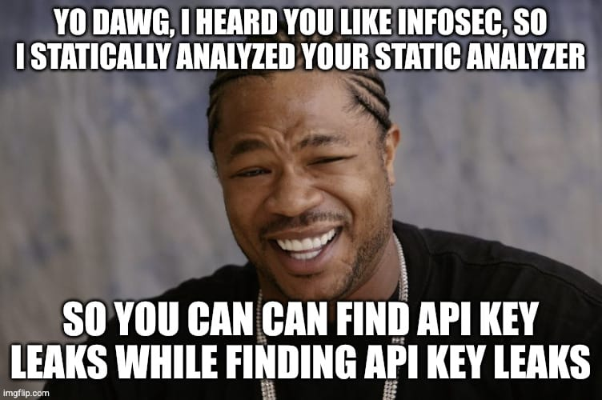

# Static analysis

**Who reads this:** B and C turning on static analysis, and anyone asking how secrets are kept out of records. Opt-in: with no `analysis` section in `.factory/config.json`, the tools on this page do not run (the redaction of records, [below](#secrets-in-records-and-posts-redaction), always runs).

Agents are good at judgement and bad at noticing what a tool proves in a second: a secret in a commit, a package with a known vulnerability, a SQL string built from input. So the harness runs those tools itself, **before** any verifier or council member sits, and gives the provable findings straight back to the implementer. Members then spend their rounds on what only a model can judge. CI runs the same tools as required checks, so a pull request cannot merge past them.

## Where it runs

| Slot | When | What happens to findings |
| --- | --- | --- |
| `pair` | after every pair-implementer run, before the pair verifier or council | auto-fix (committed as the implementer), then the **fix loop**: up to `analysis.maxFixRounds` (default 2) extra implementer runs with exactly the tool's findings. A bounce is not a pair round or a council round. What is still open then reaches the members as harness findings |
| `story` | once the pair rounds and the story-level lint pass | blocking findings go back to the implementer (same budget); the report is evidence for the architecture review |
| `prCheck` | each PR check round | evidence for the critics; read from the commit's report when one exists |
| `featureVerification` | the automation precheck | blocking findings in the tests the automation wrote fail the precheck, like lint |
| CI | every pull request | required jobs: secret scan, dependency audit, security patterns, workflow lint |

Each slot writes **one report per commit** (`.factory/state/analysis/reports/<sha>/<slot>.json` in the main checkout). A later slot, the review, feature verification and the PR check read the report for the head commit instead of running the tools again; a report from other tool settings is never reused.

### Findings that reach the members

What the fix loop could not clear becomes a harness finding:

- `source: "tool"`, `id: "tool:fp-<fingerprint>:<rule>"` (the fingerprint first and prefixed, so no rule name sits right before a hex string; ids in the older form `tool:<rule>:<fingerprint>` are still read, through `canonicalFindingId`; stable across rounds: the fingerprint is the tool, rule, file and normalised line, not the line number), `lens` from the tool, `action: "fix"`;
- `severity: "blocking"` only for rules or levels on the tool's `block` list; everything else is a minor note;
- added after the council's merge, so it is **outside `blockQuorum`** (members cannot outvote it) and it **cannot be disputed** to a model (the harness drops an implementer's dispute of a `tool:` finding). Only a change that makes the tool stop reporting it ends it.

A tool is never a council member. Members get the report as evidence (tools run, what was fixed before them, what is open, suppressions, coverage) and are told not to raise the open findings again.

### Only what the change introduces

| `baseline` | A finding is charged to the ticket when |
| --- | --- |
| `lines` | it is on a line the change added or changed (a new file counts whole): the changed-lines rule the pre-commit hook and CI's lint use |
| `merge-base` (`fingerprint`) | the merge-base does not have it, matched by fingerprint as a multiset (a moved finding is the same finding; a second copy is new). The merge-base is analysed once in a throwaway worktree and cached per commit |
| `native` | the tool already reports only new findings (Betterleaks on the commit range, Opengrep `--baseline-commit`) |

Pre-existing findings in touched code become `followUps` (one per tool and rule), never ticket findings, and are counted in the PR body.

#### Secrets: values, uncommitted files, commits, history

- **A value already on the base is not new.** A secret finding whose matched secret itself the base branch already holds at the merge-base (a sample token copied from a settings file into a test plan) is pre-existing: a note that names the file where the value lives, never a blocking finding of this change. A new value blocks. The value is read in the harness's process from the line the scanner points at (inside the match's columns) and looked up with `git grep` through a private temporary pattern file; it never reaches a report, a log, an argument list or an agent.
- **Uncommitted files are in the scan's scope.** Every slot (pair, story, PR check, feature verification, delivery) reads modified and untracked files, test plans and scenarios under `.factory/` included; only the pipeline's own records (`metricsDir`, `stateDir`) are outside it. A scan of a tree with uncommitted files is a scan of that working tree: it is never stored or counted as the HEAD commit's scan, its metrics row says `tree: dirty` and `covers: null`, and a commit-reading tool that could not read those files names them as `unseen`. Records written after a commit (between the push and the delivery's scan) do not make the tree dirty.
- **The matched secret, not the line.** A scanner's match is `key = value`: the matched secret is the last value of the match span, and only it decides. A base value that merely shares the line or the span with a new value does not make the finding pre-existing; text on the key side does not make a base value new. Without a span, every candidate on the line must be on the base.
- **One decision, local and CI.** `scripts/pipeline/lib/analysis/decide.mjs` is the only code that decides introduced or pre-existing (the tool's scope and baseline, changed lines measured from the merge-base, the value rule for secret tools). The local slots import it; `factory render` copies it next to the CI script, which imports it too. `analysis-parity.test.mjs` runs the local slot and the generated CI script on the same fixture trees and fails on any disagreement.
- **CI's jobs before the push.** Before the delivery pushes a branch for its CI proof, it runs every analysis job with CI's own script (`node .factory/bin/analysis/ci.mjs --job <id> --base <base>`) on a clean checkout of HEAD. A blocking finding goes to one fixing round (no push); a secret living only in unpushed commits is folded out; if the jobs still fail, nothing is pushed and the tickets fail. After a red CI on the pushed branch, the jobs run here again on the same head (a disagreement is recorded in `analysis-agreement.jsonl`) and the decision table below gives the way out.
- **The commit gate.** Before the harness commits a worktree's files, the secret scanner's `worktreeRun` reads the staged files. A file with a new secret on a line the commit adds is left out of the commit (uncommitted in the worktree, recorded in `analysis-held.jsonl` and the worktree's `analysis-held.json`); the story's next scan hands it to the implementer. The delivery never pushes while a held file is still uncommitted.
- **Unpushed history.** A secret whose value is already gone from the files but stays in the story branch's unpushed commits (an agent committed it, then removed it) is cleared by the harness: it folds the unpushed commits into one commit with the same tree (checked before the branch moves, compare-and-swap), keeps every pushed commit and every merge of the base as parents, records the fold in `history-rewrites.jsonl`, and scans again. It never rewrites a commit a remote-tracking ref holds, the base branch or a shared branch (`main`, `master`, `develop`, `trunk`); then the finding goes to the implementer and escalates as before.

#### Known test credentials

An application's e2e tests sign in as seeded demo users, and the secret scanner flags their password in every new spec (each one is a new finding to the baseline). Declare such values once, as governance: `"analysis": { "secrets": { "allow": { "stopwords": ["<the seeded test password>"] } } }`. Betterleaks then runs with its default rules plus one allowlist of exactly these values (`BETTERLEAKS_CONFIG_TOML`), locally and in CI; any other secret is still found.

### Decision table for a secret finding

The table is code (`secret-table.mjs`) and every cell is tested (`secret-table.test.mjs`). The place (local or CI) never changes the verdict; CI has no way out of its own, so a red job goes back to the harness, which takes the row's way out.

| Value | Uncommitted | Committed, unpushed | Pushed, no PR | PR open |
| --- | --- | --- | --- | --- |
| New, real-looking | block: implementer (the commit gate holds the file) | block: implementer, then fold of unpushed commits | block: escalate (may be real: rotate) | block: escalate |
| The matched secret is on the base | note | note | note | note |
| Shares the line or span with a base value | as the value the base lacks (new or fake) | same | same | same |
| On the allow-list (`analysis.secrets.allow`, or holding `factoryfake`) | pass (not reported) | pass | pass | pass |
| Fake but flagged | block: implementer | block: implementer, then fold of unpushed commits | block: implementer, then the harness folds the story branch since the base and pushes it with a lease | block: escalate (an open PR's history is never rewritten) |

Fake, by the table's rule: the finding is in a test file of the change (tests, specs, e2e, fixtures, test plans, stack scenarios), the value is not on the base, and it is not (part of) a credential the harness can see (an environment variable's value: every host and bot token the factory reads comes from one). A pushed value that is not fake by this rule, an open PR, or an unknown PR state escalates. Decisions are recorded in `secret-decisions.jsonl` (no value), folds in `history-rewrites.jsonl` (`kind` `unpushed` or `branch`). The test-writing agents are told to use a value containing `factoryfake`, which the scanner's allow-list always holds.

## Secrets in records and posts (redaction)

No text record the harness writes, and nothing an adapter writes to a host, tracker or sink, may carry a secret, or look like one to a third-party scanner. `scripts/pipeline/lib/redact.mjs` is the one boundary. Images are not text records: video keyframes are copied unmasked and finished video frames are not scanned ([video checks](pr-demo-video.md#secrets-never-show)). Two different things happen there: **redaction** replaces what it detects in local records and output and never blocks; the **gates** on what leaves the machine (commit, push, every host, tracker and sink write) redact and then scan again, and only they block. Source files an agent edits are not records: with static analysis on, the secret scanner and the commit gate above cover them.

- **What passes it:** every metrics shard, run record, decision, usage row, report, lesson, plan record, log line and the harness's console output (`writeJson`, `appendJsonl`, `writeText`, `appendText`, `log`, and a wrapper on stdout and stderr installed by `util.mjs`); every write operation of every host, tracker and sink adapter (the contract's `write` operations, wrapped where the adapter is created, so built-in and custom adapters alike); the agent prompt files.
- **What it detects:** the pinned scanner's high-confidence rules (gitleaks / betterleaks rule ids: private keys, GitHub, GitLab, AWS, Slack, Stripe, Google, Anthropic, OpenAI and npm tokens, JWTs, storage keys, credentials in URLs and connection strings); the credential shape, a name ending in key, secret, token or password directly before a hex or base64-like value; the values of the token environment variables (`*_TOKEN`, `*_SECRET`, `*_PASSWORD`, `*_API_KEY`, `*_CREDENTIALS` and any the config names in `*Env` settings); config values under credential-named settings; and every value detected earlier in the run, by the boundary or a scanner's parser. Only a SHA-256 of a seen value is kept (`<stateDir>/redact-seen.jsonl`, never committed or shipped).
- **What it does not detect: payment card data.** The boundary has no card rule, so tickets, plans, decisions and PR text keep a card number they quote; it does not rewrite what agents read. Card fields and numbers are masked only in the backend request evidence, with limits ([card data](pr-demo-video.md#backend-bugs-the-requests-before-and-after-the-fix)).
- **What it writes:** `[redacted:<rule>]` in place of the value. Values holding the placeholder marker `factoryfake` are test data and stay.
- **Gates on what leaves the machine:** before the harness commits, staged records (`.factory/metrics/`, lessons, plans) are redacted in place and scanned (`record-gate.mjs`); before it pushes a story branch, the records the push carries are scanned; before a host, tracker or sink write, its arguments are redacted and scanned. Anything still detected throws `SecretGateError` and nothing is sent.
- **Tool output:** a secret scanner's findings keep rule, file, line and fingerprint; the snippet is dropped, the message redacted, the `key` (a hash of the value) is used for the fingerprint and not recorded, and the matched value is remembered as a hash. The pinned scanner runs with `--redact`.
- **Agents:** every agent and council member, on every CLI, gets the rule never to write a key, token, password or connection string anywhere, to refer to it by setting name or file and line, and to use a `factoryfake` placeholder in test data.
- **What it leaves alone:** fingerprints, SHAs, finding ids, token counts, ticket keys and paths (none carries the credential shape), so baselines, the secret decision table and resume read the records as before.
- **Proof:** `scripts/pipeline/test/canary-run.test.mjs` seeds canaries in the config, an agent's output, a tool finding and an environment variable, runs the real writers, gates and adapters, and asserts that no canary appears in anything committed, posted, logged or exported, and that the pinned scanner and the generic `(api-key|secret|token|password)[:=]<value>` pattern find nothing. `redaction-guard.test.mjs` fails when a writer or poster goes around the boundary.

### Why records are scanned too



While the secret scanner was being tested on a public test repository, the information security team of the
owner's employer reported an API key posted there. No secret had been pushed. The factory had committed its own
metrics record of a secret-scan finding, and finding ids then had the form `tool:<rule>:<fingerprint>`, which for
the generic API key rule reads like a key name followed by a value. An outside scanner had flagged the record of
the tool that looks for secrets. Since then finding ids put the fingerprint first, everything the factory writes or
publishes passes the boundary above, records are scanned again before commit and push, and every agent is told
never to write a key or token.

## Suppressions

- Agents may not change analysis configuration or add suppression files: the packs' `protect` lists (`.gitleaksignore`, `.betterleaksignore`, `.editorconfig`, `.globalconfig`, `deny.toml`, ...), `analysis.protect` and a local rule folder join the [factory guard](../configuration.md#factory-guard-factoryguard) while analysis is on.
- Inline suppressions a change adds (`#pragma warning disable`, `[SuppressMessage]`, `<NoWarn>`, `NuGetAuditSuppress`, `eslint-disable`, `@ts-ignore`, `# noqa`, `# nosec`, `//nolint`, `gitleaks:allow`, `nosemgrep`, ...) are listed for the members, who ask for a justification. The patterns are data: `suppressions` in each pack, `analysis.suppressions.inline` in the repository.

## Configuration

See [configuration.md](../configuration.md#static-analysis-analysis) for every key. The shortest working section is:

```json
{ "analysis": {} }
```

It turns on the `security` pack (every repository) and the packs of `project.languages`, with their slots and CI jobs. Then:

```bash
factory analysis check            # tools, slots, CI jobs, licences, parser samples
factory analysis install          # pinned binaries, rule sets and the offline database, into the machine cache
factory render                    # the CI script, its data and the workflow
factory doctor                    # versions, checksums, rules, database age, CI rendered, licences
factory analysis run --stage story --base origin/main   # run a slot by hand
```

## Default tools

| Tool | Licence | What | Slots | CI job |
| --- | --- | --- | --- | --- |
| [Betterleaks](https://github.com/betterleaks/betterleaks) 1.10.1 | MIT | secrets in the commits of the change (`git --log-opts=<base>..HEAD -f sarif --redact`; never `--validation`), and, when the change has files not committed yet (modified or untracked), those files too (`dir`, its `worktreeRun`; what it finds on their changed lines counts as introduced). The secret value never reaches a report | pair, story, PR check, feature verification | `secrets` |
| [OSV-Scanner](https://github.com/google/osv-scanner) 2.7.1 | Apache-2.0 | known vulnerabilities in lockfiles and manifests, from a local copy of the OSV database (`--offline --data-source native`; never deps.dev). In the pair loop only when a lockfile or manifest changed | pair, story, PR check | `dependencies` |
| [Opengrep](https://github.com/opengrep/opengrep) 2.0.0 | LGPL-2.1 (run, never shipped) | security patterns, only what the change introduces (`--baseline-commit`) | pair, story, PR check, feature verification | `sast` (with `--enable-interfile`: cross-file taint, CI only) |
| [zizmor](https://github.com/zizmorcore/zizmor) 1.32.0 | MIT | GitHub Actions security (`--offline --format sarif`; exits 0 with findings, so the report is read) | when `.github/workflows` exists | `workflows` |
| [actionlint](https://github.com/rhysd/actionlint) 1.7.12 | MIT | GitHub Actions errors (JSON output; shellcheck and pyflakes integration off, so results do not depend on the machine) | when `.github/workflows` exists | `workflows` |
| the repository's linters (`precheck.lint` / `precheck.fix`) | the repository's | the existing changed-lines lint and auto-fix, as the `precheck` tool | pair, story, PR check, feature verification | (CI's `lint` job) |

Per stack, enabled by file presence (`when`):

| Pack | Tool | Licence | Notes |
| --- | --- | --- | --- |
| dotnet | `roslyn-security` | MIT | the SDK's security analyzers (CA2xxx, CA3xxx, CA5xxx) on a full rebuild with `AnalysisModeSecurity=All`, read from the build output; a solution build cannot write one SARIF `ErrorLog` per project from the command line without changing the repository's MSBuild files, which the factory does not do. Story level and PR check only (it rebuilds) |
| dotnet | `nuget-audit` | MIT | `dotnet list package --vulnerable --include-transitive --format json`: a report separate from restore's NU1901–NU1904 warnings, so a `NoWarn` of those codes (the eShop sample has one in `Directory.Build.props`) does not silence it. `NuGetAuditSuppress` items still apply and are listed as suppressions. Added to the `dependencies` job |
| typescript | `eslint-security` | Apache-2.0 | eslint-plugin-security (4.x; 3.x does not run on ESLint 10) from the repository's own `node_modules`, with the factory's ESLint and TypeScript parser; reported as not installed where the repository does not have it |
| python | `bandit` | Apache-2.0 | declared, parser tested against recorded output; **not exercised end to end** |
| dotnet, typescript, python | `repeated-values-<pack>` | ISC (the factory's) | the [repeated-values check](#repeated-values): a fallback or literal that repeats a value with one source. Evidence for the clean-code reviewer, never blocking on its own. Pair, story level and PR check |
| go | `gosec` | Apache-2.0 | declared, SARIF; **not exercised end to end** |
| java | `spotbugs-findsecbugs` | LGPL-2.1 / LGPL-3.0 (run only) | needs a build; off by default; **not exercised end to end** |
| rust | `cargo-deny` | MIT OR Apache-2.0 | declared, parser tested against recorded output; **not exercised end to end** |
| security | `jscpd` | MIT | on: duplicated code the change adds ([below](#duplication-and-complexity)). A dependency of the factory (5.4.2); its semantic mode stays off (it downloads a large model). Pair, story level, PR check, feature verification |
| security | `lizard` | MIT | on: functions the change adds or edits over the complexity or length limit ([below](#duplication-and-complexity)). A Python tool: `pip install lizard` (or `FACTORY_LIZARD` naming it); without it the tool is reported not installed, never failed. Pair, story level, PR check, feature verification |
| security | `psalm-taint` (PHP), `trivy-config` | MIT / Apache-2.0 | optional, off. Trivy: pin it by digest yourself if you turn it on (its releases were compromised in March 2026, and its database and telemetry call out) |

Not defaults, and why: CodeQL (CLI terms forbid closed-source code without paid GitHub Advanced Security), Bearer (Elastic License), MegaLinter and Super-Linter (duplicate the stack packs, very large images), KICS (no release binaries; compromised in 2026), TruffleHog (AGPL; verifies secrets live by default), Snyk and DeepSource (hosted services), security-code-scan and Horusec (unmaintained).

### Duplication and complexity

`jscpd` and `lizard` run in the gate by default and report only what a change adds; existing duplication and
complexity alone are never reported:

- `jscpd` (`packs/security/analysis/duplication.mjs`) scans the repository, so the other copy is found wherever it is,
  and keeps a clone only when at least one copy is on a line the change adds or edits. It is reported at that copy with
  both places (`src/cart.ts:12: 14 lines (90 tokens) duplicated between src/cart.ts:10-23 and src/order.ts:40-53`).
  `analysis.duplication.minTokens` (default 50) is the smallest clone it reports.
- `lizard` (`packs/security/analysis/complexity.mjs`) reads the changed files and reports each function that overlaps a
  changed line and is over `analysis.complexity.maxCyclomatic` (default 15) or `analysis.complexity.maxFunctionLines`
  (default 100 lines), with the function's place.

Like the repeated-values check, both are clean-code evidence (the report's `cleanCode` list), given to the clean-code
reviewer on every stage that reviews code: the pair verifier, the architecture review, the test automation verifier
(for the tests) and the PR check. A clone or a breach is a starting point: the reviewer upholds it as its own finding
or says why it is not a problem (two copies that describe different knowledge), and only an upheld finding blocks.
Each analysis run records the counts by kind (`cleanCode`: `clones`, `breaches`, `repeats` in `analysis-runs.jsonl`),
so the retro can compare what the tools reported with what the reviewer upheld.

### Repeated values

`repeated-values-<pack>` (`packs/security/analysis/repeated-values.mjs` with the pack's `repeats.json`) reports, on the
lines a change adds or edits:

- `repeated-default`: a literal fallback equal to the default the configuration already defines for the same key, with
  both places (`src/Basket/Service.cs:12: the fallback 900 repeats the default of TimeoutSec, which
  src/Basket/BasketOptions.cs:5 already defines as 900`);
- `repeated-constant`: a literal equal to a named constant of another file, for the same purpose (the constant's name
  and the line share a word), with the constant's place.

A change that only reads the configured value or the constant reports nothing, and duplication that was already there
is not the change's. Its sources are `project.configSources`: globs of the files where configuration defaults live
(options and settings classes and `appsettings*.json` in .NET, config modules and `.env.example` in Node, settings
modules in Python; JSON files are read by key). `factory init` drafts them from the packs' candidates (`configSources`
in each `pack.json`) and asks when it finds none; the `onboard-codebase` skill confirms them. A wrong source (a file
that is not configuration, or one that is missing) is corrected in `.factory/config.json` (`project.configSources`), or
with `factory init --set project.configSources=<globs>`. Named constants are read from every file of the pack's
languages outside test code.

Its findings are clean-code evidence: they go to the report's `cleanCode` list, not to the harness findings, so there
is no fix bounce and nothing blocks on the tool alone. The clean-code reviewer upholds an item as its own finding
(citing `CC-1`, both places) or says why it is not a problem; only an upheld finding blocks.

## Rule sets for Opengrep

A rule source is data, pinned by commit, with only the folders it names:

```json
"rules": [
  { "id": "gitlab-sast-rules", "repo": "https://gitlab.com/gitlab-org/security-products/sast-rules.git", "commit": "83144bd2ec7d3200cda96347fa923f81c8ad8413",
    "include": ["java", "scala", "python", "csharp", "javascript"], "requireHeader": "License: MIT (c) GitLab Inc.", "licence": "MIT" },
  { "id": "gitlab-sast-rules-go-c", "repo": "...same...", "commit": "...same...", "include": ["go", "c"], "licence": "MIT", "licenceReview": "pending" },
  { "id": "factory", "builtin": "opengrep", "include": ["typescript", "csharp"], "licence": "MIT" }
]
```

`factory analysis install` (and the CI script) fetches a source **sparse and shallow** at its commit (no full clone is left on disk), checks the commit, drops files without the required licence header, then **loads each rule file once with Opengrep** and drops the ones that do not load (at the pinned commit, GitLab's `csharp/crypto/rule-CertificateValidationDisabled.yml` makes Opengrep exit 2 for the whole run; it is dropped and reported). The validated set is cached once per machine and never copied into the application's repository. Rule ids are reported without the machine-specific folder prefix Opengrep adds, so block lists and fingerprints are the same everywhere.

### The factory's own rules

`packs/security/rules/opengrep/` holds rules the factory wrote itself (MIT), for gaps the permissive sets leave, each with a positive and a negative fixture run through `opengrep test` in the test suite (skipped, visibly, when no Opengrep binary is on hand; set `FACTORY_OPENGREP` to one; the suite never downloads):

| Defect | TypeScript / JavaScript | C# |
| --- | --- | --- |
| SQL built by concatenation or interpolation | `factory.ts.sql-string-built` | `factory.cs.sql-string-built` |
| shell or process execution with a non-fixed command | `factory.ts.process-from-input` | `factory.cs.process-from-input` |
| `eval` / dynamic code / types from strings | `factory.ts.dynamic-code` | `factory.cs.dynamic-code` |
| unsafe deserialization | `factory.ts.unsafe-deserialization` | `factory.cs.unsafe-deserialization` |
| TLS certificate validation disabled | `factory.ts.tls-verification-off` | `factory.cs.tls-verification-off` |
| weak hash or cipher | `factory.ts.weak-crypto` | `factory.cs.weak-crypto` |
| non-cryptographic random for a secret | `factory.ts.insecure-random-secret` | `factory.cs.insecure-random-secret` |
| path traversal from request data (taint) | `factory.ts.path-from-request` | `factory.cs.path-from-request` |
| server-side request forgery from request data (taint) | `factory.ts.ssrf-from-request` | `factory.cs.ssrf-from-request` |

They were written from the defect descriptions, not adapted from any rule repository. **Ruby and PHP have no permissive rule coverage yet** (Brakeman's licence and the Semgrep registry exclude the usual sources).

Optional sources a repository may add (each off by default): GitLab `rules/lgpl` (LGPL-3.0: rule content under the LGPL needs an `acceptLicence` entry), `0xdea/semgrep-rules` for C/C++ (MIT; leave out `raptor-bad-words`), Trail of Bits' rules (AGPL-3.0: a client's own decision).

## Licences and paid client work

The factory is delivered to clients as paid work and runs on their private code, so every default tool, rule set and data source must have a licence that clearly allows that. Each tool entry, rule source and data source states its `licence`; a factory-wide allowlist decides what may be enabled:

| Licence | Use allowed |
| --- | --- |
| MIT, Apache-2.0, BSD-2-Clause, BSD-3-Clause, ISC, CC0-1.0 | run, load as rules, read as data |
| CC-BY-4.0 | read as data (advisory databases) |
| LGPL-2.1, LGPL-3.0 | run an unmodified engine binary only. Obligations begin on redistribution; the factory never mirrors or commits a binary: it fetches the upstream release by pinned URL and checksum |

Anything else needs an `analysis.acceptLicence` entry naming the tool (or `<tool>:<rule source>`), the licence and **who** accepted it. `.factory/config.json` is governance: agents cannot change it, so a person, not an agent, accepts a licence. `factory analysis check` and `factory doctor` print every licence and fail a configuration that pulls a non-allowlisted licence or a known-rejected source; such a tool or source is not run or loaded.

**Never a default, never fetchable by a default configuration** (fail even when named): Semgrep's rules and registry (Semgrep Rules License: internal use only), `opengrep-rules` (archived; Commons Clause), GitLab `sast-rules` `rules/lgpl-cc` (Commons Clause) and `rules/gitlab` (GitLab EE licence) and the repository without an include list, and the Wolfi and Chainguard advisory data in the OSV database (CC-BY-NC-ND: an explicit non-commercial term). The Wolfi and Chainguard folders are deleted after every database download; packages they would cover go unchecked.

**Client opt-in only** (`acceptLicence` with `"rejected": true`): Brakeman (its licence treats use in a value-added service as commercial use), CodeQL, Bearer, Trail of Bits' rules.

### Enabled pending legal review

By the owner's decision, these run by default while a lawyer reviews them. Each is marked `licenceReview: "pending"` in the data; `factory analysis check` prints a `WARN` line and `factory doctor` a `WARN` row for each ("enabled by default, legal review pending"), without failing. **`"analysis": { "licenceReview": "strict" }` turns all of them off at once.**

| Item | Why it is pending |
| --- | --- |
| GitLab `sast-rules` folders `go/` and `c/` | their files carry no `License: MIT (c) GitLab Inc.` header (1 of 27 in `go/`, none of 62 in `c/` at the pinned commit), and the repository's LICENSE says: *"All third party components incorporated into the GitLab Software are licensed under the original license provided by the owner of the applicable component."* |
| OSV data from Debian, Ubuntu, Alpine, other Linux distributions and the NVD-converted (Git) source | licences unstated or share-alike per source; fetched only when the repository's ecosystems need them |

### Points that still need a lawyer

1. The provenance of GitLab's `go/`, `c/` and the FindSecBugs-mapped Java and Scala rules, under the clause quoted above.
2. The OSV data sources with restrictive or unstated licences.
3. Who owns rules written during a paid engagement (the factory's own rules are MIT; rules written for a client may be the client's).

This section describes what the factory does; it is not legal advice.

## Supply chain

- **Pinned and verified.** Every scanner is a release binary pinned by version, URL and SHA-256 (the release's own checksum file where it publishes one; GitHub's recorded asset digest otherwise, for example zizmor, and both were checked against each other). The hash is verified before anything is unpacked or run. Never `latest`: validation refuses an unpinned version, URL or rule commit. Opengrep publishes sigstore signatures (`.sig`/`.cert`); the factory checks the checksum, not the signature, so verify the signature yourself when you change the pin (`cosign verify-blob`).
- **No marketplace actions for scanners.** Each CI job checks out, sets up Node (GitHub's own `actions/checkout` and `actions/setup-node`, pinned by commit) and calls one generated Node script, `.factory/bin/analysis/ci.mjs`. The script needs only Node 20 and git: no factory install, no account, no hosted service.
- **No secrets to scanners.** The jobs get read access to the repository only (`permissions: contents: read`, `persist-credentials: false`); no `FACTORY_TOKEN` or other secret. The base branch reaches the script through the environment, never by template expansion into the shell.
- **Offline.** Every default runs with its offline flags (`--offline`, `--data-source native`, `--redact`); a test asserts the rendered commands carry them and never the network ones (`--validation`, `--config auto`). Nothing leaves the machine except the pinned downloads and the OSV database download for the ecosystems the repository uses. `factory doctor` checks the flags are there.

## CI

The jobs are declared once, provider-neutral (`{ id, name, tools, required, toolchain, timeoutSec }`, from the packs or `analysis.ci.jobs`), and rendered for the CI system:

| CI system | Rendered file | How a job becomes required | Where |
| --- | --- | --- | --- |
| GitHub Actions | `.github/workflows/factory-analysis.yml` (one job per analysis job, `on: pull_request`) | the review gate derives its expected workflows and the ruleset's required checks from the workflow files, so it waits for these jobs before calling a head green or auto-merging; explicit `implement.reviewGate.ci.expected` and `requiredChecks` lists get the workflow and job names added, and `ignore` cannot drop it | this branch |
| GitLab CI | `.gitlab/ci/factory-analysis.yml` (include it from `.gitlab-ci.yml`); merge request pipelines; an optional job has `allow_failure` | the project's "Pipelines must succeed" setting | rendered by `factory render` when `ci.provider` is `gitlab-ci` |
| Azure Pipelines | `.azure-pipelines/factory-analysis.yml`, PR validation | branch policy build validation (set outside YAML) | as GitLab |

Findings already on the base branch do not fail a job; they are printed as `on base`. A tool that cannot run fails its job (a required check fails closed). `factory doctor` reports whether the jobs are rendered.

**Tool-owned git worktrees.** A tool may check a commit out in a git worktree of its own (Opengrep's `--baseline-commit`). Every tool process, in CI's script and in the local slots and the pre-push gate, runs with the repository's hooks off for each git call it makes (`core.hooksPath=/dev/null` through git's environment configuration, appended to any the CI checkout set) and with its own temporary folder; a worktree it leaves there is removed afterwards (`toolSandbox` in `baseline.mjs`). Without this, a repository that installs hooks (`core.hooksPath`) ran them inside the tool's worktree and the tool could not remove it, wrote no output, and SAST "could not run here". `analysis-parity.test.mjs` runs SAST with hooks installed on both sides and through the pre-push gate.

**The pre-push gate's record.** The gate (CI's jobs run here before the push) writes one row per job to `analysis-gate.jsonl` (shipped to the metrics sink): story, branch, base, head, job, `ran`, `verdict` (`pass`, `fail`, `unverified`: could not run here, CI decides), `why` (the job's last error line, never a value) and the number of blocking findings. The PR's evidence line names why a job could not run, and the Static analysis section lists the gate's jobs for the head it ran on.

## A client's own commercial scanner

A client that already licenses Semgrep, GitHub code scanning (CodeQL), Snyk Code, Snyk Open Source, SonarQube, Checkmarx One or Veracode turns it on with `analysis.commercial` ([../providers/commercial-scanners.md](../providers/commercial-scanners.md)). Every definition is off until a named person accepts its licence, and the token is the client's, as a `${NAME}` reference.

- **Local mode:** the vendor's CLI runs in the fix loop and in its own CI job, for every CI system.
- **Server mode:** the vendor's result for the head joins the merge evidence. A pending scan keeps the head pending, and a scan with no result within the timeout fails it.
- **Replace or beside:** the scanner replaces the open-source jobs it names, or runs beside them, with findings at the same place and CWE reported once.
- **Severities:** mapped to blocking, major and minor as data, with a client override.
- **Triage:** a finding a person triaged in the vendor's system is reported and does not block. No agent may triage there.

A scanner with no definition is still a tool like any other (`analysis.tools`, with `licence`, `run`, `parse: "sarif"`), and a scanner service gets a [custom adapter](../providers/custom.md#worked-example-a-scanner-service).

## Metrics, PR body, disk

- `analysis-runs.jsonl`: per slot run, the tools (status, wall time, introduced, pre-existing), fix-loop bounces, fixed before review, open, blocking, suppressions. `analysis-findings.jsonl`: every finding with `source: "tool:<id>"` and its outcome (`fixed-before-review`, `open`, `pre-existing`). Council records carry `source: "model:<member>"` per item, so council rounds per story can be compared before and after analysis.
- The PR body gets a regenerated **Static analysis** section (tools run, fixed before review, still open, follow-ups on pre-existing code, suppressions added), like the council table. No analysis, no section.
- Disk: pinned binaries, rule sets and tool data live in one per-machine cache (`FACTORY_CACHE_DIR`, else `~/Library/Caches/ai-app-factory`, `$XDG_CACHE_HOME/ai-app-factory` or `%LOCALAPPDATA%\ai-app-factory\cache`); two tool entries running one engine share one copy. Reports and merge-base caches are in the main checkout's `.factory/state/analysis/`. `factory prune` removes reports beyond the newest `prune.analysisReports` (200), merge-base caches older than `prune.analysisBaseDays` (14), scratch folders of stopped runs, and cached tools and rule sets this repository does not pin and nothing used for `prune.analysisCacheDays` (30). The OSV database is about 200 MB per large ecosystem (npm). Tools run one at a time per process and at most `analysis.maxConcurrent` (2) at once on the machine, each with its timeout.

## Platforms

Pinned builds exist for Linux and macOS (x64, arm64) and Windows x64 for every default; Windows arm64 for Betterleaks, OSV-Scanner and actionlint only (Opengrep and zizmor publish no Windows arm64 build). Verified by running on macOS arm64: the installer (download, checksum, unpack) for all five, Betterleaks, OSV-Scanner (database download and offline scan), Opengrep (baseline commit, rule validation, the factory rules' tests), zizmor and actionlint, and the generated CI script end to end on a scratch repository. Linux and Windows builds are pinned from the same releases and were **not run here**; `.zip` archives are unpacked with `tar` on macOS and Windows and `unzip` on Linux. The CI renderers emit `ubuntu-latest` runners.
