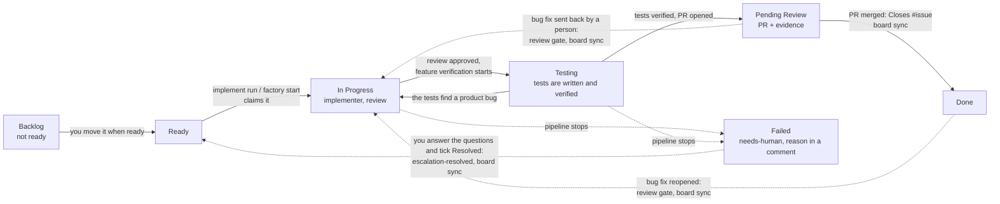

# Board stage

Part of the [AI development pipeline](README.md). Every story, bug, epic and research spike is an issue on one GitHub Project (the **story board**), whose default view shows the epics. An engineer starts the pipeline by hand for a story or a whole epic, and the card moves as the pipeline reaches each step: claimed, under test, back to the implementer on a product bug, ready for review, failed or done.

The issue is the story's **source of truth**: its body carries the complete story, and the pipeline reads it from there (see [Tickets](#tickets-the-issue-is-the-source-of-truth)).

The stage CLI is `factory board` (`scripts/board/board.mjs` in the factory). Its defaults are the engine's `scripts/board/config.json`; a repository sets its own project and overrides any default in the `board` section of `.factory/config.json` ([configuration](../configuration.md)). The state machine is `scripts/board/lib/flow.mjs`.



## Lanes

The lane names below are the defaults (`board.columns`).

| Lane | Reached by |
| --- | --- |
| Backlog | `board setup` (every card without a lane). Not ready for implementation |
| Ready | you, when a story is ready for implementation |
| In Progress | the **claim** when `factory implement run` (or an interactive `factory start <KEY>`) begins the story, with a comment naming the user and machine; and the **product-bug** event when feature verification finds bugs in the implementation and the story goes back to the implementer, with a comment listing the bugs |
| Testing | the **testing** event: the architecture review approved the code and feature verification started writing and verifying the automated tests (again after every bug fix) |
| Pending Review | the **verified** event: the tests are verified and the PR is open (headless), or the line of work is done and verified (interactive, no PR). The issue gets the review notes and evidence; the epic gets the same links. A bug-fix PR is then [gated](review-gate.md): it auto-merges (Low risk, high confidence) or waits for a person's approval while the card stays here |
| Failed | the **failed** event: any outcome of `factory implement run` other than done (`blocked`, `unresolved`, `plan-rejected`, `pair-exhausted`, `limit-*`, `fv-*`, a blocker that failed, a PR that could not be opened, ...). The card gets the `needs-human` label and a comment with the outcome, up to three questions for a human, the details (escalation notes, findings, branch, log) collapsed, and a **Resolved** checkbox ([escalations](escalations.md#questions-and-the-resolve-checkbox)) |
| Done | `board sync`: closed story issues move to Done (also when the review gate auto-merged the PR). The PR body gets `Closes #<issue>`, so merging the PR closes the issue. (The project's built-in "Item closed" workflow does the same instantly if you turn it on under the project's Workflows; GitHub has no API for that.) |

The board is informational: GitHub errors are logged and never block an agent or change a pipeline outcome.

## The state machine

Pipeline events move a card only along these transitions; any other event is ignored and logged.

| Event | Sent by | From | To |
| --- | --- | --- | --- |
| `claim` | `implement run` (each story it runs), `factory start` (story-start hook) | no lane, Backlog, Ready, Failed, In Progress; Testing, Pending Review or Done only with `--force`; a card another machine holds only with `--takeover` | In Progress |
| `testing` | the runner after the review approves; the Stop hook (interactive) | In Progress | Testing |
| `product-bug` | the runner when feature verification reports bugs and a bug-fix cycle starts; the Stop hook | Testing, In Progress | In Progress |
| `verified` | the runner after it opens the PR (`board review`); the Stop hook | In Progress, Testing, Failed (a story that failed in an earlier run and is verified, or only merged, by a later one) | Pending Review |
| `failed` | `implement run` for every story that did not finish (`board fail`) | no lane, Backlog, Ready, In Progress, Testing | Failed |
| `closed` | `board sync` | any lane but Done | Done |
| `reopened` | `board sync` (the [review gate](review-gate.md#human-reopens)), when a person reopened a triaged bug fix | Pending Review, Done, In Progress | In Progress |

Testing goes back to In Progress only on a product bug. A claim of a card in Testing by the machine that holds it (a resumed run) leaves it in Testing.

**Claims.** A claim fails when the card is in In Progress or Testing and its latest event came from another user or machine (`<gh login>@<host>`). `implement run` then skips that story (and any story stacked on it) and says who holds it; `--takeover` takes it over (`--force` is for running a story in Pending Review or Done again). While another machine holds a card, events from this machine are ignored (`not-owner`), so a stale run cannot move a card someone else took over.

**Sequence numbers.** Every event carries a per-ticket number that only grows. The last applied number is stored in two places:

- on this machine, in `<git common dir>/ai-pipeline/board/<KEY>.json` (shared by the main checkout and every worktree, so the batch and its story workers agree), with the number each event id was given;
- on the card, in a hidden marker at the end of the comment each transition posts (`<!-- pipeline-board:{"seq":4,"owner":"me@host","event":"testing",...} -->`), so other machines see it.

An event whose number is not above the last applied one is stale or a replay and is ignored. Events carry ids derived from the pipeline state (`testing:<approved hash>`, `bug:<automation finish time>`, `verified:<verified hash>`), and an id keeps the number it was first given, so the runner and the Stop hook can report the same event any number of times and it applies once, in order.

**Moving cards by hand.** `board move <KEY> <lane>` moves a card forward in board order (Backlog, Ready, In Progress, Testing, Pending Review, Failed, Done); `--force` moves it anywhere. Hand moves bypass the state machine.

## Starting the pipeline

Automatic pickup (`board pick`, which polled the board and ran the stories assigned to you) was removed; it will be reworked later. An engineer starts the pipeline by hand from an up-to-date checkout of the base branch:

```bash
factory implement run --epic checkout --pr   # every story of an epic, one epic PR
factory implement run SHOP-12 --pr           # one story
factory board mine                           # the stories assigned to you
```

`implement run` first runs `board sync`, then claims every story it will run. The headless runner reports `testing`, `product-bug` and `verified` from each story's worktree as they happen, and after the batch it moves every story that did not finish to Failed. Answer the questions on its failure comment and tick **Resolved** (the `board-escalation-resolve` workflow swaps `needs-human` for `escalation-resolved`); the next `board sync` moves it to Ready and the next run takes your answers as binding requirements. `implement requeue` (by hand or [on a timer](escalations.md#requeue-on-a-timer)) runs every resolved ticket in one batch. You can still fix a failed story yourself and run it again (the claim takes it out of Failed), or move it back to Ready by hand (`board move <KEY> ready --force`).

**Interactive sessions.** `factory start <KEY>` claims the card (story-start hook; a card another machine holds is not taken: `board claim <KEY> --takeover` takes it). The board stage's Stop hook reads the story's pipeline state and reports, in order, a product bug feature verification found since the last stop, the review approving the code that is now under test, and the verified tests of a finished line of work, so the card moves the same way as in a headless run. Headless runs (`PIPELINE_HEADLESS=1`) skip both hooks because the runner reports its own events.

## board sync

`board sync` does the bookkeeping that belongs to no single run. `implement run` runs it at start; run it by hand any time.

- Closed story issues move to Done, and their section on the epic's evidence comment shows Done.
- Their late outcome is recorded for the [implement decision log](implement.md#decision-log): whether the PR merged, how many commits and lines humans added on the branch before merge, and which bug tickets name the story (`type: "late"` in `.factory/metrics/decision-outcomes.jsonl` of the checkout, left uncommitted). Only stories this machine implemented have a run record to compare with.
- Failed story cards labeled `escalation-resolved` and not `needs-human` (a human answered the escalation questions) move to Ready. `--json` prints the keys moved (`requeued`) and every resolved ticket in Ready (`resolved`), which `implement requeue` runs.
- The [review gate](review-gate.md)'s bookkeeping for bug-fix PRs: **human reopens** of triaged tickets (a card moved back to In Progress with no pipeline event behind it, a reopened issue, a "changes requested" review on a gated PR) are recorded (severity +1, `reopened` label, a `reopened` event, the reason under `## Decisions`), every open gated PR is evaluated again (a waiting PR auto-merges once its checks pass), and every closed gated PR gets a `pr-review` record for the [retro](review-gate.md#review-data-for-the-retro) (plus a `revert` record when its merge was reverted). `--json` lists the reopened tickets (`reopened`), which `implement requeue` re-runs ([human reopens](review-gate.md#human-reopens)).
- Every epic card moves to the lane its stories call for.
- Feature videos published after a story (or an epic PR) reached Pending Review are posted on the story issue and linked from the epic's evidence comment ([below](#pending-review-evidence)).

## Pending Review evidence

When a story reaches Pending Review, the issue gets a comment with the PR link and:

- **API stories** (`[BE - ...]` in the title): the requests and responses of the story's verified Playwright tests, when the repository has set a command for it in `board.evidence.playwright` (unset by default, in which case the comment points to the PR). The command is an argument list in which `{files}` becomes the test files that carry the story's case ids (`TC-<KEY>-`), `{casePrefix}` that prefix and `{output}` a results folder; it must run those tests against the test stack with tracing on and write Playwright's JSON report to the path in `PLAYWRIGHT_JSON_OUTPUT_NAME`. The stage reads the API calls (the `request` fixture; browser traffic is left out) from each trace and posts them grouped by test. Secrets (`token`, `password`, `secret`, `authorization`, `cookie` keys) are redacted, bodies and the comment are capped (`board.evidence`), and the full log stays in `.factory/state/evidence/<KEY>/api-evidence.md`. The test stack must be up (`factory teststack up`, see [test stack](../test-stack.md)), as it is for feature verification.
- **UI stories** (`[FE - ...]`): the feature video, taken from the "Demo video" section the [PR demo video](pr-demo-video.md) workflow keeps in the PR description. The workflow runs after the PR opens, so the comment first says the video is pending; `board sync` posts it on the issue and links it from the epic once it is published.

## Epic evidence

Whenever a story posts evidence (Pending Review), fails, or reaches Done, its epic issue gets the same links on **one rolling comment**, edited in place and found by a hidden marker (`<!-- pipeline-epic-evidence:{...} -->`, which also carries the data, so any machine can update its story's section without losing the others). The comment has:

- per story: its lane, the PR link (and the epic branch it was merged into) or the branch, the feature video, screenshots, and a link to the API evidence comment on the story issue (the requests and responses themselves stay on the story issue);
- for an epic delivered as one branch: the epic PR, its branch and its video (`board epic-pr <epic issue> --pr <url> [--branch <name>] [--video <url>]`; `board review <KEY> --pr <url> --epic-branch <branch>` records that a story's PR was merged into the epic branch);
- for a bug epic delivered as PR groups: one line per group with its PR, branch and tickets (`board epic-pr <epic issue> --pr <url> --branch <name> --group <id> [--title <text>] [--tickets K1,K2]`).

### Epic PRs

With [epic delivery](implement.md#epic-delivery) (`implement run --epic <EPIC>`, the default) there is no PR per story. When a story's tests verify and it is merged into the epic branch, the runner moves its card to Pending Review with `board review <KEY> --epic-branch <branch>` (no `--pr`; the comment and the epic's section name the epic branch). When every story is verified, the runner opens ONE PR for the epic, whose body has `Closes #N` for every story and bug (so merging it closes them all, and `board sync` moves them to Done), and records it with `board epic-pr`. A bug epic gets one PR per group instead: each ticket goes to Pending Review with its group's PR (`board review <KEY> --pr <url> --epic-branch <group branch>`), and each group PR is recorded with `board epic-pr ... --group <id>`. A story that fails goes to Failed as usual; the epic PR is not opened until every story is verified.

Over 60,000 characters every story shrinks to one line of links, below GitHub's comment limit.

## Epics and mockups

Every epic is an issue (label `epic`, title `Epic: ...`) with a card. Each story is a sub-issue of its epic, and each research spike a sub-issue of the epic it feeds. The project's views, in tab order:

| View | Shows |
| --- | --- |
| Epics (default) | Epic cards only, with each one's sub-issue progress. Open an epic to see its stories and click through to them |
| Stories by epic | Story cards, one swimlane per epic (grouped by the built-in Parent issue field) |
| Stories | Story cards, no swimlanes |
| All items | Table of everything |

GitHub can't reorder views, so `setup` recreates them in this order if they drift (the view URLs change when it does).

An epic's lane follows its stories; the first rule that matches wins:

| Epic lane | When its stories are |
| --- | --- |
| Done | all done |
| Pending Review | all in Pending Review or Done |
| In Progress | any in progress |
| Testing | none in progress, any in testing |
| Failed | any failed, and none can still move on its own (none in progress, testing or ready) |
| Ready | any ready |
| In Progress | some in Pending Review or Done, the rest in Backlog |
| Backlog | otherwise |

Every story transition, `board sync` and `setup` recompute it, so moving an epic card by hand is undone.

**Assigning an epic assigns its stories.** The `board-epic-assign` workflow runs when an epic is assigned or unassigned, and `board sync-epic <issue>` gives every open story of the epic exactly the epic's assignees. A story can still be reassigned on its own afterwards; the next change to the epic's assignees overrides it. GitHub runs issue workflows from the default branch, so the workflow acts once it is merged there; until then run `sync-epic` by hand.

Mockups belong to a ticket: they are its assets on the `board-assets` branch, shown in its **Mockups** section (images inline, other files linked, pinned to one commit) and downloaded into its cache folder by `board fetch` (see [Assets](#assets)). Attach mockups to a new ticket with `board new --mockups <dir>`.

Who sees them: the agents implementing a story read its own mockups (and, in an `implement run --epic`, the epic's) from the start, the UI verifier compares renders of every mockup screen and state with the running app each pair round, and the PR check's design lens holds the finished branch to them ([implement](implement.md#mockups), [PR check](pr-check.md#mockup-renders)). The [story guard](README.md#story-guard) keeps every other ticket's mockups closed. Keep the mockup folder's `README.md` listing the screens and their states: builders and verifiers use it to match each screen to a page.

## Tickets: the issue is the source of truth

Stories, bugs, epics and research spikes are GitHub issues on the ticket repository (`tickets.repo`, by default this checkout's GitHub `origin`), and the issue body holds the **complete** source Markdown. There is no story folder in the repository: every stage reads a ticket through one loader (`scripts/pipeline/lib/tickets.mjs`) from a local cache that `board fetch` (or the loader, on demand) fills from the issues.

| Type | Key | Labels | Parent |
| --- | --- | --- | --- |
| story | `SHOP-12` (title `SHOP-12: ...`) | `story`, `enhancement`, `frontend` or `backend` | the epic its **Part of** line links |
| bug | `FIX-9` (or `**Type:** Bug`) | `story`, `bug`, `frontend` or `backend` | the epic its **Part of** line links |
| epic | `epic-<slug>` | `epic` | - |
| spike | `spike-<slug>` (research write-ups) | `spike` | an epic |

A story key is uppercase letters and digits, a hyphen and a number. `frontend` goes on `[FE - ...]` titles and `backend` on `[BE - ...]` titles. `board setup` creates the labels the board owns; `bug` and `enhancement` are GitHub's default labels and must exist in the repository.

### Issue body format

`scripts/board/lib/ticket-format.mjs` renders and parses it:

```markdown
<!-- board-ticket:v1
{"schema":1,"key":"SHOP-12","type":"story","title":"SHOP-12: [BE - orders-api] - Cart pricing API","slug":"SHOP-12-be-orders-api-cart-pricing-api","source":null,"parent":"epic-checkout","blockedBy":["SHOP-10","SHOP-11"],"sourceHash":"<sha256 of the source bytes>","eol":"lf","finalNewline":true,"content":"inline","assets":{"repo":"your-org/your-app","branch":"board-assets","commit":"<asset commit>","files":[{"path":"mockups/SHOP-12/cart/Main.html","name":"cart/Main.html","kind":"mockup","sha256":"<sha256>","size":1234}]}}
-->
> **SHOP-12** · Story · part of #63 · blocked by #52, #53
>
> The text between the `board-ticket:source` markers below is the source of truth for the pipeline (`board fetch` reads it back verbatim). Edit it there; everything outside the markers is generated.

<!-- board-ticket:source:begin -->
# SHOP-12: [BE - orders-api] - Cart pricing API
...the story, every section, verbatim...
<!-- board-ticket:source:end -->

---

## Mockups


- [`Main.html`](https://github.com/<repo>/blob/<asset commit>/mockups/.../Main.html)

---

Assign this issue to yourself and move it to **Ready** when it is ready for implementation ...
```

- **Hidden metadata** (an HTML comment, `>` escaped so it can never close early): key, type, title, slug (it names the branch and `.factory/plans/<slug>/`), parent, blockers, the source's sha256 and line-ending style, and the **asset manifest**: every file's path on the assets branch, sha256 and size, pinned to one asset commit.
- **Round trip:** `parseBody(renderBody(file)).content` is the file byte for byte. The one normalisation: GitHub may store a body with CRLF line endings (web edits do), so the body is read with CRLF as LF, and the source's own line endings (`eol`) and final newline come back from the metadata. A text that differs from `sourceHash` was edited on GitHub; that edit is the new truth.
- **Edit the story** between the markers on GitHub, or edit the cached `story.md` and run `board publish <KEY>`.
- **Size:** an issue body is capped at 65,536 characters. During a [migration](#migration), a source that would not fit (or has mixed line endings, or contains a marker) is **spilled**: stored on the assets branch as `files/<KEY>/<file>.md`, linked from the body with a preview, and `content` in the metadata names it. Fetch downloads it and checks its sha256. `board new` refuses such a source instead: split the story.

### Assets

Mockups, images and other non-Markdown files live on the orphan branch **`board-assets`** (`tickets.assetsBranch`): `mockups/<KEY>/<folder>/<file>` for mockups and `files/<KEY>/<path>` for everything else (a spike's images, spilled sources). `scripts/board/lib/assets.mjs` builds its commits with git plumbing (`hash-object`, a temporary index, `write-tree`, `commit-tree`, `update-ref`), so your branch and working tree are never touched. Only `migrate --apply` and `new --mockups` push the branch. Bodies embed images and link files by the pinned commit, so a later asset change never alters what an existing body shows.

### Fetch and the local cache

```bash
factory board fetch SHOP-12 SHOP-13      # or --epic <EPIC>, or --all; --refresh to re-download
```

```text
.factory/state/board/<KEY>/story.md     the source Markdown, exactly as in the issue
.factory/state/board/<KEY>/meta.json    the metadata, the issue (number, url, updatedAt, state), the story sha
.factory/state/board/<KEY>/mockups/     mockups, downloaded at the pinned commit and checked by sha256
.factory/state/board/<KEY>/files/       other attachments
.factory/state/board/<KEY>/history/     every version fetched, by story sha (feature verification diffs a stale plan against it)
```

- An issue whose `updatedAt` did not change is not downloaded again; `--refresh` re-downloads.
- Offline, the cached copy is used with a warning; a ticket that is neither cached nor on the board is a clear error that says how to create it.
- Local edits to a cached story (the implementer's Implementation Notes) are never overwritten: if the issue changed too, fetch reports a conflict and keeps your copy until you `publish` it or fetch with `--refresh`.
- `factory start <KEY>`, `implement run <KEY>` and `fv plan <KEY>` re-check the issue themselves; hooks only read the cache, so no hook waits on GitHub.
- With `git config fv.autoPlan true`, a fetch that brings a changed story starts its test plan in the background (commits do not: stories are not committed files).
- `.factory/state/` is ignored by git; the cache is per checkout. `implement run` copies a story's cache folder into its worktree (and into each subtask worktree).

### Creating and changing tickets

```bash
factory board new story.md [--epic epic-checkout] [--mockups path/to/SHOP-14-cart]
factory board new - --type spike < findings.md
factory board publish SHOP-12            # the cached story (e.g. with Implementation Notes) back to its issue
```

`new` takes the format in [writing-stories.md](writing-stories.md); the key comes from the heading (`# SHOP-14: ...`) or `--key`. It creates the issue with its labels, makes it a sub-issue of its epic, adds it to the project and caches it. `publish` refuses when the issue changed since you fetched it (`--force` overwrites). `implement run` publishes a finished story itself.

## Migration

For a repository whose stories, epics, mockups and research live in a folder of Markdown files. Name the folder in `tickets.legacyDir` in `.factory/config.json` (there is no default) and, when it holds research documents, give the epic they go under in `tickets.spikeEpic` (`{ "key": "epic-<slug>", "title": "..." }`). `board migrate` then moves all of it to the board, and is safe to run again:

```bash
factory board migrate                 # dry run: where every file goes; report in .factory/state/board/migration-report-plan.md
factory board migrate --apply         # GitHub writes (idempotent)
factory board migrate --verify        # fetch every ticket into a temp cache and compare
factory board migrate --delete-local  # only after a passing verify of exactly these files
```

| Step | What it does |
| --- | --- |
| dry run | Classifies every file: `stories/<KEY>-*.md` is a story or bug, `epic-*.md` an epic, any other Markdown document that is not an index or template a **research spike** under the `tickets.spikeEpic` epic (whose body is generated when it has no file), `mockups/<owner>-*/` files are mockups of the story key or epic they are named after, files a ticket links to (a spike's images) are its attachments, and files in a spike's folder or named after a ticket go to that ticket. Anything else is **unplaced**. Prints counts; the full table (file, ticket, existing issue or "create", asset path) is in the report. |
| `--apply` | Builds and pushes the `board-assets` commit, creates the `spike` label, creates or updates every issue (epics first, so links get numbers), adds new issues to the project and links sub-issues. A second run changes nothing. |
| `--verify` | Fetches every ticket from GitHub into a temporary cache and compares it with the files: content byte for byte, every asset by sha256. Any difference (or an unplaced file, unless `--allow-unplaced`) fails it. Writes `.factory/state/board/migration-report.md` with a fingerprint of the folder. |
| `--delete-local` | Refuses unless the last verify passed and its fingerprint matches the files now. Then it stages the folder's removal (`git rm -r --cached`), deletes it, and removes the references to it it knows how to edit: the `tickets.legacyDir` key and `storyGuard.folders` entry in JSON config files, lines naming the folder in ignore files and YAML files, and `story-file:` in test plan indexes (replaced by `story-issue: <url>`). It lists any reference it could not edit. Review and commit the result. |

## Setup

Once per repository (the `setup-board` skill walks through it). Run it again after changing `board.columns`; it is idempotent.

```bash
gh auth refresh -s project                       # Projects need the project scope
factory board setup --dry-run                    # every change it would make, none made
factory board setup
```

On a **shared** project (one that holds other repositories' cards), `setup` changes only what is this repository's: it adds missing labels to this repository, links the project to it, and gives this repository's cards without a lane a Backlog lane. It never changes the project's columns, fields, options or views, nor another repository's card; missing columns are reported for a person to add, and missing triage fields are only created, never altered. `--dry-run` prints each of those changes as "would …" and makes none, so check it first on a project you share.

Before the first run, `.factory/config.json` needs `board.owner`, `board.ownerType` (`user`, the default, or `organization`), `board.repo` (`owner/name`), and either `board.projectNumber` of an existing project or `board.projectTitle` for a new one. `factory init` fills in `board.owner` and `board.repo` from the checkout's GitHub `origin`; the rest are unset by default.

`setup` enables issues on the repository, creates the labels (`story`, `epic`, `spike`, `needs-human`, `escalation-resolved`, `frontend`, `backend`), finds or creates the project named `board.projectTitle` when no `board.projectNumber` is set (it prints the number: put it in `board.projectNumber` in `.factory/config.json`), links the project to the repository, sets the Status columns, sets up the views, creates the [review gate](review-gate.md)'s triage fields (Impact, Complexity, Fix risk, Severity, Confidence, Human reopens; names in `board.fields`), and puts every card without a lane in Backlog. It never writes issue bodies: tickets are created by `board new` and `board migrate --apply`. A new project's default `Todo` column is renamed to Ready in place, and missing columns are added without losing the cards of the existing ones; until a column exists, moving a card to it is logged and skipped. Any repository collaborator can be assigned.

The board is active only when the configuration has a `board.projectNumber`, the checkout's `origin` is `board.repo` (so test fixtures and forks never touch it), and `PIPELINE_BOARD` is not `0` (or `off`, `false`, `no`). Everyone who runs the pipeline needs `gh` logged in with the `project` scope.

## Labels and workflows

| Label | Set by | Meaning |
| --- | --- | --- |
| `needs-human` | `board fail`; the [review gate](review-gate.md) on a bug-fix PR | On an issue: the pipeline could not finish the ticket; the latest comment has the questions and the Resolved box. On a PR: the gate requires a person's approval |
| `reopened` | `board sync` (the [review gate](review-gate.md#human-reopens)) | A person reopened a triaged bug fix; `implement requeue` re-runs it and removes the label when it starts (`board clear-reopened`). The reopen stays in the issue's `## Triage` |
| `approvals:N`, `auto-merged` (PRs) | the [review gate](review-gate.md) | How many approvals a bug-fix PR needs (`review-quorum` enforces it); a PR the gate merged |
| `escalation-resolved` | `board-escalation-resolve` workflow (or a human) | A human answered the questions; `board sync` moves the card from Failed to Ready, the next run re-runs it and removes the label when it claims the card |

`factory render` generates the workflows as `.github/workflows/factory-<name>.yml` (with the `ci` feature on); each installs the pinned engine with the generated `setup-factory` action.

| Workflow | Trigger | What it does |
| --- | --- | --- |
| `factory-board-epic-assign.yml` | an epic is assigned or unassigned | `board sync-epic`: the epic's stories get its assignees |
| `factory-board-escalation-resolve.yml` | a failure comment is edited (Resolved ticked), or `escalation-resolved` added by hand (new comments, `Qn:` replies included, do not start it) | `board resolve-check`: untick and list what is missing, or swap the labels, record `## Decisions` in the issue body and confirm ([escalations](escalations.md#questions-and-the-resolve-checkbox)) |

Both use only `github.token` with `issues: write`; moving cards needs the project scope, so it happens in `board sync` on a pipeline machine.

## Commands

```bash
factory board setup [--dry-run]
factory board fetch <KEY>... | --epic <EPIC> | --all [--refresh]   # tickets into .factory/state/board/
factory board new <file.md|-> [--type story|bug|epic|spike] [--key KEY] [--epic <epic-key>] [--mockups <dir>] [--dry-run]
factory board publish <KEY> [--force]       # the cached story back to its issue
factory board migrate [--summary] | --apply | --verify [--allow-unplaced] | --delete-local [--dry-run]
factory board sync [--json]                 # closed stories to Done, resolved Failed to Ready, late outcomes, review gate (reopens, gated PRs), epic lanes, videos
factory board resolved [--json]             # resolved tickets (escalation-resolved, no needs-human); moves nothing
factory board mine
factory board claim <KEY>... [--force] [--takeover]  # claim for this machine (implement run does this)
factory board event <KEY> claim|testing|product-bug|verified|failed|closed|reopened [--id <id>] [--force] [--takeover]
factory board fail <KEY>                    # Failed + needs-human, questions and Resolved box from the run record
factory board resolve-check <issue> [--actor <login>] [--comment <id>] [--label]   # run by the board-escalation-resolve workflow
factory board clear-resolved <KEY>          # drop escalation-resolved (a re-run started; implement run does this)
factory board clear-reopened <KEY>          # drop reopened (a re-run of a reopened bug fix started; implement run does this)
factory board move <KEY> backlog|ready|inProgress|testing|review|failed|done [--force]
factory board review <KEY> [--pr <url>] [--epic-branch <branch>]   # Pending Review + evidence
factory board epic-pr <epic issue> --pr <url> [--branch <name>] [--video <url>] [--group <id> [--title <text>] [--tickets K1,K2]]
factory board status [KEY]                  # lane and last event (number, owner)
factory board sync-epic <issue>             # give an epic's open stories its assignees
factory board hook story-start <KEY> | hook stop   # called by the dispatcher
```
