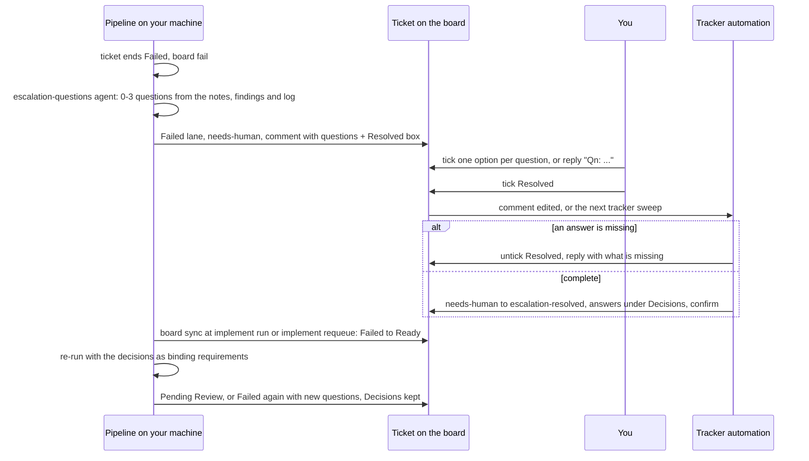

# Handling escalations and failed stories

**Who reads this:** C (operators). Every agent loop has a limit; when a ticket stops, this page says what its outcome means and what to do next. Start with the [outcome](#outcomes) the run printed or the card shows.

## Where to look

| What | Where |
| --- | --- |
| Batch progress and outcome per story | `factory implement status [KEY]` (main checkout) |
| Per-story stage state (review rounds, plan and automation status, PR check score) | `factory status KEY`, run inside the story's worktree |
| Escalation notes | `.factory/state/escalations/<KEY>-<stage>.md` (in the worktree for `implement run`); also in the collapsed details of the failure comment on the issue |
| Questions for you and the Resolve checkbox | the latest failure comment on the issue ([below](#questions-and-the-resolve-checkbox)) |
| Runner logs | `.factory/state/logs/implement-<KEY>-*.log` (main checkout) |
| Stage logs (background plan, automation and PR check runs) | `.factory/state/logs/<KEY>-<stage>-*.log` (worktree) |
| PR check report | `.factory/state/pr-check/<id>/report.md` |

Escalations are written by the review (`review`), by feature verification (`plan`, `automation`), by the PR check (`pr-check`) and by the retro (`lessons-retro.md`, when a lessons run keeps crashing: see [retro](retro.md#crash-recovery)). The next agent session in that checkout is told about them at start-up. Each one is deleted automatically when its stage later passes (review approval, a verified plan or test suite, a passing PR check, a finished retro run); you can also delete the file once you have dealt with it.

## Outcomes

`implement run` prints an outcome per ticket and exits 0 only when every ticket is `done` (or skipped as already
implemented). A run outcome is how the run ended; the card's board lane is separate: `done` means delivered, and the
card then waits in Pending Review for the merge. Every other outcome carries a `reason` and its `findings` in
`.factory/state/implement/<KEY>.json`, and the card goes to Failed with them ([questions](#questions-and-the-resolve-checkbox)),
except where the table says otherwise. Limits and their settings are in [implement-reference.md](implement-reference.md#limits).

| Outcome | What happened | What to do |
| --- | --- | --- |
| `done` | Delivered: the PR opened (or, without `--pr`, everything verified and committed) | nothing; the PR waits for the [review gate](review-gate.md) or a person |
| `blocked` | The orchestrator reported the ticket unimplementable (an open question that changes the design, a missing blocker), the blockers' branches conflict, or CI's analysis jobs still fail before the push, or a held secret is still in the worktree (nothing pushed) | Answer the question in the ticket on the board, merge the blocker, resolve the conflict, or remove the secret; then re-run |
| `plan-rejected` | The plan broke the rules twice, or needed more than `maxSubtasks` subtasks | Split the ticket, or make it clearer; re-run |
| `pair-exhausted` | A subtask was not approved after its rounds and one rewrite or takeover | Read the verifier findings on the card; sharpen the ticket or fix by hand in the worktree |
| `merge-conflict` | The orchestrator could not resolve a conflict merging a subtask, or a ticket into its epic or group branch | Resolve it in the worktree; re-run |
| `model-policy` | A model the plan needs, or a role's CLI, is not allowed ([models.md](models.md)) | Allow the model, or change the role's CLI |
| `limit-agent-runs`, `limit-wall-clock` | The ticket hit `maxAgentRunsPerStory` or `storyWallClockSec` (at its ceiling) | Read the log for the loop that used the budget; raise the limit only if the ticket is just large |
| `no-changes` | The implementer changed no implementation files | Check the log: if the feature already exists, close the issue; if the ticket is too vague, sharpen it |
| `review-escalated` | No approval within `review.maxRounds` (5); see `<KEY>-review.md` | Fix the code in the worktree, or settle the disagreement (a ticket change, or an exception in the [architecture policy](../architecture-policy.md)); re-run |
| `unresolved` | Still not approved after `maxImplementerRuns` (8), or the PR check still upholds findings after its returns, or a returned finding came back with nothing addressed | Same as `review-escalated`; for the PR check, read its report |
| `fv-product-bug` | The tests contradict the code after `maxBugFixCycles` (2) fix cycles; see `<KEY>-automation.md` | If the test matches the ticket, fix the code; if the ticket was ambiguous, fix it and re-plan |
| `fv-escalated`, `fv-blocked-on-plan` | The plan or the tests did not reach the required score (`loops.requiredScore`, 9) in their rounds; see `<KEY>-plan.md` or `-automation.md` | Gaps that repeat usually point to an ambiguous ticket |
| `fv-crashed`, `fv-timed-out`, `fv-not-started`, `error` | A process died or ran past its ceiling | Read the log, fix the cause (agent CLI not signed in, Docker not running, a hung test); `implement resume` |
| `fv-reverify-failed` | An epic unit's stale tests did not verify again before the push | Read the automation escalation of that ticket |
| `needs-decision` | The PR check raised a question only the ticket's owner can answer; the branch is pushed, no PR | Answer the questions on the ticket |
| `pr-check-incomplete` | The PR check did not finish (crashed, never started, past its ceiling); branch pushed, no PR | Read its log; re-run |
| `pr-check-escalated` | An epic unit's fix-mode PR check ended escalated or still upheld findings at `fixUntil` or worse; no PR | Read the report; fix the findings or record why one is out of scope |
| `ci-red`, `ci-flaky`, `ci-conflict`, `ci-unverified`, `ci-escalated` | CI was still red, passed only with retries, had a merge conflict, could not be verified, or its fixing round escalated: before the open (no PR) or after it (the PR on hold) | Read the failing checks; fix on the branch; re-run, or resolve the questions |
| `demo-video-blocked` | `video.bugPair.requireBefore` is on and a bug's reproduction could not be shown before the fix; no PR | Read the reason on the card; fix the reproduction case, or turn the setting off |
| `not-delivered` | The push or the open failed for a reason other than a refusal of the text, or another ticket's re-verified tests failed | Read the reason; re-run |
| `pr-refused` | Every stage passed and CI proved the head, but the code host refused the PR's text even with the shortest body | `implement resume` opens it later ([what a resume re-runs](implement.md#resume-and-interrupted-runs)) |
| `gate-assessment-failed` | The review gate is on and could not rate the bug fix before the open; no new PR opened. The branch is pushed (CI-proven unless the proof was bypassed: draft-first or `ciWait: false`); a re-delivered PR stays open on hold | Fix the gate's CLI or the triage agent (or turn the gate off). A PR that never opened: the next run, or `implement resume`, replays the delivery from the analysis jobs and push, rates again and opens. A re-delivery runs again on hold and updates the same PR |
| `hold-failed` | The open PR could not be confirmed on hold, so no agent ran; it may already be in draft or labelled | Check the PR on the host, then tick Resolved: after the open the run resumes at the CI wait; a reopened ticket is held again first |
| `release-unconfirmed` | Checks were green but the host did not confirm the PR's release from hold; no ready time recorded | Tick Resolved and the run retries the release at the CI wait, or mark the PR ready by hand |
| `agent-unavailable` | The agent provider stopped serving (quota, usage limit); no card moves to Failed | `implement resume` once the provider is back |
| `stopped` | `implement stop` ended the run | `implement run <KEY> --force` to start it again |
| `skipped` | Already implemented (issue closed, or delivered by this checkout's run), or a blocker did not finish | Fix the blocker; `--force` runs an implemented ticket again |

An epic run adds its own summary: `stories-failed` (a ticket failed, its unit got no PR), `undelivered`,
`waiting` (a ticket waits for a person) or `joined` (a ticket joined a running epic).

## Questions and the Resolve checkbox

Agents never ask questions while a ticket runs: they make a documented choice, or stop. Questions are asked once, when the card moves to **Failed**, and answered on the issue.



1. **Questions step.** `board fail` reads the escalation notes the run left (`.factory/state/escalations/<KEY>-*.md`, in the ticket worktree), its findings and the end of its log, and asks the `escalation-questions` agent (model `agent.models.escalationQuestions`, default `sonnet`, checked by `factory models check`) for at most three questions (`board.questions.maxQuestions`) only a human can answer, each with two or three options, one recommended. Mechanical failures (`error`, `fv-crashed`, `fv-timed-out`, `fv-not-started`, an agent provider outage, a skipped dependent) get no questions. If the call fails, the comment goes out without questions; `board fail` never fails because of this step. A replayed `board fail` (same event id) posts nothing and asks nothing.
2. **The failure comment.** A one-line summary, the questions as task lists (one `- [ ] **A.** ...` line per option, then `- [ ] **Other**`, answered by a `Q1: ...` reply), the escalation notes, findings, branch and log collapsed under **Details**, then `- [ ] **Resolved**: I've answered the questions; re-queue this ticket`. A hidden marker (`<!-- pipeline-escalation:{"key","round","questions":[{"id","options"}]} -->`) lets automation read it.
   A ticket that did not run because a blocker failed (outcome `skipped`, "blocker X ended ...") gets no questions: its comment names the blocker, which holds the decision. Resolve the blocker first. The runner records such a ticket's outcome when the batch ends, so a later run that skips it for the same reason replays the failure instead of posting a new comment.
3. **You answer.** Tick exactly one box per question. For **Other**, reply in a new comment whose line starts with `Q2: ...` (one comment may answer several, one `Qn:` per line). Then tick **Resolved**: only that edit starts the check (a reply on its own does not), so if you reply after ticking it, untick and tick **Resolved** again.
4. **The tracker automation checks** (`factory board resolve-check`; on GitHub the `factory-board-escalation-resolve.yml` workflow with `issues: write` only, on other trackers the scheduled tracker sweep, [hosts-and-trackers.md](../hosts-and-trackers.md#what-works-in-each-combination)). It acts only on the latest failure comment. A question with no box or several boxes ticked, or **Other** without a later `Qn:` reply by a human (bot comments and pipeline comments never count), unticks **Resolved** and replies with the list. Otherwise it removes `needs-human`, adds `escalation-resolved`, writes the answers to the issue body under `## Decisions` (round, question, answer, who, when; a round is replaced, never duplicated) and replies `Resolved by @you. Decisions recorded: ...`. Adding the `escalation-resolved` label by hand does the same (it records whatever is ticked, and notes what is unanswered).
5. **Re-queue.** `board sync` moves Failed cards labeled `escalation-resolved` without `needs-human` to Ready. It runs at the start of every `implement run`, by hand, or from [`implement requeue`](#requeue-on-a-timer).
6. **Re-run with the answers.** `implement run`/`resume` treat `escalation-resolved` as permission to run the ticket again, fresh (like `--force` for that ticket's earlier run, including a standing review, plan or automation escalation). `board fetch` writes the `## Decisions` next to the cached story (`decisions.md`), and the implementer, the orchestrator's plan and integration, the pair implementers and verifiers, the architecture reviewer, the test planner, the test automation agent and their verifiers get them as **Human decisions (binding requirements)**: reviewers and verifiers flag code that contradicts a decision instead of reopening it. When the re-run claims the card, it removes `escalation-resolved` and deletes the ticket's old escalation notes.
7. **Round 2.** If the ticket fails again, a new comment asks again (round 2), and the earlier rounds stay under `## Decisions` as context. `board publish` keeps the section when it rewrites the issue body.

## Requeue on a timer

`factory implement requeue` picks up every ticket you resolved and runs them in one batch, so you can answer several Failed tickets on GitHub and have them run together:

1. Skips (exit 0, logged) when an `implement run` is active on this machine, the last one was interrupted (resume it first: `implement resume`), another requeue is running, or the agent provider reported an outage in the last 60 minutes (`implement.requeue.outageCooldownMin`) (`.factory/state/implement/agent-outage.json`).
2. Runs `board sync`, which moves the resolved Failed cards to Ready. Nothing resolved: exits 0.
3. Starts `implement run <KEY...> --parallel auto --pr` for all of them. Bug fixes a person reopened after the [review gate](review-gate.md#human-reopens) assessed them (`reopened` in `board sync --json`) run too, in their own runs with `--force`: on their PR's branch while the PR is open, else as a follow-up PR. Tickets of an epic whose epic run is still in progress go per delivery unit (one run per bug-epic PR group they belong to), so they join their group's branch and PR; every other ticket goes in the single run. A run that stops on a provider outage (exit 75) stops the requeue too.

`--requeue-only` moves the cards and starts nothing; `--dry-run` lists what it would run without moving anything; `--parallel N|auto`, `--no-pr` and `--base <ref>` pass through. Each pass logs to `.factory/state/logs/requeue-<time>.log` (the runs' output included) and records itself in `.factory/state/implement/requeue-last.json`.

**macOS (launchd).** From your main checkout, with the shell environment the pipeline should use (agent CLI on `PATH`, `PIPELINE_AGENT_CLI`, signed in to `gh` and the agent CLI):

```bash
factory requeue-schedule install --interval 60   # writes ~/Library/LaunchAgents/com.ai-app-factory.requeue.<project name>.plist and loads it
factory requeue-schedule install --dry-run       # print the plist only
factory requeue-schedule status                  # installed?, interval, last requeue and its log
factory requeue-schedule uninstall
```

The launchd agent is named after the project (`project.name`), so two repositories on one machine each get their own timer. It runs the installed engine's `implement requeue` from the main checkout every interval (default 60 minutes, minimum 5) with the `PATH`, `HOME`, `LANG`, `PIPELINE_AGENT_CLI`, `PIPELINE_AGENT_CMD`, `PIPELINE_BOARD`, `CLAUDE_CONFIG_DIR` and `GH_CONFIG_DIR` of the shell that installed it, plus any variable named in `implement.requeue.envKeys` (for a toolchain that needs its own, such as an SDK root); no secret is written to the plist. launchd output goes to `.factory/state/logs/requeue-launchd.log`.

**Windows (Task Scheduler).** In PowerShell from the main checkout:

```powershell
$node = (Get-Command node).Source
$factory = Join-Path (factory version --path) 'bin/factory.mjs'
$action = New-ScheduledTaskAction -Execute $node -Argument "`"$factory`" implement requeue" -WorkingDirectory (Get-Location)
$trigger = New-ScheduledTaskTrigger -Once -At (Get-Date) -RepetitionInterval (New-TimeSpan -Minutes 60)
Register-ScheduledTask -TaskName 'factory requeue' -Action $action -Trigger $trigger -Settings (New-ScheduledTaskSettingsSet -MultipleInstances IgnoreNew)
# status: Get-ScheduledTaskInfo 'factory requeue'; remove: Unregister-ScheduledTask 'factory requeue'
```

The task runs as you, so it uses your `PATH` and sign-ins; set `PIPELINE_AGENT_CLI` as a user environment variable if you need it.

## Re-running

- **After answering the questions:** tick **Resolved** on the issue; the next `implement run` or `implement requeue` runs it with your answers ([above](#questions-and-the-resolve-checkbox)).
- **A whole ticket:** `factory implement run <KEY>`. It reuses the existing worktree and branch, starts the ticket again (which resets the review rounds and PR check runs) and continues from the code already on the branch. Add `--force` if its issue is closed or this checkout's run record shows it delivered.
- **Only the tests:** from the worktree, `factory fv plan KEY` and `factory fv automate KEY` (add `--background` to detach).
- **Only the review:** `factory review run KEY` runs one round and prints it.
- **Interactively:** open an agent session in the worktree, run `factory start KEY`, make the fix, then `factory done`. The Stop hook runs the review, feature verification and the PR check again.

Any code change after an approval makes the review run again first; feature verification and the PR check follow the newly approved hash.

These commands are the same in Terminal on macOS and in PowerShell on Windows. To skip a gate for one push, run `FV_SKIP=1 git push` on macOS, or `$env:FV_SKIP = '1'; git push; Remove-Item Env:FV_SKIP` in PowerShell.

## Cleaning up

`implement run` never deletes story worktrees (`factory implement cleanup [KEY...]` removes the subtask worktrees a failed run left behind). Once a story's branch is merged or abandoned, run these from the main checkout (same commands on macOS and Windows; git accepts forward slashes in PowerShell too). The paths follow `implement.worktreeDir` (`../{repo}-worktrees`) and `implement.branchPrefix` (`feat/`):

```bash
git worktree list
git worktree remove ../<repo>-worktrees/<key>
git branch -D feat/<key>-<title>
```

If `git worktree remove` fails on Windows because a file is in use, close any editor, terminal, build or test process still running in that folder, then try again.

`.factory/state/` is not committed; deleting a story's `stories/<KEY>.json` there resets all of its stage state. Keep `.factory/metrics/`: it is committed and feeds the [retro](retro.md).
