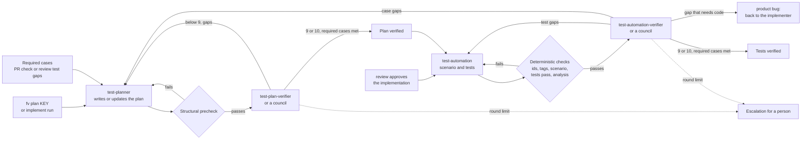

# Feature verification stage

**Who reads this:** C (operators); B before writing stories. How test plans and automated tests are written and verified.

Agents turn each user story into a verified test plan, and, once the implementation of a story is architecture-approved by the [review stage](review.md), into verified automated tests. Every artifact an agent produces is checked by a separate verifier agent that starts with a clean context and loops until it scores at least the required score (9/10, `testPlan.councilPassScore`). Every denial is logged, and recurring denials become lessons that the agents read on their next run (the [retro](retro.md)).

The stage is run as `factory fv <command>` (`factory feature-verification` is the same command). Its defaults are in the engine's `scripts/feature-verification/config.json`; a repository overrides any of them in its `.factory/config.json` ([configuration](../configuration.md)).



## Workflow 1: story to test plan

- Output: `.factory/plans/<story-slug>/_index.md` (`plansDir`; the slug is kept in the ticket's metadata) plus one `TC-<KEY>-NN-<slug>.md` per case, covering every happy and sad path. Each case has front matter (`id`, `type` happy or sad, `sad-path` for sad cases, `covers`, `layer`: `unit`, `functional` or `e2e`), a `# <id>: <title>` heading that holds its title, and the sections `Why`, `Preconditions`, `Steps` and `Expected result`. The title is not in the front matter: Markdown linters count a front-matter `title` as a second top-level heading (markdownlint MD025), and the structural check refuses it.
- The runner owns the index front matter. `story-sha` records the story text the plan was written for and `story-issue` links the story's issue. When the story changes on the board, the plan becomes stale and the agent gets the story diff and updates the affected cases in place, keeping the ids of the others stable. The diff comes from the ticket cache, which keeps every version it fetched, or else from the issue's edit history.
- Every case file has a `## Why` section: the requirement or risk it protects and why it sits at its layer. The plan agent's result also lists what it deliberately left out and why. Both go to the [decision log](#decision-log).
- The verifier sees only the story and the plan. It never sees the planner's reasoning in its own context; the `## Why` sections are part of the plan it reads.

## Workflow 2: implementation to automated tests

1. The implementation agent runs `factory start <KEY>` and, when the line of work is complete, `factory done`.
2. When its turn ends, the dispatcher runs the review stage first. The feature verification stage runs only once the review has approved the current implementation (`review.approvedHash` matches), then starts the automation loop in the background and lets the agent finish. If the implementation changes again, the next approval runs automation again in update mode, so the tests follow the corrected code.
3. The automation loop writes the story's scenario (`.factory/stack/scenarios/<key>/scenario.yaml`: `scenariosDir`, `precheck.scenarioFile`) and tests in the application's own test tree whose names carry their case ids, runs them (when the plan has functional or e2e cases and a test runner runs on the stack, at least one of the story's tests must run on the test stack and load the scenario; `precheck.requireStack: false` turns that off; every UI case must record a `highlight:` or `absent:` keyframe of the state it asserts, from the `demo` fixture, else the precheck sends it back, `precheck.requireUiEvidence: false` turns that off; the automation verifier reports per UI case which keyframe it opened and what it shows, and a case it skipped or whose frame does not show the state caps the score below the pass mark; after the story's own tests pass, each test project they live in runs whole, unfiltered, as CI runs it (a runner's `runAll`), and so does every other test project that covers a service the change touches (the service's `unitTests` and `testProjects` in the project model, or a test project whose manifest references the service's folder), built first; a failure goes back to the automation agent, each run is recorded in `full-project-runs.jsonl` and listed in the PR body, and `precheck.runFullProjects: false` turns it off; the whole projects run once, after the verifier approves the tests, not in every round, unless `precheck.fullProjectsEveryRound` is true; under `implement run` the pass holds one stack slot that the agent and every precheck round share, rebuilding only the services changed since its last build, and takes it down once when the pass ends), and loops with the automation verifier until it scores at least 9/10. If the tests show that the implementation contradicts the plan, the run stops with a `product-bug` escalation instead of weakening the tests.
4. A test runner marked `evidence: true` (the Playwright runner of `packs/playwright`) also gives the agents what the browser showed. Its run writes a manifest (`evidence.manifest`, default `artifacts/e2e-videos/manifest.json`) that lists every test with its status, errors, video and labeled keyframes (see the [`feature-demo-video`](../../skills/feature-demo-video/SKILL.md) skill). When the run fails, the feedback to the automation agent includes each failed test's error and keyframe paths. When the tests pass, the verifier gets every test's keyframes and checks that the screen matches each case (`visual-mismatch`). Only a manifest written by that run is used.

### Test runners

The engine knows no test framework. How a story's tests are found, tagged, built and run comes from `precheck.testRunners`:

- `null` (the default): the runners of the language packs named in `project.languages` (`packs/<id>/tests.json`). `[]`: none.
- An entry is `"<pack>"` (every runner of that pack), `"<pack>/<name>"` (one of them), `{ "use": "<pack>/<name>", ...overrides }`, or a complete runner object.
- Runners are tried in order; the first whose `match` takes a file and whose `discover` finds a unit for it runs that file.

| Runner field | Meaning |
| --- | --- |
| `name` | shown in logs and messages (required) |
| `match` | the files it runs: globs (`tests/**/*.rs`) or extensions (`.rs`) (required) |
| `exclude` | files it never runs (same forms) |
| `roots` | folders searched for its tests when `testRoots` is empty |
| `testFile` | regex: only files whose text matches hold tests, so helpers that mention a case id are not tag-checked |
| `discover` | how files group into runnable units: `{ marker, required, contains, fallbackDepth }`. A file's unit is its nearest ancestor folder that holds a `marker` file (a project or package manifest); `contains` (regex) must match that file's text. Without `discover` there is one unit, the repository |
| `build` | command run once per unit, one unit after another, before any test runs |
| `run` | command run once per unit, all units at the same time (required) |
| `storyTag` | `{ pattern, template, caseTemplate, note }`: `pattern` (regex) must match every test file of the story, so the run command can select the story's tests; the others tell the agents what to write |
| `stack` | `true` for an end-to-end runner that needs the [test stack](../test-stack.md): it runs on a leased [stack slot](#stack-slots), or under the shared stack lock |
| `evidence` | `true` when the run writes the recorded-run manifest (`evidence.manifest`) |
| `env` | extra environment for build and run |
| `lang` | code fence language for its files in agent prompts |
| `notes` | extra lines for the automation agent's task |

Commands, patterns and templates take the placeholders `{files}`, `{unit}`, `{story}` (`SHOP-12`), `{casePrefix}` (`TC-SHOP-12-`), `{storyIdent}` (`shop_12`), `{caseIdent}` (`tc_shop_12_`) and `{storyPascal}` (`Shop12`), for languages whose test names cannot hold a dash. With no runner configured, or for a file no runner takes, the tests are not run (the log says so) and the verifier still reads them.

## Static analysis

With an `analysis` section, the automation precheck also runs the `featureVerification` slot (or reads the head commit's report): a blocking finding the change introduced in a test file the automation wrote fails the precheck like a lint error ([analysis.md](analysis.md)).

## Where it hooks in

The [dispatcher](../internals.md#hooks-and-lifecycle-events) calls the feature verification stage on these events:

| Event | What the feature verification stage does |
| --- | --- |
| `story-start` | reports the story's test plan state |
| `session-start` | resumes plan and automation runs that died; reports the active story's plan and automation state and the implementation bugs its tests found |
| `stop` | after review approval: starts automation in the background, or resumes it if its run died |
| `post-commit`, `post-merge` | nothing: stories are board issues, not committed files, so a commit never starts a plan |
| `pre-push` | the same check as `fv check`: existing plans and tests for touched stories are verified and current (a story with no plan yet passes). A push touches a story through its plan or scenario folder, tests carrying its case ids, or its key in the branch name or a commit message; stories are checked against their cached ticket (fetched when missing) |
| pull request | `.github/workflows/factory-feature-verification-check.yml` (`factory fv check --changed-from <base>`), called from `factory-gate.yml` |

Adding or changing a story never starts an agent: run `factory fv plan <KEY>` (or `--stale`) yourself; `fv plan <KEY>` checks the issue again first. Opt in to automatic planning with `git config fv.autoPlan true`: `factory board fetch` then plans every story it brings in changed, in the background. Bypass the pre-push gate once with `FV_SKIP=1 git push`; CI still enforces it.

## Verifier loops

- Each round starts a new verifier process whose prompt holds only what it needs: the story and plan for plans; the case files, the tests and the scenario for automation. It cannot see the producer's reasoning or earlier verdicts.
- Cheap deterministic checks run before any verifier call:
  - **Plan:** front matter, ids, sections, at least one happy and one sad case, the index lists every id.
  - **Automation:** every case has a test, no test names a case that is not in the plan, the scenario file exists, every test file carries its runner's story tag (`storyTag.pattern`), no fixture type is set up per class in two classes of one test project (a runner's `sharedFixture`; for xUnit, `IClassFixture<T>` twice starts two app hosts in parallel, so the classes share one `ICollectionFixture` collection; the whole project is checked, existing classes included), the scenario validates (`precheck.validateScenario`, when set), and the tests pass (`precheck.runTests`).
  - **Lint:** both run the repository's linters on the agent's files (`precheck.lint`, a command per file extension), so a lint error goes back to the agent instead of failing the pipeline's commit. Before linting, the automation precheck fixes what the same tools can fix on their own (`precheck.fix`), so formatting never costs a round. The engine's default lints and fixes Markdown with `markdownlint` when the repository has it in `node_modules/.bin`; a tool that is not installed is skipped.
- Before the precheck and before the pipeline commits a story's tests, the runner normalizes the plan's table delimiter rows (`|---|` to `| --- |`, `factory fv tidy <KEY>`), which `markdownlint --fix` cannot repair; a verified plan stays verified because only that whitespace changed.
- The automation agent runs the same checks itself before it finishes: `fv precheck <KEY>` (coverage, story tags, fix and lint, scenario validation; `--tests` also runs the tests). A failure it can fix in its own turn doesn't use up a round.
- A verdict passes at the required score (`testPlan.councilPassScore`, 9) or above. Gaps listed with a passing score are minor; they are logged in the metrics but don't block. A lower score without gaps counts as an unexplained gap. Gaps on a failing verdict go back to the producer as its next task.
- Every round is a fresh agent session; work carries over only through the files on disk and the feedback. The last verifier round's gaps stay in the feedback until a verifier runs again, so a precheck failure or a crashed run in between does not hide them from the next round.
- Automation gaps the verifier traces to the case itself (`root_stage: plan`) are sent to the plan loop and attributed to the plan agent in the metrics. That includes cases a test cannot carry out through a public interface; the plan verifier rejects those too (`untestable-expectation`).
- After `testPlan.maxCouncilRounds` or `testAutomation.maxCouncilRounds` (5 each) rounds below the required score, the loop stops and writes `.factory/state/escalations/<KEY>-plan.md` or `<KEY>-automation.md`, which the next agent session is told about ([escalations](escalations.md)).

With `testPlan.councilMembers` or `testAutomation.councilMembers` (or `council.members`) above one, a council of verifiers from the model pool, on several CLIs and models, sits instead of the test plan verifier alone or the test automation verifier alone, under the stage's own round limit and pass score; see [council.md](council.md).

## Crash recovery

A loop saves its round and the feedback for that round in the story state before each round. If the machine crashes or the run is killed, the state still says `running` (or `starting`, or `queued` for the rest of a plan batch) but its process is gone. The run is resumed in the background at the saved round, with the saved feedback and a note that the work on disk is from the interrupted run:

- on the next session start (any interrupted story) or Stop hook (the active story);
- by `factory resume [KEY]` (or `factory fv resume`);
- while `implement run` waits for the tests of a story.

Automation for code that has changed since the run started is dropped, and the Stop hook starts a fresh run for the new code. Each run is resumed up to `recovery.maxRetries` times (default 3), waiting `recovery.retryDelaySec` (60 s) and then twice as long before each retry, so a run that crashes on start does not loop. After that its status is `crashed` and an escalation is written; fix the cause, then run `factory resume <KEY> --force`.

The lessons and factory retro run is not tied to a story and recovers on its own: see [retro](retro.md#crash-recovery).

## Observability

Results are appended to `.factory/metrics/*.jsonl`, which are committed with the plans and tests they describe (`merge=union` keeps every record across branches). [Observability](../observability.md) lists every stream and where they can be shipped. This stage writes:

| File | One record per |
| --- | --- |
| `verifier-runs.jsonl` | verifier round: stage, story, round, score, passed, producer and verifier prompt versions |
| `verifier-denials.jsonl` | gap: category, subtype, case, detail, location, `root_stage`, `attributed_agent` |
| `precheck-failures.jsonl` | failed deterministic check |
| `calibration.jsonl` | audit of a past passing verdict (`agreed`, or each gap the verifier missed) |
| `decisions.jsonl` | agent decision and its reasons (see [Decision log](#decision-log)) |

`factory fv metrics` (or `--json`; `factory metrics` combines every stage) reports denial rates, first-round pass rates, rounds to a passing score, denials by category and agent, the trend for each prompt version (a version is the hash of the agent's base definition, its addendum and its lessons), automation denials traced back to the plan, and calibration misses.

### Decision log

`.factory/metrics/decisions.jsonl` records why each agent decided what it did, at the points where the factory can go wrong. Every stage writes to it (`scripts/pipeline/lib/decisions.mjs`). One record per decision: `ts`, `stage`, `story`, `round`, `agent`, `agent_ver`, `subject` (the agent whose work is judged), `decision`, `reason` (the agent's own summary) and `items`, each with its own `reason`. Text is capped at 1,000 characters and stripped of control characters; `items` at 200 entries.

| `stage` | `decision` | Why it was decided | `items` |
| --- | --- | --- | --- |
| `plan` | `plan-written` | the plan agent's summary of how it split the story; `excluded` lists what it left out and why | each case: id, title, type, layer, `covers` and its `## Why` |
| `plan-verify`, `automation-verify` | `approved`, `denied` | the verifier's summary and `score` | each gap: case, category, subtype, location, `root_stage`, `subject` (the agent it is attributed to) |
| `review` | `approved`, `changes-requested` | the reviewer's summary (`architecture-reviewer`, or `arch-review-agent` for the policy pack with `policy_decision`) | each finding: severity, category, `rule`, `repeat`, file, line, `fix` |
| `bug-triage` | `auto-merge`, `wait`, `review` | the [review gate](review-gate.md)'s assessment of a published bug-fix PR: its severity with the explanation, and what triggered review | each ticket: the three ratings, severity, confidence, reopens, systems |
| `automation` | `product-bug` | the automation agent's summary of why the implementation, not the test, is wrong | each bug: case, expected, actual, location |

Plan decisions are logged each round that passes the structural check, so each pairs with that round's verifier decision. Calibration audits are not logged here (they go to `calibration.jsonl`). The implement stage adds its orchestrator's plans and pair verdicts ([implement](implement-reference.md#decision-log)).

## Auto-improvement

The [retro stage](retro.md) (`factory retro run`; `factory fv lessons` is the older name of the same command) reads these metrics and writes lessons for `test-planner`, `test-automation`, `test-plan-verifier`, `test-automation-verifier`, `implementer` (from blocking review findings, see [review](review.md#how-the-implementer-improves), implementation bugs the tests found, and PR check findings upheld in round 1) and the PR check fixer and critics (see [pr-check](pr-check.md#how-agents-improve)). The thresholds are the `lessons` settings of this stage's config:

| Setting | Default | The retro |
| --- | --- | --- |
| `retro.lessons.storyThreshold` | 3 | **adds** a rule when a denial category recurs in that many stories and no rule covers it, and **strengthens** a rule whose category keeps recurring in that many stories after it was added |
| `retro.lessons.retireAfterStories` | 10 | **retires** a rule when its category has not recurred for that many stories |
| `retro.lessons.revertMinRounds` | 6 | **reverts** a rule when, after that many verifier rounds, the denial rate for its category did not drop |
| `retro.lessons.maxRules` | 15 | keeps at most that many rules per lessons file |
| `retro.intervalDays` | 7 | `retro run --if-due` does nothing when the last run is more recent |
| `retro.lessons.examplesPerCategory` | 5 | examples per category in the digest the `retro` agent reads |
| `retro.enabled`, `windowDays`, `allowedPaths` | `true`, 7, `.factory/agents/`, `.factory/policy/` | the factory retro over the decision log: on or off, how far back it reads when there is no earlier lessons commit, and what the agent may edit besides the lessons files |

Rules are written to `.factory/lessons/<agent>.md` and proposed in a pull request, so every change to agent behavior is reviewed like code. Each rule carries a marker with its category and date, which is what makes the retire and revert measurements possible. The lessons file is appended to the agent's prompt on every run and is part of the prompt version, so the metrics show whether a change helped.

Verifiers improve through calibration: `factory retro calibrate` (also `factory fv calibrate`) audits recent passing verdicts again with a stricter auditor (on the verifier's own pool entry), and gaps the verifier missed become lessons for that verifier.

What a run does, the factory retro, the pull requests it opens and the review-gate approvals proposals are described in [retro.md](retro.md).

## Speed

- **Test run in the precheck.** Runners without `stack` build each unit once, one after another (units often share dependencies), then run every unit's tests at the same time. Stack runners run alongside them.
- **Shared test stack.** By default the machine has one test stack (slot 0), and loading a scenario wipes its data. So a stack runner holds a lock in git's common dir (`.git/pipeline-locks/teststack.lock`), which every worktree shares. Stories in different worktrees write and build their tests in parallel and take turns only on the end-to-end run, unless they run on [stack slots](#stack-slots).
- **Models.** The writers and verifiers each run on their pool entry, `models.agents.<agent>` (`test-planner`, `test-automation`, `test-plan-verifier`, `test-automation-verifier`). Test writing (`test-automation`) uses `sonnet`: it is a long build-and-fix loop where speed matters, and the automation verifier still scores every round. An agent with no entry of its own runs on `models.agents.default`.

### Stack slots

A story's end-to-end run leases an isolated stack slot instead of waiting for slot 0 whenever `featureVerification.slots.enabled` is on (the default; `FV_USE_SLOTS=0` or `1` overrides it for one shell). The run (`scripts/feature-verification/lib/slots.mjs`):

1. leases a slot (`factory stack lease --owner fv-<KEY>`);
2. brings that slot's stack up from the story's worktree (`factory teststack --slot <n> up`), so it runs that worktree's code;
3. runs the runner's command with `TESTSTACK_SLOT=<n>` and `TESTSTACK_URL` set to the slot's base URL;
4. takes the stack down and releases the slot, even when the run fails.

The test-automation agent's session gets a slot of its own the same way (`fv-agent-<KEY>`, with `TESTSTACK_SLOT` and `TESTSTACK_URL` in its environment), so the stack it brings up and tests against is built from its own worktree. The slot is taken down and released when the session ends.

**No slot, no tests on someone else's stack.** Under `implement run`, a lease waits up to `slotWaitSec` (default 21600 s, a ceiling: a lease whose owner died is reclaimed, so it only waits on live runs) for a free slot. When none comes free, nothing runs on slot 0, which holds whatever checkout last built it: the agent session does not start, the precheck reports `No free test-stack slot …`, and the automation stage escalates with that reason. End-to-end specs that name a slot-0 host port literally (`localhost:<port>`, `127.0.0.1:<port>` or `host.docker.internal:<port>` for a port in `stack.ports`) cannot run on a slot, so under `implement run` they are a precheck error. Tests that take their URLs from the environment (or from `factory stack info --slot <n>`) run on any slot; tell the automation agent how in `precheck.automationNotes`. Outside `implement run` (a developer's own checkout) the run uses slot 0 behind the lock, as before.

**How many slots.** `stack.poolSize` in `.factory/config.json` (default 2) is the number of slots agents lease, machine-wide, shared by every run on the machine. `implement run` lowers it to what Docker memory holds (`TESTSTACK_SLOTS_MAX`, see [implement](implement.md#resources)); `TESTSTACK_SLOTS` sets it outright.

**In the PR.** Every lease is recorded in `run-conditions.jsonl` (story, stage, slot, seconds waited, outcome), and the PR body says when a story waited for a slot, did not get one, or ran without a language server.

How slots, ports and scenarios work is in [test-stack.md](../test-stack.md).

## Models

Every agent runs on an entry of the model pool, `models.pool`: its CLI, the CLI's own model id, its effort (default `opus` and `sonnet` on Claude Code, `sol` on Codex). `models.agents.<agent>` names an agent's entry, and `models.agents.default` (`sonnet`) the entry of every agent with none of its own; a name that is not in the pool fails when the config loads. `PIPELINE_MODEL_OVERRIDE=<entry>` runs every agent on one entry, for experiments. To add a model, add an entry to `models.pool` in `.factory/config.json`. See [models](models.md) for the per-CLI view, discovery and `factory models check`.

## Commands

```bash
factory fv status [SHOP-12]
factory fv plan SHOP-12 | --stale | --all [--force] [--background]
factory fv automate SHOP-12 [--skip-tests] [--background]
factory fv precheck SHOP-12 [--tests]      # the automation round's deterministic checks
factory fv tidy SHOP-12                    # normalize the plan's markdown tables
factory fv resume [SHOP-12] [--force]      # resume runs that died; --force also escalated ones
factory fv check [--all] [--changed-from origin/main] [--rev <rev>]
factory fv metrics [--json] [--since 2026-01-01]
factory retro calibrate [--stage plan|automation] [--sample 3]
factory retro run [--dry-run] [--local] [--if-due] [--no-push]
```

Background runs log to `.factory/state/logs/`. The settings (the `featureVerification` section: `enabled`, `timeoutsSec`, `precheck`, `categories`, `testExtensions`, `evidence`, `slots`; and `project.testRoots`, `retro.lessons`) are listed in the [settings reference](../configuration.md#settings-reference).
