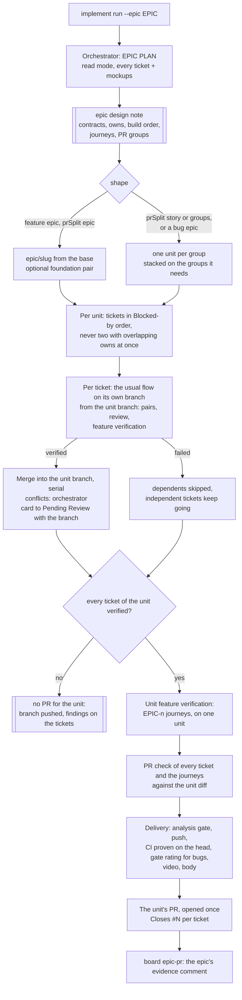
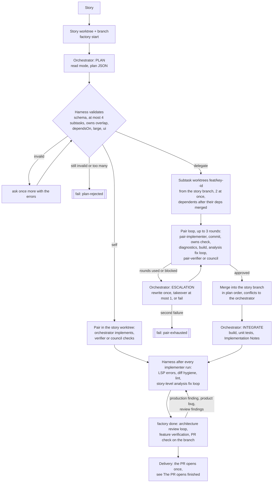

# Implement stage

Give the pipeline story keys (or an epic) from the [board](board.md) and it implements them: one worktree and feature branch per story, the [implementer agent](../../agents/implementer.agent.md) as an **orchestrator** that plans the story into subtasks, **verifier pairs** that implement and check each subtask in its own worktree, then the [architecture review](review.md) loop and [verified tests](feature-verification.md). A deterministic Node harness runs the loops; every agent is a separate headless CLI process, so it works the same with Claude Code, Copilot CLI or `PIPELINE_AGENT_CMD` (Codex is refused by the default [model policy](models.md)). The harness knows nothing about the codebase's language: what a service is, how to build and how to run unit tests come from the project model and the `implement` section of the repository's `.factory/config.json` ([Config](#config)).

```bash
factory implement run --epic checkout --dry-run
factory implement run SHOP-12 SHOP-13                # as many at once as resources allow (--parallel auto)
factory implement run SHOP-12 SHOP-13 --parallel 3 --pr
factory implement SHOP-12                            # a story key, fetched from its issue
factory implement run --epic checkout --pr           # every story of the epic (its sub-issues)
factory implement status                             # live progress, from another terminal
factory implement cleanup [KEY]                      # remove subtask worktrees a failed run kept
factory implement stop                               # end the run and everything it started; nothing resumes it
factory implement resume                             # continue a run that was interrupted
factory implement requeue [--dry-run]                # run the Failed tickets a person resolved
factory implement metrics [--json] [--since <date>]
factory implement decisions [--story KEY] [--json]   # how the orchestrator's choices turned out
```

| Option | Meaning |
| --- | --- |
| `--dry-run` | Print the order, branches and bases, then stop. No agents run. |
| `--parallel N\|auto` | Run up to N stories (or bug groups) at once. `auto` (the default, `implement.parallel`) sizes it from free memory; see [Resources](#resources). Each has its own worktree; dependents still wait for their blockers. |
| `--base <ref>` | Base for stories with no in-batch blocker (default `baseRef`, `origin/main`; fetched first). |
| `--pr` | Push each finished branch and open a PR with `gh`, against its base branch (stacked PRs for dependents). The push and the PR are made as your [PR bot](setup.md#the-pipelines-pr-bot) `dev-bot-<gh login>`, so you can approve the PR yourself; until `factory bot setup` has run, the run warns and uses your own `gh` login. A bug-fix PR then goes through the [review gate](review-gate.md). |
| `--epic <EPIC>` | Implement every story and bug of the epic (its sub-issues on the board, fetched into the ticket cache), in Blocked-by order, in addition to any given. The epic's own ticket folder (its body and mockups) is handed to the agents too, and copied into every worktree of the run. |
| `--delivery epic\|story` | How an epic is delivered (`implement.delivery`, default `epic`): one epic branch and one PR (bug epics: one PR per group of bugs), or a branch and PR per story. See [Delivery modes](#delivery-modes). |
| `--grouping auto\|epic\|ticket` | Bug epics (`implement.epic.grouping`, default `auto`): `auto` lets the orchestrator group the bugs into PRs when most tickets are bugs, `epic` forces one PR, `ticket` one PR per bug. See [Bug epics: PR groups](#bug-epics-pr-groups). |
| `--pr-split epic\|story\|groups` | Feature epics (`implement.epic.prSplit`, default `epic`): one PR for the epic, one PR per story, or PR groups the orchestrator chooses (at most `implement.epic.maxStoriesPerGroup` stories each). See [Feature epics: PR split](#feature-epics-pr-split). |
| `--standalone` | A ticket of an epic whose epic run is in progress gets its own branch and PR instead of joining the epic's branch. |
| `--force` | Also implement stories already implemented (their issue is closed, or this checkout's run record delivered them), and run stories whose [board](board.md) card is already in Pending Review or Done. |
| `--takeover` | Take over board cards another machine holds in In Progress or Testing (otherwise those stories, and stories stacked on them, are skipped). |

## Delivery modes

| Mode | Command | Branches | PRs |
| --- | --- | --- | --- |
| **epic** (default) | `implement run --epic <EPIC>` | `epic/<slug>` from the base, one long-lived epic worktree; each story on its own branch from the epic branch, merged back once verified | one PR for the epic (`Closes #N` for every story and bug), one per story or per group of stories with [`--pr-split`](#feature-epics-pr-split), or one per [PR group](#bug-epics-pr-groups) for a bug epic |
| **story** | `implement run --epic <EPIC> --delivery story`, or `implement run <KEY>...` | a branch per story, stacked on its blockers | one PR per story (with `--pr`) |

A single ticket (`implement run <KEY>`) keeps the story path: its own branch from the base and its own PR. If the ticket belongs to an epic with an epic run in progress (its run state in `.factory/state/implement/epics/<epic>.json` is not delivered and its epic branch exists), it **joins** that run instead: it runs from the epic branch (or its PR group's branch), merges back into it and goes to Pending Review naming that branch, without planning the epic again or opening a PR; the epic run (or `implement resume`) opens the PR. `--standalone` opts out. Bugs (`BUG-*` keys or type bug) take the same paths.

### Epic delivery



1. **Epic branch and worktree.** `epic/<slug>` (`implement.epic.branchPrefix`) from the base, in `../<repo>-worktrees/epic-<slug>`, with the epic's tickets (epic body, stories, mockups) in its ticket cache. Its language server stays warm for the foundation and conflict resolution.
2. **Epic plan.** The orchestrator (read mode, `implement.epic.planTimeoutSec`) reads the epic, every story inline and the mockups, and returns the **epic design note** (`AGENT_RESULT: <note JSON>`): shared contracts, migrations, components and integration events (one owner each), an optional **foundation**, each story's `owns` and extra `dependsOn`, the build order and the cross-story **journeys**. The harness validates it (story keys, journey ids, cycles; `lib/epic-plan.mjs`) and asks once more with the errors. The note is kept as JSON and Markdown in `.factory/state/implement/epics/<epic>.note.{json,md}` and logged in the decision log (stage `implement-epic-plan`, decision `plan-written` or `plan-rejected`). A rejected or blocked plan ends the run before any story starts (every story `blocked`).
3. **Foundation.** Shared groundwork several stories need (a migration, a DTO) runs first as one verifier pair in the epic worktree: the orchestrator implements it inside the foundation's `owns`, a fresh verifier checks it, and it is committed on the epic branch. A failed foundation ends the run.
4. **Stories.** Each story runs the per-story flow ([What happens](#what-happens)) on its own branch from the epic branch's current head; its PLAN task carries the design note. Stories start in Blocked-by order (plus the note's `dependsOn`) once their blockers are merged, up to `--parallel` at once, and two stories whose planned `owns` overlap never run at the same time. A verified story is merged into the epic branch (`<KEY>: Merge into epic/<slug>`, one at a time under a lock shared with joined tickets); a conflict goes to the orchestrator in the epic worktree, and an unresolved one ends the story `merge-conflict`. After the merge the runner publishes the ticket and moves its card to Pending Review with `board review <KEY> --epic-branch <branch>` (no PR per story). A failed story's dependents are skipped; independent stories keep going.
5. **Epic-level feature verification.** When every story is verified and merged, the journeys become a ticket `EPIC-<epic issue number>` in the epic worktree's cache, and the feature verification stage plans and automates it like a story (cases `TC-EPIC-<n>-NN`). `implement.epic.featureVerification: false` skips it.
6. **PR check.** Before it, each story's cached ticket (with its Implementation Notes, which its plan's `story-sha` covers) is copied into the unit worktree, so the check and the pre-push feature verification check read the text the plan was verified against. The stories' workers skip the Stop hook's per-story background check (`PR_CHECK_SKIP=1`); this one covers them. One run of the PR check over every story and the journey ticket against the whole epic diff (`pr-check run --stories K1,K2,EPIC-n`; each frontend story gets the design lens). `implement.epic.prCheck`: `fix` (default; fixes committed on the unit branch), `report` or `off`.
7. **One PR.** With `--pr`: the unit goes through the same delivery as a single ticket ([The PR opens finished](#the-pr-opens-finished)): CI's analysis jobs on the head, the push, CI proven on the head, then one PR opened against the base, titled for the epic, whose body lists every story with its outcome, orchestration, review rounds, bug-fix cycles and PR check, the journeys' feature verification, the implementers' follow-ups, `Closes #N` for every story and bug and `Part of #<epic>`. Then `board epic-pr <epic#> --pr <url> --branch <branch>` records it on the epic's evidence comment. Without `--pr` the run ends `complete` with the body saved in the epic run state.

The epic PR is opened only when every story that ran is verified and merged; otherwise the run ends with the epic's failed and skipped list (`stories-failed`), and the cards of failed stories go to Failed as usual. `implement status` shows each epic run (plan, foundation, merged, running, failed and skipped stories, each unit's branch, feature verification and PR), and `implement resume` continues an interrupted epic: the note, the foundation and merged stories are kept, a story that finished but was not merged is merged, interrupted stories resume in their worktrees. The epic state records the phase it is in (`plan`, `foundation`, `units`, `summary`, `finished`) before each step; a step that throws leaves the epic `interrupted` (outcome `crashed`, with the phase and the error), never `running`, and the records the run wrote in this checkout (the epic plan's usage and decisions) are shipped to the metrics store whatever happened. A unit PR check that ends escalated in fix mode (or still upholds findings at `fixUntil` or worse) is a failure before the open: no PR, the branch pushed, the findings on the tickets. A feature group's PR title never repeats the epic's title.

### Bug epics: PR groups

An epic whose tickets are all or mostly bugs (type `bug` or `BUG-*` keys; `--grouping auto`) is not delivered as one PR. Its epic plan (run from this checkout) also returns `prGroups: [{id, title, tickets, reason, risk}]`: the orchestrator decides which bugs ship together, grouping by shared service or area, overlapping files, a shared root cause or Blocked-by, and keeping each PR reviewable; unrelated or risky fixes (security, data) ship alone. The harness checks the grouping: every ticket in exactly one group, a ticket's Blocked-by tickets (and the tickets the note's `dependsOn` names) in the same or an earlier group, and at most `implement.maxBugsPerGroup` tickets per group when that is a positive number (default `null`: no cap). An invalid grouping goes back once with the errors; if only the grouping is still wrong, the run falls back to one PR per bug. `--grouping ticket` skips the orchestrator's grouping (one PR per bug), `--grouping epic` delivers the bug epic like a feature epic.

Each group gets `bugfix/<epic-slug>/<group-id>` (`implement.epic.bugfixPrefix`) from the base, stacked on the branch of a group it depends on (a group holding a Blocked-by or `dependsOn` ticket of one of its tickets), and its own worktree. Its tickets run the usual per-ticket flow one at a time and merge into the group branch; then the group gets one PR check of all its tickets (`run --stories`) and one PR with `Closes #N` for each of its tickets and why they were grouped. Groups run in parallel, up to `--parallel` groups at once; a group whose dependency group failed is skipped. Each ticket's card goes to Pending Review with its group's PR, and `board epic-pr <epic#> --pr <url> --branch <branch> --group <id>` lists every group PR on the epic's evidence comment. Once a group PR is open, the [review gate](review-gate.md) assesses it (as it does a single-ticket bug PR); nothing before the PR changes. The epic-level journeys are skipped unless the plan lists journeys whose tickets are all in one group.

Before a group (or a feature epic's branch) is pushed, tickets whose verified tests went stale because a later ticket on the same branch edited the same spec file (`fv check`: "tests or scenario edited after verification") are automated again in the unit worktree, which re-runs their feature verification verifier, and the result is committed. If one does not verify again, the unit ends `fv-reverify-failed` and gets no PR; the pre-push feature verification check is never bypassed.

The grouping is a decision (stage `implement-epic-plan`, decision `pr-groups`, `items` = the groups with their reasons, `fallback` when the harness grouped one per ticket), and every group's outcome is a `type: "pr-group"` record in `decision-outcomes.jsonl` (`groupId`, `tickets`, `verified`, `failed`, `skipped`, `pr`, `outcome`, `cost_usd`, `mergeConflicts`). Both are written in this checkout's `.factory/metrics/` (a bug epic has no single branch to commit them to). `implement decisions` labels a group **`bad-grouping`** when some of its tickets verified and others did not (the failure held back a PR that was ready), or when merging its tickets conflicted.

### Feature epics: PR split

A feature epic is delivered as one PR by default. `implement.epic.prSplit` (or `--pr-split`) chooses another split; a bug epic keeps its own grouping (above) whatever this says, and `--grouping epic|ticket` still overrides both.

| `prSplit` | PRs | Who decides |
| --- | --- | --- |
| `epic` (default) | one PR for the whole epic, from `epic/<slug>` | today's behaviour |
| `story` | one PR per story, from `feat/<slug>--<story>` | the harness (one group per story); the orchestrator still writes the design note |
| `groups` | one PR per group of stories, from `feat/<slug>--<group>` | the orchestrator (`prGroups` in its plan), checked by the harness |

The groups are the bug epics' machinery, reused: the same plan validation (every story in exactly one group; a story's Blocked-by and `dependsOn` stories in the same or an earlier group; at most `implement.epic.maxStoriesPerGroup` stories per group when that is a positive number, default `null`; one retry with the errors, then one PR per story), the same scheduling (a group that needs another group's stories is stacked on its branch and waits for its PR), and the same single delivery: each group's PR opens once, after every agent stage of its stories, on a head CI proved green, with only deterministic steps after the open. What differs from a bug group: the branches are feature branches, the PR gets no bug-fix rating from the review gate (as a feature epic's PR), and the plan cannot have a foundation (there is no epic branch for it; shared groundwork belongs to the first group that needs it).

**Cross-story journeys when the epic is split.** Every journey of the design note is verified once, on one group: the last group in dependency order that holds a journey story. The harness stacks that group on every other group that holds a journey story (it adds the dependency when the plan did not), so its branch has every story the journeys cross, and its unit-level feature verification plans, automates and checks all of them under the epic's test key (`EPIC-<n>`), followed by its PR check. The other groups verify only their own stories. The decision is recorded in the run state (`units.<id>.journeys: true`) and logged. Why one group: one test key and one set of journey specs per epic (two groups writing `EPIC-<n>` cases would collide), and a journey can only be shown on a branch that has all its stories.

## What happens



1. **Plan.** Every key given is fetched from its issue into the ticket cache (`.factory/state/board/<KEY>/`; an unchanged issue is not downloaded again), and its cached `story.md` is the story. A cached `story.md` path, or a `<KEY>-<title>.md` file or folder of them, works too. A story whose issue is closed, or that this checkout's run record shows delivered, is skipped as already implemented; a heading in the ticket's text never decides it. Each story's `**Blocked by:**` line is parsed. Stories blocked by others in the batch run after them, and a dependency cycle is an error. Blockers outside the batch are left to the implementer, which checks that their code exists.
2. **Worktree.** Each story gets `../<repo>-worktrees/<key>` on `feat/<key>-<title>`. A story with no in-batch blocker branches from the base. A dependent stacks on the branch of the blocker that already contains the most of its other blockers and merges in the rest; a merge conflict marks the story `blocked`. Rerunning reuses existing worktrees and branches. The story's ticket folder (story, metadata, its own mockups) is copied into the worktree's ticket cache, and into each subtask worktree, so every stage there reads the same text; nothing about the story is committed. When the story finishes, the runner publishes the cached story (with the implementer's Implementation Notes) back to its issue (`board publish`). The runner calls `factory start`, and starts the language server daemon for the story worktree (unless `implement.lsp.enabled` is `false`; see [Language servers](#language-servers)).
3. **Orchestrator plan.** The implementer agent runs in PLAN mode (read-only) and ends with `AGENT_RESULT: <plan JSON>` (a last fenced `json` block is accepted too). The harness validates it (see [Plan](#plan)); an invalid plan goes back once with the errors, then the story fails `plan-rejected`. More than `maxSubtasks` subtasks fails at once with "split the story". An orchestrator that reports the story blocked ends it `blocked`.
4. **Verifier pairs.** For each subtask the harness creates `../<repo>-worktrees/<key>--<id>` on `feat/<key>--<id>` from the story branch's current head (copying the story worktree's graphify graph when it has one, running `implement.prepareCmd` when one is configured, for example a dependency restore, and starting the language servers with the subtask's `owns`). Then, up to `maxPairRounds` times:
   - the **pair-implementer** (implement mode, the subtask's model class, no subagents) implements and commits;
   - the harness checks the diff against `owns`: any other changed file fails the round with a finding naming it (the verifier is not asked);
   - the harness runs language server diagnostics on the changed files, every command in `implement.checks` (the build, a linter, whatever the repository configured) and the unit tests of each service with changed files and of every service that lists one of those in `dependsOn` ([Config](#config)); a failing command fails the round. With no checks configured nothing runs and the verifier is told so;
   - a fresh **pair-verifier** (read mode, model class `medium`) gets only the subtask spec, the diff against the story branch and that output, and returns `APPROVED` or `CHANGES_REQUESTED` with findings tied to file and line. For `verify: "ui"` subtasks the **pair-ui-verifier** (verify mode, model class `large`) checks the running app instead (see [UI verification](#ui-verification)). Diagnostics errors in changed files block approval whatever the verdict;
   - blocking findings, screenshot paths and diagnostics go verbatim to the next implementer round. A verdict that breaks the output contract is asked for again once; if it is still unusable the round is spent and the next round only re-verifies.

   Subtasks whose dependencies are merged start as soon as a pair slot is free (`maxConcurrentPairs` per story). Every agent run also takes one of `maxConcurrentAgents` machine-wide slots (lock files under the git common dir, shared by all worktrees and story processes; a slot held by a dead process is reclaimed).
5. **Escalation.** A pair that uses all its rounds or reports blocked goes back to the orchestrator (implement mode, in the subtask worktree with the pair's last attempt, all findings in the task). It returns `rewrite` (a corrected spec, validated against the other subtasks' `owns`; a fresh pair runs it once from the story branch), `takeover` (it implements the subtask itself, there and then; a fresh verifier checks it and its findings come back to the orchestrator; at most `maxTakeovers` per story) or `fail`. A second failure fails the story `pair-exhausted` with every finding. A failing story aborts its other running agents.
6. **Merge.** Approved subtask branches are merged into the story branch one at a time in plan/dependency order (`<KEY>: Merge subtask <id>`, `--no-ff`). A conflict goes to the orchestrator in the story worktree, which resolves and commits it; the harness then builds, and a failure (or language server errors after any merge) is passed to the integration pass. An unresolved conflict fails the story `merge-conflict`. Merged subtasks' worktrees and branches are removed (their language servers stopped first). A failed story keeps them for debugging: `implement status` lists them and `implement cleanup` removes them.
7. **Integrate, review, test.** In delegate mode the orchestrator runs once more in INTEGRATE mode in the story worktree: build, existing unit tests, make the pieces fit, Implementation Notes, commit. (Self mode skips this; its verifier already approved the story.) Language server errors in the story's changed files go straight back to it. Then, as before: the runner runs `factory done` and fires the stop hook; review findings become the next orchestrator task (review rounds, escalation and `maxRounds` are the review stage's own); on approval feature verification writes and verifies the tests in the background, and implementation bugs feature verification finds go back to the orchestrator up to `maxBugFixCycles` times.
8. **Finish.** The runner appends to `.factory/metrics/implement-runs.jsonl` and the [decision log](#decision-log) and commits them with the feature verification output (`<KEY>: Add verified test plan and automated tests`); a story that stops earlier commits its metrics alone (`<KEY>: Record implement metrics`). With `--pr`, the PR check on the branch and its returns come first ([below](#findings-about-the-production-change-go-back-to-implementation)), then the delivery opens the PR once ([The PR opens finished](#the-pr-opens-finished)); a bug's PR (single ticket or bug-epic group) is rated by the [review gate](review-gate.md) before the open and auto-merged or sent for review after it. The [board stage](board.md) follows the run: the batch claims each story's card (In Progress) after `board sync`, the runner moves it to Testing when the review approves and feature verification starts, back to In Progress when feature verification finds a product bug, and to Pending Review when the PR opens; after the batch, every story that did not finish goes to **Failed** with the outcome, reason, findings (for example the verifier findings of the subtask that ran out of rounds), branch and log.

The review and feature verification stages run against the worktree (`PIPELINE_ROOT`) with the engine that ran the command, and read the worktree's own `.factory/config.json`. A dependent's review diff is against its blocker's branch, so it sees only its own changes.

`IMPLEMENT_ORCHESTRATE=0` (or `implement.orchestrate: false`) runs the previous flow instead: one implementer agent implements the whole story, then the same review loop, feature verification and PR.

## Static analysis in the pair rounds

With an `analysis` section ([analysis.md](analysis.md)), after each pair-implementer run and before the pair verifier or council, the harness applies the tools' auto-fix (committed as the implementer), runs the `pair` slot's tools on what the subtask touched, and hands provable findings back to the implementer for up to `analysis.fixLoop.bounces` (2) extra runs. A bounce is not a pair round. What stays open reaches the verifier as harness findings (`source: tool`), outside the council's votes and disputes; blocking ones send the round back. After the pair rounds, the `story` slot runs once on the whole story with the same budget. Pre-existing findings in touched code are follow-ups. Every bounce is one agent run, counted against `maxAgentRunsPerStory` and the story's wall clock like any other (a bounce is not a pair or council round, so the round limits do not move). Worst case per pair round: `fixLoop.bounces` more runs; size `maxAgentRunsPerStory` with that in mind. The run record carries `analysisBounces` and `analysisFixed`.

## Plan

```jsonc
{
  "mode": "delegate" | "self",
  "modeReason": "<one short sentence>",                 // required
  "splitReason": "<one short sentence>",                // required for delegate
  "uiStory": true | false,                              // checked against the story
  "features": { "services": ["orders-api"], "estimatedSize": "small" | "medium" | "large" },
  "notes": "<optional>",
  "subtasks": [{
    "id": "api",                                        // [a-z0-9-], unique
    "goal": "...", "acceptance": ["..."],
    "owns": ["services/orders-api/**"],                // globs: * in a segment, ** across, bare path = subtree
    "dependsOn": [],
    "modelClass": "small" | "medium" | "large", "modelReason": "...",
    "model": "<optional allowed alias, e.g. sol on Copilot>",
    "justification": "...",                             // required for large
    "verify": "code" | "ui", "verifyReason": "...",
    "scenario": "<optional: the name of an existing test stack scenario for ui>",
    "expectedFiles": 3, "expectedLoc": 120, "confidence": 0.8,
    "alternatives": [{ "option": "...", "reason": "..." }]
  }]
}
```

The harness enforces (pure functions in `scripts/implement/lib/plan.mjs`, unit tested):

- the schema above; reason, expectation and confidence fields are required (they feed the decision log and never reach a verifier);
- at most `maxSubtasks` subtasks, otherwise the story fails at once with "split the story";
- no two subtasks' `owns` can match the same file (glob intersection, not just prefixes), no `owns` that covers the whole repo, no absolute or `..` paths;
- `dependsOn` names other subtasks and has no cycle;
- at most `maxLargeSubtasks` subtasks with model class `large`, each with a `justification`;
- `verify: "ui"` (and `uiStory: true`) only for **UI stories**: the story has mockups, its title opens with a tag from `implement.uiStory.titleTags` (default `[FE - ...]`), the title's component list (`[XX - a, b]`) names a frontend service (`implement.uiStory.components`; by default the names of the services with `kind: "frontend"`), or the story names a file that matches `implement.uiStory.filePatterns` (by default `project.frontendPaths` plus the frontend services' paths);
- `self` mode (meant for one service or about `selfModeMaxFiles` files) takes at most one subtask entry; the implicit subtask owns everything and is implemented by the orchestrator in the story worktree, still checked by a verifier.

## UI verification

UI verifiers run against an isolated app stack slot, through one adapter (`scripts/implement/lib/stack.mjs`) over two commands: the slot registry (`implement.ui.slotsCmd`, by default the engine's `factory stack`) and the repository's own stack command (`implement.ui.teststackCmd`: `factory init` drafts `["node", ".factory/bin/factory.mjs", "teststack"]` when the repository has a test stack, and `factory doctor` flags a stack without it). The [test stack](../test-stack.md) page describes both.

1. Lease a slot on the pair's first UI round and keep it for the rest of the pair: `factory stack lease --owner <KEY>--<id> --pid <harness pid> --wait-sec <leaseWaitSec>`. No free slot: retry every `leaseRetrySec` until the story's wall clock runs out (then `limit-wall-clock`). The lease is renewed every `renewEverySec`.
2. From the subtask worktree, every round: `<teststackCmd> --slot <n> rebuild-changed --base <story head the subtask branched from>`, then `up` on the first round only, then `load <scenario>` when the subtask names one. The plan may name only a scenario folder that exists (the ones not starting with `_`); anything else sends the plan back with the list, and the subtask's goal says what data the verifier must set up itself, which the verifier then does through the slot's services. `rebuild-changed` runs first so that `up` does not rebuild every image each round: it builds only the affected images (all of them when the slot's images came from another worktree) and, once the stack is running, recreates only those containers. A failing step is a blocking finding for the implementer. It is the harness's finding, not a verifier's: no verifier ran, so the implementer cannot dispute it away, and the round cannot approve. Without a `teststackCmd` the harness starts, loads and stops nothing (logged once), and the verifier uses whatever runs at the leased slot's URL. Build time (builds share a machine-wide lock) counts as stack wait in the metrics.
3. When the story has mockups (its own, and the epic's in an `--epic` run), the harness copies their renders every round into `artifacts/pairs/<KEY>/<id>/round-<r>/mockup/` (see [Mockups](#mockups)).
4. The pair-ui-verifier (verify mode: shell yes, file edit tools and git writes no) gets the app's URL (the lease's `baseUrl`) and `artifacts/pairs/<KEY>/<id>/round-<r>/` (`implement.ui.screenshotsDir`, in the story worktree; keep it ignored by git) for screenshots, plus the mockup files and renders. It drives the app with its own Playwright script, checks every acceptance criterion, and screenshots the app at each mockup screen and state the subtask builds (`actual-<screen>[--<state>].png`) to compare with the render. It returns findings that reference screenshots; a difference from the mockup in layout, copy, labels or states is a finding with `category: "design"` and both paths, `mockup` (the render) and `actual` (the app). The paths, and the renders, go to the next implementer round. Anything it leaves in the worktree is discarded.
5. When the pair ends (approved, exhausted, blocked or failed), in a `finally`: `<teststackCmd> --slot <n> down`, then `factory stack release --slot <n>`.

### Mockups

The builders see the design from the start, not only the PR check at the end:

| Agent | Gets |
| --- | --- |
| Orchestrator (plan) | The absolute mockup files of a UI story, and the instruction to give UI subtasks `verify: "ui"` and name the mockup screens and states each one builds in its acceptance criteria |
| Pair implementer (`verify: "ui"` subtasks) | The same files, the instruction to match layout, copy, labels and states (the story wins where they disagree), the previous round's renders, and `mockupScreens` in its result (the screens and states it built, passed to the verifier) |
| Pair UI verifier | The files, the README, and PNG renders of every screen and state, every round |

`scripts/implement/lib/mockups.mjs` finds the files (the story's `mockups/` folder, and the epic's when the epic was handed to the run) and renders them with Playwright's Chromium, offline (remote fonts and assets fall back):

- **Design canvas files** (`.dc.html`, the board's mockup format): a template inside `<x-dc>` with `{{expressions}}`, `<sc-if value>` and `<sc-for list as>` blocks, and a `<script data-dc-script>` whose `Component extends DCLogic` computes the values from `this.props` and `this.state`. The canvas runtime (`support.js`) is not shipped with the files, so the renderer brings a small one. It renders the default state, then each boolean or enumerated prop in `data-props` (`section: "State"` switches such as `showValidation`) and each boolean initial state (`confirmOpen`, `ended`) flipped, at most 8 per screen, at the canvas's preview size (or its `canvas.json` artboard). Files are `<folder>__<Screen>[--<state>].png`; `manifest.json` lists screen, title (from `canvas.json`), state, source and PNG.
- **Any other HTML file** is rendered as one full page; **images** are used where they are.
- **Cache:** renders are keyed by the sha256 of the mockup files (names and bytes) and the renderer version, stored once in `artifacts/pairs/<KEY>/.mockup-cache/<sha>/` and copied into each round's `mockup/` folder. A render that fails is reported to the verifier, which then reads the sources.

`factory mockups diff <mockup.png> <actual.png> <out.png>` writes a pixel diff (differing pixels in red) and prints the differing ratio. The verifier may attach it to a design finding as `diff`; sample data and fonts make every diff noisy, so it is evidence, never the verdict. `factory mockups render <out-dir> <files...>` renders mockups by hand.

The UI pair's members are checked for an unchanged tree like every other member: a UI verifier may write only into the declared artifact folders (`implement.ui.artifactDirs`, default `artifacts`, `test-results`, `playwright-report`, `blob-report`; git-ignored files never count). A round in which a member changed anything else has no result. Before C16 this check was off for UI pairs, whose Codex member runs with `workspace-write` and network to drive the browser.

## Nits and scope

Pairs work to the ticket, not to taste. Every finding gets an id (`<subtask>-r<round>-<n>`; a verifier that raises it again keeps it), and `scripts/implement/lib/disputes.mjs` runs the exchange:

1. **Verifiers** (pair-verifier, pair-ui-verifier) judge against the subtask's acceptance criteria and `owns`, the mockup and correctness and security. Nits (style, naming, preference) are `minor`, which never blocks; work beyond the ticket is never requested.
2. **Implementers** do not act on nits or scope-widening requests, and do not ignore them silently: their result lists `disputes: [{finding, kind: "nit" | "out-of-scope", reason}]` (the reason cites the acceptance criterion, `owns` or mockup), and real problems outside the ticket go to `followUps: [{title, reason}]`.
3. **The next verifier round** gets the disputes and rules on each (`disputes: [{finding, decision: "accepted" | "reasserted", evidence}]`): accepted drops the finding; re-asserted raises it again with the same id and evidence that the ticket's acceptance criteria, the mockup or correctness/security require it. A disputed finding raised again without evidence is accepted and demoted to minor, so a dispute alone never leaves a finding "unaddressed".
4. **No ping-pong:** a finding re-asserted twice (`MAX_REASSERTS`) can no longer be disputed; a further dispute is `overruled`, the finding stays blocking and the implementer is told to fix it or report blocked. The round limit still applies.

The same rule holds above the pairs, with the same JSON shape (`lib/feedback.mjs`): architecture review findings and feature verification bugs reach the orchestrator with ids (`review-r<n>-<i>`, `fv-r<n>-<i>`). It fixes what the acceptance criteria, correctness, security or the mockup need, disputes nits and scope creep in its result, and lists follow-ups. Review disputes are written to `.factory/state/review/<KEY>.disputes.json` in the story worktree; the next review round shows them to the reviewer, which accepts them or re-raises the finding with evidence (`scripts/review/lib/review.mjs`). A finding raised again keeps the id it was disputed under, so a finding re-asserted twice stays blocking there too. Feature verification bugs are failing tests, so their disputes are only recorded. The orchestrator's disputes and follow-ups are logged in the decision log (stage `implement`, decision `disputed` or `follow-ups`), the reviewer's rulings in its `review` entry (`disputes`), and `implement-runs.jsonl` carries `disputes` {`nit`, `outOfScope`, `total`} and `follow_ups` (the pairs' and the orchestrator's). In epic delivery each ticket's follow-ups are kept in the epic run state and listed in the epic (or group) PR.

Recorded: per round in `subtask-runs.jsonl`, `disputes` {`nit`, `outOfScope`, `accepted`, `reasserted`, `overruled`, `followUps`}; in the `implement-verify` decision-log entry, `disputes` [{`finding`, `kind`, `reason`, `ruling`, `evidence`}], `follow_ups`, and on each item its `id` and `dispute` {`kind`, `ruling`}. Follow-ups are collected per subtask (`followUps` in `subtask-runs.jsonl`) and for the story (`followUps` in its `type: "story"` record in `decision-outcomes.jsonl`, and in the run's progress), to be filed as new tickets; filing them is not automatic.

With `council.stages.pairVerify` or `council.stages.pairUiVerify` in `.factory/config.json`, a council of verifiers on several CLIs and models replaces the pair verifier (`pairVerify`) or the pair UI verifier (`pairUiVerify`); each member is an agent run of the story, so size `maxAgentRunsPerStory` for it, and its rounds replace the stage's round limit; see [council.md](council.md).

## Resources

`--parallel auto` (the default) sizes the run from the memory free right now (`lib/resources.mjs`): `os.freemem`, plus on macOS the inactive and purgeable pages `vm_stat` reports, and Docker's `MemTotal` (`docker info`). From the budget (free memory minus `resources.reserveGb`, default 6) it derives, and prints with the reasons at the start of the run:

| Value | Rule (`resources.*`; the defaults are the engine's) |
| --- | --- |
| `parallel` (tickets or bug groups at once) | budget / (`worktreeGb` 3 + `agentGb` 0.5), at least 1, at most the CPUs and `maxParallel` |
| `maxConcurrentPairs` per story | 2 when each ticket's share also holds a second pair (`lspServerGb` 0.8 + `agentGb`), else 1 |
| `maxConcurrentAgents` | per ticket, its pairs (`maxConcurrentPairs`) times the verifiers a pair's council seats at once (at least 2), at most the CPUs; `implement.maxConcurrentAgents` set in `.factory/config.json` wins |
| `LSP_MAX_SERVERS` (passed to `lspd`) | one per ticket plus what the rest of the budget holds at `lspServerGb` each, at most one per ticket and per pair |
| `TESTSTACK_SLOTS_MAX` (an upper bound for `stack.poolSize`, the machine-wide number of leasable stack slots) | (Docker memory - `dockerOverheadGb` 1 - slot 0) / `stackGb` 1.6; not set when Docker's memory is unknown. `TESTSTACK_SLOTS` sets the pool size outright |

The defaults were measured on one application; set `worktreeGb`, `lspServerGb` and `stackGb` to what a worktree with a warm language server, one more language server and one stack of your codebase take. With the defaults, on a 48 GB, 14-CPU machine with about 30 GB free and a 15.6 GB Docker VM this gives 6 tickets at once (8 with 34 GB free), 6 stack slots and 12 agents. The values go to every process of the run (`IMPLEMENT_RESOURCES`) and into each `implement-runs.jsonl` record (`resources`). Before a new ticket, group or verifier pair starts, the harness checks free memory again and waits while it is below the reserve (every `waitPollSec` 15, at most `maxWaitSec` 1800, then starts anyway). An explicit `--parallel N` (or a number in `implement.parallel`) turns auto sizing off; `LSP_MAX_SERVERS`, `TESTSTACK_SLOTS`, `IMPLEMENT_MAX_AGENTS` and `IMPLEMENT_MAX_PAIRS` in the environment win over the derived values. Disk is checked the same way: a run refuses to start below `prune.minFreeGb` free (after pruning what no run needs) and a new ticket, group or pair pauses while space is short; see [disk.md](disk.md). Under `implement`, feature verification runs each story's e2e specs on a leased stack slot built from its worktree, even one ticket at a time ([feature-verification.md](feature-verification.md#stack-slots)).

## Language servers

The harness reaches the language servers ([code intelligence](../code-intelligence.md)) through one adapter, `scripts/implement/lib/lsp.mjs`. With `implement.lsp.enabled: false`, or when a language server is missing or unavailable, every call degrades to "no information" and the run carries on; agents fall back to graphify.

- **Start and stop.** In each new worktree the harness runs `implement.lsp.setupCmd` (it checks that the configured servers can be found; a problem is logged, not fatal) and then `lspd start`: for the story worktree the whole checkout, for each subtask worktree with the subtask's `owns`, so a language server that has a scope module loads only the part of the checkout that owns those globs. Each daemon is stopped before its worktree is removed, when the story ends, and in `implement cleanup`. A server that is unavailable (the machine-wide cap `LSP_MAX_SERVERS`) is logged, and one still loading is not a failure.
- **Diagnostics.** `lspd diagnostics` runs on the changed files after every pair round, merge and orchestrator run. Errors block approval; a language whose server is not ready reports nothing.
- **Agents.** The agents get the `lsp` MCP server through `scripts/pipeline/lib/agents.mjs`: implement and write modes the whole server, read and verify modes only its read-only tools (Copilot runs in the worktree with `--trust-folder` so `.mcp.json` loads; Codex gets the server inline). They use it for precise work after graphify located the code: definitions and callers before changing code, find-references before changing a signature (verifiers run it on every changed signature), diagnostics after edits.
- **Metrics.** Each run's LSP calls are counted from `<worktree git dir>/lsp/calls.jsonl`. A pair implementer that changes the signature of a non-private function or method without a find-references call sets `signatureChangesWithoutReferences` for the story and, once per subtask, answers it before the verifier or council sits: the harness hands the changed signatures back to the implementer (run find-references and update the callers, or say why none exist), in a bounce that is not a pair round, and records the answer on the round (`codeIntelligence`). A passing verifier or council round is never followed by another round for it. A pass the harness overrides (compiler errors, blocking tool findings, outside the council's votes) records why on the round (`continuedBy`). The harness recognises a signature from the changed lines with one pattern for the common declaration styles; `implement.lsp.signaturePattern` (a regular expression matched against each changed diff line, its leading `+` or `-` included) replaces it for a codebase it does not fit.

## Outcomes

`implement run` prints a table at the end and exits 0 only when every story is `done` (or skipped as already implemented).

| Outcome | Meaning | Dependents |
| --- | --- | --- |
| `done` | Implemented, approved by the review, tests verified, all committed | run |
| `blocked` | The orchestrator (or implementer) reported the story unimplementable (for example an Open Question that changes the design), or blockers' branches conflict | skipped |
| `plan-rejected` | The plan broke the rules twice, or had more than `maxSubtasks` subtasks ("split the story") | skipped |
| `pair-exhausted` | A subtask was not approved after its rounds and one escalation (rewrite or takeover) | skipped |
| `merge-conflict` | The orchestrator could not resolve a conflict merging a subtask (or, in epic delivery, merging the story into the epic or group branch) | skipped |
| `model-policy` | A model the accepted plan needs (or a role's CLI) is not allowed by the model policy | skipped |
| `limit-agent-runs`, `limit-wall-clock` | The story hit `maxAgentRunsPerStory` or `storyWallClockSec` | skipped |
| `no-changes` | The implementer finished without changing implementation files | skipped |
| `review-escalated` | The review did not approve within its round limit; see `.factory/state/escalations/` | skipped |
| `unresolved` | Still not approved after `maxImplementerRuns` implementer runs | skipped |
| `fv-<status>` | Tests did not verify: `product-bug` (after the bug-fix cycles), `escalated`, `blocked-on-plan`, `crashed`, `timed-out` | skipped |
| `skipped` | Already implemented, or a blocker did not finish | skipped |
| `error` | The runner itself failed; see the story's log | skipped |
| `needs-decision` | The PR check raised a question only the ticket's owner can answer; it is asked on the ticket and no PR opens | skipped |
| `pr-check-incomplete`, `pr-check-escalated` | The PR check did not finish, or (an epic unit) ended escalated or still upheld findings at `fixUntil` or worse: no PR, the branch pushed, the findings on the tickets | skipped |
| `not-delivered` | The push or the open failed for a reason other than a refusal of the text (for example a re-verification of another story's tests failed) | skipped |
| `pr-refused` | Every stage passed and CI proved the head, but the code host refused the PR's text even with the shortest body (below); the head and the delivery's input are kept, and `implement run` or `implement resume` opens the PR later with no agent | skipped |

Every non-`done` outcome carries a `reason` and, where there are any, `findings` (plan errors, the verifier findings of a failed subtask, feature verification bugs) in `.factory/state/implement/<KEY>.json`; `implement run` posts them on the card it moves to Failed (`board fail`).

Each story's log is under `.factory/state/logs/implement-<KEY>-*.log` in the main checkout. `implement status` shows where each story is, with its mode, agent runs and each subtask's state and round, and lists subtask worktrees still on disk. The accepted plan is in the story worktree's `.factory/state/implement/<KEY>.plan.json`. Per-story pipeline state (review rounds, feature verification status, escalations) is in the worktree's own `.factory/state/`; run `factory status <KEY>` from inside the worktree to see it.

## Limits

| Limit | Default | What happens when it is reached |
| --- | --- | --- |
| `maxSubtasks` | 4 | Plan rejected: split the story |
| `maxConcurrentPairs` | 2 | Further subtasks wait (per story) |
| `maxConcurrentAgents` | 6 | Agent runs wait for a slot (machine-wide, across stories) |
| `maxPairRounds` | 3 | The pair escalates to the orchestrator |
| `maxTakeovers` | 1 | A second takeover is refused; the subtask fails |
| `maxLargeSubtasks` | 1 | Plan rejected |
| `maxAgentRunsPerStory` | 20 | Story ends `limit-agent-runs` (every harness-run agent counts, including the orchestrator's integration and fix runs; review and feature verification agents are their stages' own) |
| `storyWallClockSec` | 10800 | The usual budget; the story ends `limit-wall-clock` only at `agent.supervisor.ceilingFactor` (10) times it; agent limits are clipped to the time left |
| `timeouts.plannerSec`, `orchestratorSec`, `pairImplementerSec`, `codeVerifierSec`, `uiVerifierSec`, `checkSec` | 1800, 3600, 1800, 600, 1200, 1800 | Per run: an agent is stopped when it makes no progress for `agent.supervisor.idleSec` (1800) or at `ceilingFactor` times its limit (see below) |

Hard stops are recorded (`limit_hit` in `implement-runs.jsonl`, `limitHit` in the decision log).

## Interrupted runs

Each run saves its story list and options to `.factory/state/implement/batch.json`, and each story's progress to `.factory/state/implement/<KEY>.json`. One run at a time per checkout: `implement run` refuses to start (exit 75) while another run's batch is alive there, because a second run would overwrite the batch the first needs to resume. Each story's record also names its worker's process, and a dead run's clean-up never touches a story whose worker is alive. If the machine crashes or the runner is killed, `implement status` and the next agent session say so. `factory resume` restarts the batch in the background (log in `.factory/state/logs/`), and `implement resume` (or the same `implement run` again) continues it in the foreground:

- stories that finished `done` and still have their branch are kept, and their dependents still stack on them (`--force` redoes them);
- stories that were in progress, or ended `error`, `fv-crashed`, `fv-not-started` or `fv-timed-out`, resume in their worktree. If the review had already approved the code there (the hash is taken against the story's base, its group or epic branch in epic delivery, as the review took it), the runner goes straight to the tests; otherwise the implementer continues from the work on the branch, and the review keeps its round count;
- stories that ended `fv-escalated`, `fv-blocked-on-plan` or `review-escalated` keep that outcome while their escalation note is still in their worktree (`.factory/state/escalations/<KEY>-automation.md`, `-plan.md` or `-review.md`), and their dependents are skipped for it, instead of running again to the same end. Once the escalation is handled (a re-run of that stage that passes clears its note, or a human deletes it), the next run picks the story up; `--force` or the `escalation-resolved` label runs it regardless;
- stories whose issue is labeled `escalation-resolved` (a human answered the questions of their failure comment) run again from the start, as with `--force` for that story's earlier outcome, with the issue's `## Decisions` in every agent prompt as binding requirements; the claim removes the label and the old escalation notes ([escalations](escalations.md#questions-and-the-resolve-checkbox)). `implement resume` refreshes the cached tickets first, so a label added since is seen;
- bug fixes a person reopened after the [review gate](review-gate.md#human-reopens) assessed them (label `reopened`) run again as with `--force`, with the reopen's reason in their issue's `## Decisions`: on their open PR's branch (fetched from origin when this machine has none, fast-forwarded to a person's commits on it; the PR is put on hold before any agent runs, and the delivery refreshes it instead of opening another), or, for a ticket of a delivered bug epic whose group PR is still open, joining that group again (the group branch is pushed and the PR gated again); once the PR merged, as a follow-up on `<branch>-r<n>` from the base with a new PR;
- the rest run as usual.

`implement requeue` runs every resolved ticket in one batch after `board sync` moved it back to Ready; it does nothing when nothing is resolved, a run is active or interrupted here, or the agent provider is out, so it can run on a timer ([requeue on a timer](escalations.md#requeue-on-a-timer)).

A feature verification run that dies while the runner waits is resumed by the feature verification stage's own [recovery](feature-verification.md#crash-recovery). A worker that fails with `error` or `fv-not-started` is retried `maxWorkerRetries` times in the same run.

### Agent provider outages

When an agent CLI answers that its provider will serve no more requests for a while (Copilot's "exceeded your monthly quota", Claude Code's usage limit), every later agent would fail the same way. The story failing is not the story's fault, so the run treats it as an interruption (`scripts/pipeline/lib/outage.mjs`):

- the agent's run records the outage in `.factory/state/implement/agent-outage.json`, which the run's worker and feature verification processes share (`PIPELINE_OUTAGE_FILE`); an orchestrated story stops at once (`agent-unavailable`);
- a story that ends any way but `done` during the outage ends `error` ("interrupted: the agent provider is unavailable"), so the next run resumes it in its worktree, and the worker is not retried;
- no further story or group starts, no story is skipped for a blocker that hit the outage, and stories that never started have no outcome;
- the runner prints the summary, moves no card to Failed, leaves the batch unfinished and exits 75. Run `factory implement resume` (or `factory resume`) once the provider is back; a new run clears the marker.

An orchestrated story that is resumed does not plan again. Subtasks approved before the crash were already merged into the story branch; the runner removes the subtask worktrees and branches the interrupted run left (stopping their language servers), and the orchestrator continues the story itself from what is on the branch, like a single implementer, before the review and feature verification. Stack slot leases need no cleanup: a lease whose owner process died is stale and reclaimed by the next `lease`. `implement status` lists leftover subtask worktrees, and `implement cleanup [KEY]` removes them by hand. To end a run on purpose, use `implement stop`: killing the runner is not enough, because its batch retries a story that died, and feature verification and the PR check run detached. `stop` ends the runner's process group and those stage processes, and marks the run, its stories and their stage states `stopped`, so neither the batch nor any recovery path starts them again; `implement run <KEY> --force` starts a story afresh.

## Config

The defaults are the engine's (`scripts/implement/config.json` on top of `scripts/pipeline/config.json` in the factory install). A repository overrides any of them in its `.factory/config.json`, under the same keys ([configuration](../configuration.md)). The engine ships no build or test command: `prepareCmd`, `checks`, `unitTests.cmd` and `ui.teststackCmd` have no default, `factory init` drafts the first three from the language packs, and the `onboard-codebase` skill corrects them.

| Key | Default | Meaning |
| --- | --- | --- |
| `implement.worktreeDir` | `../{repo}-worktrees` | Where worktrees go, relative to the repo root; `{repo}` is the checkout's folder name (subtask worktrees sit next to their story's, as `<key>--<id>`). `IMPLEMENT_WORKTREE_DIR` overrides it |
| `implement.branchPrefix` | `feat/` | Branch name prefix (subtasks: `feat/<key>--<id>`) |
| `implement.parallel` | `auto` | Default `--parallel`: a number, or `auto` ([Resources](#resources)) |
| `implement.delivery` | `epic` | Default `--delivery` for `--epic` runs |
| `implement.prCheck` | `mode` `fix`, `fixUntil` `major`, `bugFixUntil` `minor`, `fixLenses` `[]`, `fixRounds` 3, `returnToImplementation` (`enabled` true, `maxReturns` 2, `minSeverity` `major`) | single-ticket PR check before the PR: [fix mode](pr-check.md) (`report` keeps the report round's verdict, as the reference) and the [returns to implementation](#findings-about-the-production-change-go-back-to-implementation) |
| `implement.epic.*` | `branchPrefix` `epic/`, `bugfixPrefix` `bugfix/`, `grouping` `auto`, `planTimeoutSec` 1800, `featureVerification` true, `prCheck` `fix` (`report`: report only, as the reference), `prCheckTimeoutSec` 14400 | [Epic delivery](#epic-delivery) and [bug epics](#bug-epics-pr-groups) |
| `implement.maxBugsPerGroup` | `null` (no cap) | A positive number caps the tickets per bug PR group |
| `implement.epic.prSplit` | `epic` | A feature epic's PRs: `epic`, `story` or `groups` ([Feature epics: PR split](#feature-epics-pr-split)) |
| `implement.epic.maxStoriesPerGroup` | `null` (no cap) | A positive number caps the stories per feature PR group |
| `implement.reviewGate.*` | `enabled` true, `timeoutSec` 900, `maxDiffChars` 120000, `systems` null, `ignore`, `floor` (level High for `.github/workflows/**`, `.github/CODEOWNERS` and `.factory/config.json`; categories auth, payments, migration, security), `manySystems` 3, `sharedFloor` High, `confidence` {`highMin` 85, `maxPairRounds` 2, `maxPrCheckRounds` 2, `agentWeight` 0.2}, `approvals` (1 for every class), `labels`, `substantiveCommentChars` 20, `retro` {`minSample` 5, ...} | The [review gate](review-gate.md) for bug-fix PRs |
| `implement.autoMerge.*` | `enabled` true, `identity` `gh-user` (or `app`, `bot`), `method` `squash`, `appTokenEnv` `REVIEW_GATE_APP_TOKEN` | [Auto-merge](review-gate.md#auto-merge) of Low bug-fix PRs; `enabled` is the kill switch |
| `agent.models.bugTriage` | `opus` | The review gate's `bug-triage` agent |
| `resources.*` | `reserveGb` 6, `worktreeGb` 3, `agentGb` 0.5, `lspServerGb` 0.8, `stackGb` 1.6, `dockerOverheadGb` 1, `maxParallel` null, `waitPollSec` 15, `maxWaitSec` 1800 | [Resources](#resources). `roslynGb`, the old name of `lspServerGb`, is still read |
| `implement.orchestrate` | `true` | `false` (or `IMPLEMENT_ORCHESTRATE=0`): one implementer agent per story |
| `implement.implementerTimeoutSec` | 5400 | Per orchestrator integration/fix run |
| `implement.maxImplementerRuns` | 8 | Orchestrator runs after the pairs (integration, review fixes and bug fixes) |
| `implement.maxBugFixCycles` | 2 | Times bugs found by feature verification go back to the orchestrator |
| `implement.fvTimeoutSec`, `implement.fvPollSec` | 14400, 5 | The usual time feature verification takes at most, and how often to look; the run waits while it is alive (a dead run is resumed) and gives up only at `ceilingFactor` times it |
| `implement.prCheckWaitSec` | 14400 | The same for the Stop hook's PR check before the PR opens; a check that did not complete ends the ticket `pr-check-incomplete`, with no PR |
| `implement.prCheckStartGraceSec` | 300 | How long the run waits for the Stop hook's PR check to register at all (on a loaded machine it can start after the run first looks); one still not started after it holds the PR |
| the limits above | | See [Limits](#limits) |
| `implement.maxWorkerRetries` | 2 | Retries of a story whose worker failed (`error`, `fv-not-started`), resuming in its worktree |
| `implement.retryDelaySec` | 30 | Wait before a retry, times the attempt number |
| `implement.selfModeMaxFiles` | 6 | Guidance for the planner: self mode up to about this many files |
| `implement.roles.<role>.cli` | `null` (the pipeline's CLI) | Run a role on another CLI. Roles: `orchestrator`, `pairImplementer`, `verifier`, `uiVerifier`. `PIPELINE_VERIFIER_CLI` sets both verifiers |
| `implement.roles.<role>.modelClass` | orchestrator `large`, verifier `medium`, uiVerifier `large` | Fixed by the harness; pair implementers use the planner's class, or the `model` alias the planner names for a subtask (any alias in `agent.allowedModels` with an id for the pair implementer's CLI, for example `sol` on Copilot; checked when the plan is accepted) |
| `modelClasses.<class>` | small and medium `sonnet`, large `opus` | Model alias per class (from `agent.allowedModels`). All choices go through `resolveModelForRole()` in `lib/plan.mjs`, which checks the alias for the role's CLI with the pipeline's one model check (`resolveModel` in `scripts/pipeline/lib/agents.mjs`, see [models](models.md)) when the plan is accepted, so a disallowed model or a CLI without allowed ids (Codex by default) fails the plan, not a pair |
| `agent.models.implementer` | `null` (the orchestrator's class) | Model alias for the orchestrator or single implementer |
| `implement.prepareCmd` | `null` | A shell command run in each new story worktree and each new subtask worktree, for example `cargo fetch` (failure is logged, not fatal) |
| `implement.checks` | `[]` | `[{ "name", "cmd" }]`: shell commands run in the worktree after every pair round, for example `{ "name": "build", "cmd": "cargo build --workspace" }`. Verifiers get their output; a failure fails the round |
| `implement.unitTests.cmd` | `null` | The unit test command, with `{project}` (the service's `unitTests` path) and `{service}` (its name), for example `cargo test -p {service}`. It runs for each service of `project.services` that has changed files (by its `paths`) and declares `unitTests`, and for every service that lists such a service in `dependsOn`. A `unitTests` value with a space in it is a whole command and runs as it is; a path that does not exist in the worktree is skipped |
| `implement.uiStory.*` | `titleTags` `["FE"]`, `components` null, `filePatterns` null | What makes a story a UI story ([Plan](#plan)); null takes the frontend services and paths of the project model |
| `implement.pathHints.*` | `roots` `[]`, `extensions` `[]` | Extra top-level folders and file extensions the harness recognises as repository paths in an implementer's "blocked" reason (for `filesNeededOutsideOwns`); the folders of the project model's paths are always known |
| `implement.ui.*` | `slotsCmd` (the engine's slot registry), `teststackCmd` null, `leaseWaitSec` 300, `leaseRetrySec` 30, `stackTimeoutSec` 2400, `renewEverySec` 1800, `screenshotsDir` `artifacts/pairs` | Stack slot contract and timing ([UI verification](#ui-verification)). A relative script path in `slotsCmd` is looked up in the engine's install first, one in `teststackCmd` in the worktree |
| `implement.lsp.*` | `enabled` true, `setupCmd` and `lspdCmd` (the engine's `scripts/lsp/`), `timeoutSec` 300, `signaturePattern` unset | [Language servers](#language-servers). Relative script paths are looked up in the engine's install first, then in the repository |
| `implement.requeue.envKeys` | `[]` | Extra environment variables `factory requeue-schedule install` copies into the timer (an SDK root, for example) |
| `implement.decisions.*` | see [Decision log](#decision-log) | Labeling thresholds |

The agent CLI is the pipeline's (`PIPELINE_AGENT_CLI`, Claude Code by default). Every harness agent runs with subagents disabled (Claude's `Agent` and `Task` tools); pair implementers get the implement-mode deny list (no push, reset, checkout, switch, rebase, worktree); verifiers are read mode, the UI verifier verify mode (shell but no file edits or git writes; the harness also discards whatever a verifier leaves in the worktree). Parallel stories each run their own orchestrator, pairs, reviewer and feature verification agents, so `--parallel` multiplies LLM usage; `maxConcurrentAgents` caps the total. Implementers are told never to use the shared test stack (`factory teststack up` or `load`); UI verification uses leased slots instead.

## Decision log

The orchestrator's decisions go to the pipeline's shared decision log, `.factory/metrics/decisions.jsonl` (`scripts/pipeline/lib/decisions.mjs`), where every stage records why its agents decided what they did and which the [retro](retro.md) reads (section `implement` of its digest). Their outcomes are metrics in two more files. All are append-only in `.factory/metrics/` (committed with the story, `merge=union`) and join on `decisionId` (one UUID per accepted plan, `decision_id` in `decisions.jsonl`) and `subtaskId`. A separate decisions file is not needed: the shared log's records take any extra structured fields, so a plan's reasons and expectations fit in it as they are.

| File | One record per | Fields |
| --- | --- | --- |
| `decisions.jsonl`, stage `implement-plan` | plan attempt (decision `plan-written`, `plan-rejected` or `blocked`) and escalation (`escalation-rewrite`, `escalation-takeover`, `gave-up`) | the shared fields (`ts`, `stage`, `story`, `round` = attempt, `agent`, `agent_ver`, `subject`, `decision`, `reason`), plus for plans `decision_id` (null when rejected), `mode`, `mode_reason`, `split_reason`, `rejection_reasons`, `orchestrator` {`cli`, `model`}, `features` {`services`, `acceptanceCriteria`, `uiStory`, `estimatedSize`} and `items` = the subtasks [{`id`, `goal`, `owns`, `dependsOn`, `modelClass`, `modelReason`, `verify`, `verifyReason`, `expectedFiles`, `expectedLoc`, `confidence`, `alternatives`}]; for escalations `decision_id`, `subtask`, `pair_outcome` and the findings that led to it |
| `decisions.jsonl`, stage `bug-triage` | published bug-fix PR ([review gate](review-gate.md#where-it-is-recorded)) | the PR's severity, class, systems and gate decision, and per ticket in `items` the ratings, severity (base, bump, floor), confidence and reopens |
| `decisions.jsonl`, stage `implement-verify` | pair round with a verdict | `agent` (`pair-verifier` or `pair-ui-verifier`), `subject: pair-implementer`, `decision` (`approved`, `changes-requested`), `reason`, `decision_id`, `subtask`, `design_findings` (count of `category: "design"` findings), `items` = the findings (the verifier's and the harness's own scope, build and diagnostics findings) with `severity`, `category`, `file`, `line`, `screenshot`, `reason`, `fix`, and for design findings `mockup` and `actual` |
| `subtask-runs.jsonl` | subtask, when it ends (after its merge) | `decisionId`, `subtaskId`, `implementer` and `verifier` {`cli`, `model`, `promptVersion`}, `modelClass`, `verify`, `maxRounds`, `rounds` [{`round`, `verdict`, `findings` (counts by `severity/category`), `designFindings`, `diagnostics` {`errors`, `warnings`}, `outOfOwnsEdits`, `crossSubtaskFindings`}], `designFindings` (the rounds' sum), `approved`, `escalation` (`none`, `rewrite`, `takeover`), `filesNeededOutsideOwns`, `mergeConflictFiles`, `expected` and `actual` {`files`, `loc`}, `tokens`, `cost` (USD) and `premiumRequests`, summed from the subtask's agent runs ([costs](costs.md)), `wallClockSec`, `agentRuns`, `leaseWaitSec`, `lspCalls`, `signatureChangesWithoutReferences` |
| `decision-outcomes.jsonl` | event | `type: "escaped"`: a story-level review finding or a file changed by a feature verification bug fix, credited to the subtask whose `owns` matches (`subtaskId` null when none does), with `source` (`arch-review`, `feature-verification`) and the findings/files. `type: "story"`: the story's `outcome`, `reason`, `tokens`, `cost`, `premiumRequests` (every agent run of the orchestrated flow), `wallClockSec`, `agentRuns`, `reviewBlocks`, `bugFixCycles`, `limitHit`, `lspCalls`, `signatureChangesWithoutReferences`. `type: "late"` (written by `board sync` when the card reaches Done, in the main checkout, uncommitted): `prMerged`, `humanCommits` and `humanLines` (PR commits not reachable from the head the pipeline finished on), `humanAuthors`, `bugStories` (`BUG-*` tickets that name the key), `reverts` (null: a hook for a later revert detector). The [review gate](review-gate.md) adds, in the main checkout (uncommitted, like `late`): `type: "reopen"` (a human reopen of a triaged bug fix: `story`, `pr`, `source`, `by`, `afterMerge`, `reopens`, `severity`), `type: "pr-review"` (a gated PR closed: its class features, how people reviewed it, the outcome known then) and `type: "revert"` (a gated PR's merge reverted on the base) |

`implement decisions [--story KEY] [--json]` joins them and labels each subtask (thresholds in `implement.decisions`). Its **Design e/pr** column sets the design findings the UI verifiers caught early (the subtask's `designFindings`) against the design findings the [PR check](pr-check.md) upheld later for the story (`.factory/metrics/pr-checks.jsonl`, each finding id once per check; an epic check credits a finding to the ticket its requirement names, else to every ticket it covered), and the report ends with both totals. In `--json` they are `designFindings` and `prCheckDesignFindings`. A falling PR-check count with a steady early count means the design is caught while it is cheap to fix.

| Label | Rule |
| --- | --- |
| `over-provisioned` | Model class medium or large, approved in round 1 with no escalation, actual LOC ≤ `smallDiffLoc` (60) |
| `under-provisioned` | Escalated, used every round, or not approved |
| `bad-split` | Merge conflicts, edits or needs outside `owns`, or findings pointing at another subtask's files |
| `should-have-been-self` | (per plan) Delegated, every subtask ≤ `tinySubtaskLoc` (40) LOC and ≤ `tinySubtaskFiles` (3) files, total ≤ `selfMaxTotalLoc` (150), and more than `selfOverheadRunsPerSubtask` (2) agent runs per subtask |
| `weak-verification` | An escaped defect was credited to the subtask |
| `bad-grouping` | (per bug PR group) Some of the group's tickets verified and others did not, or merging its tickets conflicted ([Bug epics](#bug-epics-pr-groups)) |

Caveats: compare decisions only between stories with similar `features` (services, acceptance criteria, size); a bigger story legitimately needs more rounds. A change to a verifier's prompt (its `promptVersion`) changes how strict it is, so round counts and escaped defects before and after are not comparable. LOC expectations are the planner's guesses; the useful signal is the trend of expected versus actual, not single misses.

## Not automatic

Creating or editing a story on the board starts nothing: no implementation, and no test plans (unless you opted in with `git config fv.autoPlan true`, which plans a story when `board fetch` brings a changed one). Run `implement run` yourself, or from a scheduled job or CI runner that has an agent CLI and `gh` logged in.

The agents only see the tickets you pass to `implement run`: the [story guard](README.md#story-guard) denies them every other ticket in the cache (`.factory/state/board/`), in any checkout. Each story's own folder (its `story.md` and mockups) is open to its agents in every worktree that carries a copy; `--epic` also opens the epic's folder.

## Slow agents never change an outcome

An agent provider can get slow (requests that get no answer until the CLI sends them again). A slow run must
only take longer. So:

- Every agent CLI runs under a supervisor (`scripts/pipeline/lib/agent-supervisor.mjs`). It stops an agent only when it
  makes no progress for `agent.supervisor.idleSec` (default 1800; progress is the agent's session transcript growing,
  or its output), or at `agent.supervisor.ceilingFactor` (default 10) times the agent's configured limit.
- Every limit on work agents do (a story's wall clock, a fix-mode PR check, the CI fix round, an epic stage) and every
  wait for such work (feature verification, the Stop hook's PR check, a test-stack slot) is the usual budget; the run
  stops only at the ceiling. Waits check that the work is alive and restart it when its process died.
- How the provider behaved is recorded on every agent run (`api` in `token-usage.jsonl`: requests sent again, the time
  they lost, API errors, a slow start), in the run log, and in the PR body's run conditions.
- Every external call (gh, git's network commands, docker, HTTP) has a timeout and bounded retries
  (`scripts/pipeline/lib/external.mjs`); a call that still fails ends the run as not delivered with its cause.

`PIPELINE_AGENT_SLOW=<factor>` makes every agent that many times slower (a test mode): the supervisor holds each result
for `(factor - 1)` times the agent's own time, alive. `PIPELINE_CEILING_FACTOR` sets the ceiling factor for one run.

## Findings about the production change go back to implementation

When the report round upholds a finding at `fixUntil` or worse (`bugFixUntil` for a bug), the harness decides who fixes it from what it is about, never a model's choice (`lib/pr-check-return.mjs`):

| Finding | Goes to |
| --- | --- |
| lens `acceptance`, `flow`, `design`, `correctness`, `security`, `ui` or `rewrite` (a council member's critic by the member's lens), or `action: rewrite` | **the implementation stage** |
| the same, when every file it names is a test, spec, doc, plan, scenario or record (`lightPaths`) | the PR check's fixer |
| the same, `minor` (below `minSeverity`, default `major`) | the PR check's fixer (a bug's minors as before; a feature's become follow-ups) |
| lens `video`, `style` or `test-value` | the PR check's fixer |
| an unknown lens | the implementation stage (from `minSeverity` up) |

A return gives the implementer the upheld findings as its fix list ("the ticket is the answer: behaviour no line of the ticket asks for is removed, not defended"). Its change then passes the same stack as any implementation work: the static analysis fix loop, the pair verifier or council (step `pr-check-return-<n>`), the architecture review, feature verification (which updates the plan and tests when the behaviour they describe changed), and a new PR check on the new head. Only findings left for the light path go to the fixer. The PR does not exist yet during a return, so nothing can merge in between.

Bounds: `implement.prCheck.returnToImplementation.maxReturns` (2) per story. Each return also spends agent runs (`maxAgentRunsPerStory`) and wall clock. At the limit the story ends `unresolved` with the open findings and goes to Failed with questions, without a PR.

Records: the run record's `prCheckReturns` (which check round sent it back, its score and head, the findings and their routing), `pr-check-returns.jsonl`, `pr_check_returns` in `implement-runs.jsonl`, the pair council's `pr-check-return-<n>` sittings in the PR body's council table, and a "Sent back to implementation by the PR check" line in the PR body. A run that dies during a return is resumed with the same fix list (`phase: pr-check-return`).

**Routing by what resolves a finding (0.2.85).** The judge (or council member) fills `resolves` on every upheld finding: `code`, `tests`, `plan` or `records`, two for a mixed finding. Without it the harness reads the finding (`pipeline/lib/finding-route.mjs`: a missing test, a test to remove, the files it names). `code` returns to the implementer as above. `tests` or `plan` becomes a **required case** for feature verification (`feature-verification/lib/required.mjs`): the planner must add a case naming the finding id, test automation must implement it with a test that is new or changed since the finding, both verifiers see it, and the harness caps their verdict below the pass mark while it is unmet; the implementer and the review do not run, and the PR check sits again once the tests verify (`pr-check recheck`). A mixed finding is split, both parts keep its id. `records` stays with the PR check's fixer. **Returned, nothing addressed:** when the PR check upholds again a finding the last return was sent for, the harness compares it with what changed since: a finding sent where it cannot be resolved (a test gap to the implementer) is re-routed once without spending a return; one sent to the right place with nothing of what resolves it changed ends the story `unresolved` with "returned, nothing addressed". The same rule holds at the other hand-offs: the architecture review hands a test-only finding to feature verification instead of blocking the implementer on it; the automation verifier's gap marked `resolves: code` is a product bug for the implementer, not feedback to the test writer; a pair's finding about another subtask's files goes to the integration step and a pair's test gap to feature verification; the PR check's Stop-hook delivery gives the code agent only the findings it can resolve.

Owner questions remain only for what a person must decide about the ticket: the judge gives each question a `questionKind` (`ambiguous`, `contradiction`, `two-readings`, `impossible`). A dismissed acceptance finding with a question and no such kind ("is this limit acceptable?" about behaviour no line asked for) is upheld by the harness instead, and goes back to implementation.

Settings (governance, `.factory/config.json`): `implement.prCheck.returnToImplementation` with `enabled`, `maxReturns`, `minSeverity`, `implementationLenses`, `lightLenses`, `lightPaths`.

A finding that names no file is routed by the paths its text names ("copied from bug-44.spec.ts" is a spec's). Only major or worse findings return: a return to implementation costs a full pass through the stack, and each new PR check can find new minor polish, so minors returned that way would use up the returns.

## The PR opens finished

Owner requirement: *"When a pr is opened all automated agentic workflows should be completed."* A story's pull request is the finished result: when it opens, no agent of the pipeline has work left on it (`implement.preOpen`, on by default; governance).

Before the PR exists, in this order:

1. The PR check runs on the branch, with the story, the diff against the base and the drafted body under review. Its production findings return to implementation and its test gaps to feature verification (above); the fixer handles records, docs and polish.
2. Owner questions the PR check raises are asked on the ticket. An unfinished PR check, like an open question, never opens a PR.
3. The CI parity run executes what CI runs on a PR locally ([ci-parity.md](ci-parity.md)), and another story's verified plan or tests this change edited are verified again.
4. CI's analysis jobs run on a clean checkout of the head with CI's own script, before anything is pushed (with [static analysis](analysis.md) on): a blocking finding goes to a fixing round, a secret only in unpushed commits is folded out by the harness, and a head that still fails, or a secret the commit gate held, ends the ticket `blocked` with nothing pushed.
5. The branch is pushed (the latest base merged in first; the records it carries are scanned first). Its own CI must then be green on that exact head:
   - the CI system runs the same pipelines on a push of a story branch (`implement.preOpen.branches`, default from `implement.branchPrefix` and the epic prefixes; capability `branchPipelines`);
   - every pipeline a push of the branch runs must have completed successfully on this SHA (a skipped run is not a pass here);
   - a red or retry-only head gets the CI fixing round against those runs; the round pushes a new head, which is waited for on its own SHA.
6. The review gate rates a bug fix (`review-gate assess`: the gate's only model call), and saves the assessment.
7. The delivered head's own static analysis report is written (deterministic), and, with the `demoVideo` feature, the demo video and the API summary are produced on this machine for this head (`pr-video local`; [pr-demo-video.md](pr-demo-video.md)): the headline demos narrated from the `demo-narrator` agent's script, and for a **UI bug** a pair of videos, *Before the fix* (recorded against the merge base, used only when it fails at the bug's reproduction check) and *After the fix*, at the top of the section under the bug's ticket ([bugs](pr-demo-video.md#bugs-before-and-after-the-fix)); a group or epic PR of bugs gets one pair per UI bug. A failed video step is a note in the body, never a reason to hold the PR; a before video that cannot be shown is a note and a finding (`DEMO-NO-REPRO-<KEY>`), and holds the delivery (no PR, the reason on the ticket) only with `video.bugPair.requireBefore`. A **backend bug** gets its reproduction's requests captured the same way, before the fix and after it: a **Reproduction** comment on the ticket (posted before the PR opens, edited in place) and a **Before the fix / After the fix** section in the PR ([backend bugs](pr-demo-video.md#backend-bugs-the-requests-before-and-after-the-fix)); a group or epic PR shows each bug under its ticket.
8. The PR body is written whole: the council tables, static analysis, side effects, the PR check's verdict, the CI evidence ("every pipeline a push of `<branch>` runs passed on `<sha>`", and what only the PR runs), the gate's assessment, the video and the API summary.
9. The PR opens, ready, on exactly the head CI proved. The pipeline's records are committed before the branch push, so nothing is committed between the proof and the open; rows written after it stay in the worktree, as every row written after the open does. If the base moved while CI ran, it is merged in and pushed right after the proof, and that new head is proven again before the gate assesses it (a gate assessment of an older head would ask for a person); the open itself merges and commits nothing. The gate publishes the saved assessment (no model call), the card moves to Pending Review.

What only a pull request runs (the review quorum, a repository's own PR-only workflows) is listed in the body and is the only thing pending at the open.

**CI cost.** The pipelines are not run twice for the same head. In the generated GitHub Actions workflows, a PR event's run of the gate and analysis workflows starts with a `reuse` job: it finds the same workflow's push run on the same head, every job of it successful, with the base not ahead of the head, and then the other jobs stand down. Otherwise, or when that check fails, they run in full. Nothing counts as green for having been skipped: the PR run's verdict is the reuse job's verified success, and the push run whose jobs carry the required check names passed on the same SHA. The `reuse` job is never a check the host requires (`review-gate enforce` leaves it out): the workflow's own jobs carry the required names. Other CI systems run their branch pipelines by their own rules and repeat them on the PR.

**After the open, deterministic only.** The PR's checks are waited for (no fixing agent), the gate's merge decision, required checks, auto-merge, board moves and notices. If something goes wrong after the open (a check only a PR runs fails, the base moved and CI broke):

- the PR is put on hold first (`implement.preOpen.afterOpen`): `draft` (converted to draft, a notice says why), `label` (the `work-in-progress` label, for a host without drafts), or `close-reopen`. The host's capabilities decide when the wanted mode is not available. Host auto-merge is disarmed;
- the CI fixing round works on the branch while the PR is on hold;
- the PR is marked ready again only when every expected check is green on its head (`draftCycles`, default 1; after that the PR stays on hold and a person decides).

A person's review comments are handled the same way, and only when the person asks for it (labelling the ticket for a re-run, as before).

**One path for every PR.** `deliverFinished` (`implement.mjs`) is the only code that opens a pipeline PR and `afterOpen` the only code that marks one ready, for a standalone ticket, a bug-epic group, a feature epic and the retro's lessons PR alike (`pr-open-guard.test.mjs` fails on any other caller). An epic unit's PR is opened once, on the proven head, with its full body; its gate rating (bug groups) is made before the open; its ready audit covers the unit's tickets, their feature verification and the epic's own stages. A unit whose PR is already open (a reopened ticket joining its group, or a re-run of a delivered group) and a reopened standalone ticket whose PR is open: the PR is put on hold before any agent runs, and the delivery proves the new head, refreshes the body and marks it ready again only when green. The retro does not open PRs against the factory's own repository: it pushes the proposal branch and names it for a person to open the PR (its CI is not this repository's to prove); `factory retro selftest` checks that push.

**A story that does not finish** never gets a PR: the branch is pushed, the findings are on the ticket (an epic unit's on each of its tickets).

**A CI system without branch pipelines** (capability `branchPipelines` false, for example Azure Pipelines here): the PR opens as a draft (or held by the label), and is marked ready only when its checks are green on its head.

**Resume** works at every boundary, for a ticket and an epic unit alike (the runner's own retry after a worker died is a resume): after the branch push and before the open (`branch-ci`: the delivery steps run again); right after the open, before it was recorded (`pre-open`: the PR is found on the host and adopted, never opened twice, no agent runs); after the open (`ci-wait`) and during a hold (`draft-back`): only the steps after the open run. Runs saved by an older engine that waited on a PR opened before its CI continue the same way.

**The audit.** Every delivered PR's run record has `readyAt`, its holds (`[{ mode, from, to, why }]`) and `readyAudit`: the agent runs of the story (token-usage rows: start = end − seconds) that started after the PR was ready, outside every hold. `factory doctor` fails when any delivered PR has one, and `run-conditions.jsonl` gets a `pre-open` row per delivery: first push, open and ready times, branch CI pipelines and rounds, holds, agents after ready.

**Expected checks per head.** A head owes the pipelines of the events that happened to it. Before the PR: a push of the branch. On the PR: the activities the pipeline recorded for that head in its head ledger (`opened`, `synchronize`, `ready_for_review`, `labeled`, `reopened`); a head the pipeline did not push is a `synchronize`. A PR the pipeline did not open owes every pipeline of `opened`, `synchronize` and `reopened` (fail closed). A newer skipped run never supersedes a run that executed ([review-gate.md](review-gate.md)).

Settings (`implement.preOpen`): `branches`, `afterOpen` (draft | label | close-reopen), `wipLabel`, `draftCycles`. `implement.ciPollSec` and `implement.ciSettleSec` set the CI wait's poll and settle times (tests).

The reference pipeline checks a PR after it opens. This order is a deliberate difference: a person opening the PR finds it complete.

**A code host that refuses the PR's text.** A content filter can refuse a pull request for a few words of its body (GitHub has answered a bare HTTP 403 after a 60 s hang for the text `StringLength(100, Min 6)` in the "Behaviour changes" section, while a 26 KB body without it was accepted). Every host adapter classes a refusal of the text (`HostRefusedError`, code `refused`: a 4xx naming spam or content, or a 403 with no reason, on a call that sends text) apart from a permission error (a 403 that names a scope, token or permission) and a rate limit; only the first is retried. The open is sent again with the body reduced in a fixed, deterministic order (`scripts/pipeline/lib/hosts/refusal.mjs`): the demo video, the API summary, the council tables, the static analysis, any other section from the end back, then the follow-ups and the behaviour changes outside the ticket, then the run details; the summary, the review and test lines and the CI and gate evidence lines are never dropped; last, the title is shortened to the ticket key. No agent starts, so the PR still opens finished. The accepted body says which sections were left out and why; the full body and every attempt are kept in `.factory/state/pr-open/<branch>.{md,json}`, and the left-out sections are posted as comments, each on its own (one the host refuses too is recorded as refused). `run-conditions.jsonl` gets a `host-refusal` row. Refused even when shortest, the delivery ends `pr-refused`: the run record stays at `pre-open` with `greenAt`, the head and the refusal, and the next `implement run` or `implement resume` delivers again from the saved title and body (`pr-check/<KEY>-delivery-input.json`; a run from before 0.2.83 has its body rebuilt from the run records): the analysis jobs and CI are proven again only if the head or the base moved, a bug fix reuses its gate rating, and no agent runs. A ticket waiting for a person (`needs-human`) does not hold that resume. The tracker contract does the same for ticket and comment creation (`withRefusalFallback` in `scripts/board/lib/trackers/index.mjs`, every tracker adapter): a ticket's sections are dropped from the end back and follow as comments; the board's local ticket file keeps the full text.
