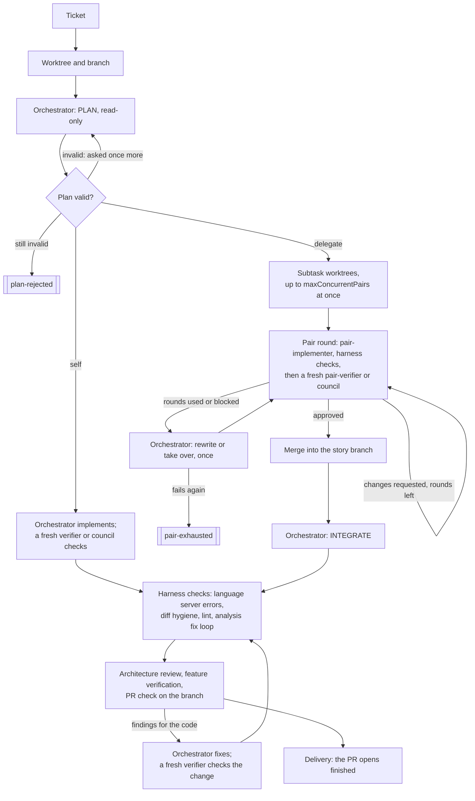
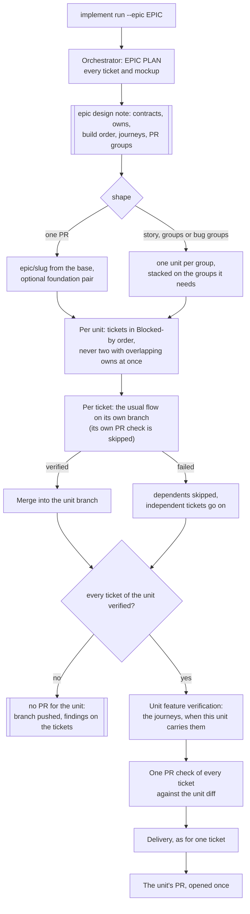

# Implement stage

**Who reads this:** C (operators), and B before a first run. The implement stage takes tickets from the
[board](board.md) to a finished pull request: it plans and implements each ticket with verifier pairs, runs the
review, the tests and the PR check, then delivers the PR. Its flags, settings, limits and records are in
[implement-reference.md](implement-reference.md); what to do when a ticket stops is in [escalations.md](escalations.md).

A deterministic Node harness runs the loops, and every agent is a separate headless CLI process (Claude Code,
Copilot CLI, Codex or `PIPELINE_AGENT_CMD`, within the [model policy](models.md)). The harness knows nothing
about the codebase's language: services, build and test commands come from the repository's
`.factory/config.json`.

```bash
factory implement run SHOP-12 --pr                   # one ticket, delivered as a PR
factory implement run SHOP-12 SHOP-13 --pr           # several, as many at once as resources allow
factory implement run --epic checkout --pr           # every ticket of the epic
factory implement run --epic checkout --dry-run      # order, branches and bases; no agent runs
factory implement status                             # live progress, from another terminal
factory implement resume                             # continue a run that was interrupted
factory implement requeue [--dry-run]                # run the Failed tickets a person resolved
factory implement stop                               # end the run and everything it started
factory implement cleanup [KEY]                      # remove subtask worktrees a failed run kept
factory implement decisions [--story KEY] [--json]   # how the orchestrator's choices turned out
```

## What happens



1. **Tickets.** Every key is fetched from its issue into the ticket cache (`.factory/state/board/<KEY>/`). A
   ticket whose issue is closed, or that this checkout's run record shows delivered, is skipped as already
   implemented. A ticket "Blocked by" another in the batch runs after it, stacked on its branch.
2. **Worktree.** Each ticket gets `../<repo>-worktrees/<key>` on `feat/<key>-<title>`, with its ticket folder
   (story, metadata, mockups) copied into the worktree's cache. The language server daemon starts for it
   ([Language servers](#language-servers)).
3. **Plan.** The `implementer` agent, as **orchestrator**, plans the ticket in read mode: `self` (it implements the
   ticket itself) or `delegate` (up to `maxSubtasks` subtasks, each owning a set of files). The harness checks
   the plan ([Plan](#plan)); an invalid plan goes back once, then the ticket ends `plan-rejected`.
4. **Verifier pairs.** Each subtask gets its own worktree and branch. Up to `maxPairRounds` times: the
   `pair-implementer` implements and commits; the harness checks that only owned files changed, runs language
   server diagnostics, the repository's `implement.checks` and the unit tests of the affected services, and the
   [static analysis fix loop](#static-analysis-in-the-pair-rounds); then a fresh, read-only `pair-verifier` (or
   `pair-ui-verifier` for UI subtasks, [UI verification](#ui-verification)) returns `APPROVED` or
   `CHANGES_REQUESTED` with findings tied to file and line. Language server errors in changed files block approval
   whatever the verdict. With `council.stages.pairVerify` or `pairUiVerify`, a [council](council.md) sits instead.
5. **Escalation.** A pair that uses its rounds or reports blocked goes back to the orchestrator, which rewrites
   the subtask (a fresh pair runs it once), takes it over (at most `maxTakeovers`) or gives up. A second failure
   ends the ticket `pair-exhausted`.
6. **Merge and integrate.** Approved subtasks merge into the story branch in dependency order; a conflict goes to
   the orchestrator, and an unresolved one ends the ticket `merge-conflict`. In delegate mode the orchestrator
   then integrates: build, unit tests, Implementation Notes.
7. **Review, tests, PR check.** The runner calls `factory done`: the [architecture review](review.md) loops with
   the orchestrator until approved, [feature verification](feature-verification.md) writes and verifies the test
   plan and the automated tests (a product bug goes back to the orchestrator, up to `maxBugFixCycles` times), and
   the [PR check](pr-check.md) holds the change to its ticket. The PR check sends production findings back
   through the whole stack and test gaps to feature verification
   ([routing](pr-check.md#findings-about-the-production-change-go-back-to-implementation)).
8. **Delivery.** With `--pr`, the PR opens finished (below). Without it, the run ends after the PR check with the
   work committed on the branch.

The board follows the run: In Progress when the run claims the card, Testing when the review approves, back to
In Progress on a product bug or a PR check return, Pending Review when the PR opens, Failed when the ticket stops
([board.md](board.md)). Every ticket that stops carries its outcome, reason and findings to its card
([escalations.md](escalations.md#outcomes)).

`IMPLEMENT_ORCHESTRATE=0` (or `implement.orchestrate: false`) runs one implementer agent per ticket instead of
the orchestrator and pairs, followed by the same review, tests and delivery.

## The PR opens finished

A pipeline pull request opens once, when no agent stage has work left on it. Before it exists, in this order:

1. **PR check on the branch.** Its production findings return to implementation, its test gaps go to feature
   verification, and its fixer handles records, docs and polish.
2. **CI parity.** What CI runs on a PR runs here first ([ci-parity.md](ci-parity.md)); another ticket's verified
   plan or tests that this change edited are verified again. A failure ends the ticket `not-delivered`.
3. **CI's analysis jobs before the push** (with [static analysis](analysis.md) on), with CI's own script on a
   clean checkout of the head. A blocking finding gets one fixing round; a secret only in unpushed commits is
   folded out by the harness. Still failing, or a secret the commit gate held still in the worktree: the ticket
   ends `blocked` and nothing is pushed.
4. **Push.** The latest base is merged in first, the records the push carries are scanned, and the ticket text is
   published to its issue.
5. **Questions and an unfinished PR check stop here.** Owner questions from the PR check are asked on the ticket
   (`needs-decision`), a PR check that did not complete ends `pr-check-incomplete`, and an epic unit's fix-mode
   check that ended escalated ends `pr-check-escalated`. The branch stays pushed; no PR opens.
6. **CI proven on the branch.** Every pipeline a push of the branch runs must complete green on this exact SHA (a
   skipped run is not a pass). A red or retry-only head gets one CI fixing round when `implement.ciFixRounds` is
   positive (default 1; `0` means none). Still red: an outcome `ci-red`, `ci-flaky`, `ci-conflict`,
   `ci-unverified` or `ci-escalated`, the findings on the ticket, no PR. If the base moved meanwhile it is merged
   in and the new head is proven again. A CI system without branch pipelines (capability `branchPipelines`)
   cannot prove the head first: the PR opens as a draft and is marked ready when its own checks are green. The
   draft is confirmed by re-reading the PR; if it cannot be, the work-in-progress label is added as well, and
   both are released once the checks are green. If neither hold is confirmed, the PR counts as ready from the open.
   With `implement.ciWait: false` nothing is proven or waited for, and the body says so.
7. **Bug rating.** For a bug fix, the [review gate](review-gate.md#assessment) runs the `bug-triage` agent and
   saves its assessment: the gate's only model call. If the gate is on and produces no assessment, no new PR
   opens: the outcome is `gate-assessment-failed` and the branch stays pushed (CI-proven, unless the proof was
   bypassed: draft-first or `ciWait: false`). A delivery whose PR never opened replays from the analysis jobs
   and the push on the next run; a re-delivery leaves its open PR on hold and runs again on hold. With the gate
   off (`implement.reviewGate.enabled: false`, `REVIEW_GATE=0`), nothing is rated or published.
8. **Evidence.** The delivered head's static analysis report is written, and with the `demoVideo` feature the
   [demo video, the bug evidence and the API summary](pr-demo-video.md) are produced on this machine for this
   head. A failed video step is a note in the body; the one setting that stops the delivery is
   `video.bugPair.requireBefore` (outcome `demo-video-blocked`).
9. **Open.** The body is written whole, and the PR opens on exactly the head CI proved. A host that refuses the
   text gets a shorter body ([refusals](implement-reference.md#a-host-that-refuses-the-prs-text)); refused even at
   its shortest, the delivery ends `pr-refused` and is resumed later. A re-delivery never opens a second PR: the
   held PR's body is refreshed. At the open the gate publishes the saved rating without starting an agent, and
   the card moves to Pending Review.

Any stop in these steps opens no new PR; on a re-delivery the existing PR stays open and on hold.
What only a pull request runs (the review quorum, a repository's own PR-only workflows) is listed in the body
and is the only thing pending at the open. `deliverFinished` is the only code that opens a pipeline PR and
`afterOpen` the only code that marks one ready, for a ticket, an epic unit and the retro's lessons PR alike.

### After the open

After the open, no agent changes the code unless a check fails or a person sends the PR back, and then only while
the PR is confirmed on hold. The PR's checks are waited for. When one fails (a check only a PR runs, or the base
moved and CI broke):

- the PR is put on hold first (`implement.preOpen.afterOpen`: `draft`, the `work-in-progress` label, or
  `close-reopen`; the host's capabilities decide when the wanted mode is missing, and Bitbucket, which cannot
  reopen a declined PR, uses `draft`), and host auto-merge is disarmed;
- the hold is confirmed by re-reading the PR (draft flag, labels, state: up to 3 reads, 1 s apart; a refused write
  is not sent again). Not confirmed: the run stops with `hold-failed` before any fixing round, and no agent runs.
  The PR may already be in draft or labelled, so check it;
- a CI fixing round (`pr-check-fixer`) works on the branch while the PR is on hold; still red with cycles left,
  another round runs on the same hold. After `implement.preOpen.draftCycles` (1) cycles it stays on hold and a
  person decides;
- the PR is marked ready again only when every expected check is green on its head, and the release is confirmed
  the same way. Not confirmed: the run ends `release-unconfirmed` and records no ready time. Every hold still
  recorded is released this way, also on a resume or a re-delivery and with `ciWait: false`.

No hold is made, and a person decides, when `ciFixRounds` is `0` or the checks are not plainly red or flaky (a
merge conflict, evidence that cannot be verified).

Then the [review gate](review-gate.md) decides a bug fix's merge, and the board and notices follow. A person who
sends a bug fix back (reopens it, or requests changes) re-runs it: the open PR is held, and the hold confirmed,
before any agent runs, and the delivery proves the new head, refreshes the body and marks it ready again only when
green. An epic unit whose PR is open, or whose PR state cannot be read, is held the same way; an earlier hold
counts only if its release was never attempted (one whose release was unconfirmed is held and confirmed again),
and an unconfirmed hold ends the unit (and a ticket joining it) `hold-failed`.

One agent can run after the open without a hold: a failure starts the `escalation-questions` agent, which writes
questions on the ticket and changes no code ([Known limits](README.md#known-limits)).

Each delivered PR's run record lists its holds and audits that no agent of its tickets started while it was
ready ([delivery records](implement-reference.md#delivery-records)).

### Resume and interrupted runs

Each run saves its batch to `.factory/state/implement/batch.json` and each ticket's phase to
`.factory/state/implement/<KEY>.json`. Only one run at a time per checkout: `implement run` refuses to start
(exit 75) while another run's batch is alive. After a crash, kill or reboot, `implement status` and the next agent
session say so; `factory resume` restarts the batch in the background and `implement resume` (or the same
`implement run`) continues it in the foreground.

- **Tickets that finished** `done` stay done (their branch on the remote counts once the local one is removed after
  delivery, see [disk.md](disk.md#after-a-delivery)), and dependents still stack on them (`--force` redoes them).
- **Tickets in progress**, or that ended `error`, `fv-crashed`, `fv-not-started` or `fv-timed-out`, resume in their
  worktree. If the review had already approved the code, the run goes straight to the tests. An orchestrated
  ticket does not plan again: the orchestrator continues from what is on the branch.
- **Tickets with a standing escalation** (`fv-escalated`, `fv-blocked-on-plan`, `review-escalated`) keep that
  outcome until the escalation note is gone, a person resolves it ([escalations](escalations.md#questions-and-the-resolve-checkbox)),
  or `--force` runs them.
- **Delivery boundaries:** see the table below.
- **An unconfirmed hold or release** (`hold-failed` after the open, `release-unconfirmed`) waits while the ticket
  is labelled `needs-human` and resumes at the CI wait once Resolved is ticked. Green: every hold not yet released
  is released, and the run ends `done` only when each release is confirmed (else `release-unconfirmed` again).
  Red: the PR is held again, and the hold confirmed, before a fixing round, if a cycle is left.
- **An open PR is held before any agent runs.** A ticket that was not skipped, resumed at its CI wait or already
  routed as reopened, and whose last record (not `done`) names a PR, gets one host read at plan time; an open PR,
  or one whose state cannot be read, is held first (after the claim, with `--pr`). `implement run --dry-run`
  makes no read and prints `PR state not checked`. A reopened ticket keeps its `reopened` label until that hold is
  confirmed; a run without `--pr` holds nothing and clears the label when it starts.

**What a resume re-runs.** An interrupted ticket that stopped before its delivery reuses every finished agent stage
(plan, pairs, review, tests, PR check); an epic group's saved PR check counts only for the very commit it reviewed (any
commit since, a person's included, is checked again). Where the delivery stopped decides the rest, for a single ticket
and an epic group alike:

Every resume of a delivery that already pushed (`branch-ci`, before the open, an opened PR recorded or not, `ci-wait`,
`draft-back`) first asks the remote (`git ls-remote`) for the branch head, before it adopts a PR or continues, a single
ticket and an epic group alike. **Unreadable**: the resume stops where it is, nothing runs, and the next resume tries
again. **Moved**: the head differs from this checkout's, or from the commit the run itself last pushed or proved (the
record's `pushedHead` at the branch CI, `provenHead` before the open, `deliveredHead` after it; so a checkout an earlier
resume already brought forward still counts as moved). A person's commits are fast-forwarded into the checkout, or the
resume stops (diverged, or local changes in the way); then the stages run again on them, with the known PR held first
(one the earlier run opened but did not record is found on the host first, never adopted past the push). A record from
before these heads were kept is compared with the local head. Otherwise:

| Where it stopped | What the resume does |
| --- | --- |
| After the push, before the open (`branch-ci`) | the delivery steps run again |
| The PR did not open, or its rating failed on a PR already open and on hold (`pr-refused`, `gate-assessment-failed`, a failed open) | a held PR's hold is confirmed on the host first, then the delivery steps run again on the head CI proved (below) |
| The PR opened but the run did not record it | the PR is found on the host and adopted, never opened twice; its rating is published (or the PR held for a person) before anything else |
| The PR opened and was recorded, the rating not yet published | the rating is published first (or the PR held for a person), then the steps after the open, never the stages again |
| After the open (`ci-wait`, `draft-back`) | only the steps after the open run; a recorded hold is confirmed on the host again before any fixing round (one a person released is held again first) |
| An epic group whose PR is open, or whose PR a recorded close-reopen hold left closed, a ticket joining it | a recorded hold counts only once the host confirms it again, otherwise the PR is held before any agent |

Whatever the route, a bug PR is marked ready only on a head whose rating the host shows: after a fixing commit (or a
person's push) the new head is rated, or published as "needs a person", while the PR is still held; a publication that
fails keeps it held and the run stops (`gate-assessment-failed`).

A delivery resumed before the open (the routes above that run the delivery steps again) calls them again: the analysis jobs and the branch CI proof (whatever those reuse for
an unchanged head is theirs), the bug rating unless one was saved for this very head (a rating repeated can come out
different and change whether the PR merges itself), the demo video step unless this very commit's step finished without
a block and its media is stored (otherwise the `demo-narrator` agent can run again), and a fixing round if the scans or
CI fail again. A bug PR opens held (a draft, else labelled) and is recorded as soon as the host returns it, before any
other call, with that draft hold recorded as not yet confirmed (a resume from there releases it too); its rating is published before it can be marked ready, and only once the host shows the gate's state for
the PR's head is it published (a saved rating for another head is published as "needs a person"). A publication that
fails is a failure: the PR stays on hold for a person (`gate-assessment-failed`) and a resume publishes it again.

**Agent provider outages.** When an agent CLI says its provider will serve no more requests for a while (a quota or
usage limit), the run treats it as an interruption: the ticket ends `agent-unavailable` or `error`, no new ticket
starts, no card moves to Failed, and the run exits 75. Run `factory implement resume` once the provider is back.

**Stopping on purpose.** Killing the runner is not enough, because feature verification and the PR check run
detached. `implement stop` ends the run's processes and marks the run and its tickets `stopped`, so nothing
resumes them; `implement run <KEY> --force` starts a ticket afresh.

`implement requeue` runs every ticket a person resolved, in one batch ([escalations](escalations.md#requeue-on-a-timer)).

## Delivery modes

| Mode | Command | Branches | PRs |
| --- | --- | --- | --- |
| **epic** (default) | `implement run --epic <EPIC>` | `epic/<slug>` (or one branch per PR group), each ticket on its own branch from it, merged back once verified | one PR per unit: the epic, or one per group ([split](#how-an-epic-is-split-into-prs)) |
| **story** | `implement run --epic <EPIC> --delivery story`, or `implement run <KEY>...` | a branch per ticket, stacked on its blockers | one PR per ticket, with no epic plan and no journeys |

`--delivery story` and `--pr-split story` both give one PR per story. `--delivery story` runs the tickets as
separate single-ticket runs; `--pr-split story` keeps the epic plan, its shared design note and the cross-story
journey tests.

A single ticket keeps its own branch and PR. If it belongs to an epic whose epic run is in progress, it **joins**
that run instead: it runs from the epic or group branch, merges back into it and goes to Pending Review naming
that branch; the epic run opens the PR. `--standalone` opts out, except that a reopened ticket of a delivered
bug group whose PR is still open always joins that group again and is re-delivered on its open PR.

## Epic delivery



1. **Epic plan.** The orchestrator reads the epic, every ticket and the mockups, and returns the **epic design
   note**: shared contracts with one owner each, an optional **foundation**, each ticket's `owns` and extra
   `dependsOn`, the build order, the cross-story **journeys** and, when the epic is split, its PR groups. The
   harness validates it and asks once more with the errors; a rejected plan ends the run before any ticket starts.
2. **Foundation.** Shared groundwork (a migration, a DTO) runs first as one verifier pair on the epic branch. A
   failed foundation ends the run. Split epics have no foundation; the first group that needs the groundwork owns it.
3. **Tickets.** Each runs the ticket flow on its own branch from the unit branch, up to `--parallel` at once, and
   merges into the unit branch when verified (a conflict goes to the orchestrator). Its card goes to Pending
   Review naming the branch. A failed ticket's dependents are skipped; independent tickets keep going.
4. **Journeys.** When every ticket of the unit merged, the journeys become a ticket `EPIC-<n>` that feature
   verification plans and automates like a story (`implement.epic.featureVerification: false` skips it).
5. **PR check.** One run over every ticket and the journeys against the unit's diff; `implement.epic.prCheck`
   is `fix` (default), `report` or `off`. A fix-mode check that ends escalated, or still upholds findings at
   `fixUntil` or worse, ends the unit `pr-check-escalated`: no PR, the branch pushed, the findings on the tickets.
6. **Delivery.** The unit goes through the same delivery as a single ticket and opens one PR with every ticket's
   outcome and `Closes #N` for each; the epic's evidence comment lists it (`board epic-pr`).

Before a unit is pushed, tickets whose verified tests went stale because a later ticket edited the same spec are
automated again; if one does not verify, the unit ends `fv-reverify-failed` with no PR. `implement status` shows
each epic's plan, units, merged and failed tickets and PRs; `implement resume` continues an interrupted epic
from its saved phase (`plan`, `foundation`, `units`, `summary`, `finished`).

### How an epic is split into PRs

The harness picks the shape before the plan is written, in this order (`scripts/implement/lib/epic-plan.mjs`):

1. `--grouping epic` (`implement.epic.grouping`): one PR. `--grouping ticket`: one PR per ticket, with no grouping
   by the orchestrator.
2. More than half the tickets are bugs (type `bug` or `BUG-*` keys): **bug groups** the orchestrator chooses.
3. Otherwise `--pr-split` (`implement.epic.prSplit`): `epic` (default) one PR; `story` one PR per story;
   `groups` PR groups the orchestrator chooses.

| Shape | Branches | Who groups | Rated by the review gate |
| --- | --- | --- | --- |
| one PR | `epic/<slug>` | none | no (a feature PR) |
| `--pr-split story` | `feat/<slug>--<story>` | the harness, one group per story | no |
| `--pr-split groups` | `feat/<slug>--<group>` | the orchestrator, at most `implement.epic.maxStoriesPerGroup` per group | no |
| bug groups | `bugfix/<slug>/<group>` | the orchestrator, at most `implement.maxBugsPerGroup` per group | yes, each group PR |

`--pr-split story` and `groups`, and epics with several groups, are proven by fixture tests only
([proof](../../README.md#what-has-been-proven)).

The harness checks a grouping: every ticket in exactly one group, a ticket's Blocked-by and `dependsOn` tickets
in the same or an earlier group, the group size limit. An invalid grouping goes back once; still invalid, the run
falls back to one PR per ticket. A group that needs another group's tickets is stacked on its branch. Groups run
in parallel up to `--parallel`; a group whose dependency failed is skipped.

**Journeys in a split feature epic** are verified once, on the last group in dependency order that holds a journey
story, stacked on every other group that holds one, so its branch has every story the journeys cross. The other
groups verify only their own stories. A bug epic verifies journeys only when all their tickets are in one group.

The grouping and every group's outcome are recorded ([decision log](implement-reference.md#decision-log));
`implement decisions` labels a group `bad-grouping` when some of its tickets verified and others did not.

## Plan

```jsonc
{
  "mode": "delegate" | "self",
  "modeReason": "<one short sentence>",                 // required
  "splitReason": "<one short sentence>",                // required for delegate
  "uiStory": true | false,                              // checked against the story
  "features": { "services": ["orders-api"], "estimatedSize": "small" | "medium" | "large" },
  "subtasks": [{
    "id": "api",                                        // [a-z0-9-], unique
    "goal": "...", "acceptance": ["..."],
    "owns": ["services/orders-api/**"],                // globs: * in a segment, ** across, bare path = subtree
    "dependsOn": [],
    "modelClass": "small" | "medium" | "large", "modelReason": "...",
    "model": "<optional allowed alias, e.g. sol on Copilot>",
    "justification": "...",                             // required for large
    "verify": "code" | "ui", "verifyReason": "...",
    "scenario": "<optional: an existing test stack scenario for ui>",
    "expectedFiles": 3, "expectedLoc": 120, "confidence": 0.8,
    "alternatives": [{ "option": "...", "reason": "..." }]
  }]
}
```

The harness enforces (`scripts/implement/lib/plan.mjs`): the schema; at most `maxSubtasks` subtasks (otherwise
"split the story"); no two subtasks owning the same file, no `owns` covering the whole repository; `dependsOn`
without cycles; at most `maxLargeSubtasks` large subtasks, each justified; `verify: "ui"` only for **UI stories**
(the story has mockups, a title tag from `implement.uiStory.titleTags`, a frontend component in its title, or
names a frontend file); and `self` mode with at most one subtask entry. Reasons and expectations feed the
[decision log](implement-reference.md#decision-log) and never reach a verifier.

## UI verification

UI verifiers run against an isolated test-stack slot ([test-stack.md](../test-stack.md)), through
`implement.ui.slotsCmd` (the slot registry) and the repository's `implement.ui.teststackCmd`.

1. The pair leases a slot on its first UI round and keeps it (`factory stack lease`); with no free slot it waits
   until the ticket's wall clock runs out (`limit-wall-clock`).
2. Every round, from the subtask worktree: `rebuild-changed` against the story head, `up` on the first round,
   `load <scenario>` when the subtask names one. A failing step is the harness's blocking finding: no verifier
   runs, so the implementer cannot dispute it.
3. When the ticket has mockups (its own, and the epic's in an `--epic` run), their renders are copied into the
   round's folder ([Mockups](#mockups)).
4. The `pair-ui-verifier` (shell, but no file edits or git writes) drives the app with its own Playwright script,
   checks every acceptance criterion, and screenshots each mockup screen and state it builds. A difference from
   the mockup in layout, copy, labels or states is a `design` finding with both images.
5. When the pair ends, the stack goes down and the slot is released.

A UI verifier may write only into `implement.ui.artifactDirs`; a round in which any member changed anything
else has no result.

### Mockups

The orchestrator, the UI pair implementers and the UI verifiers get the mockup files; implementers and verifiers
also get PNG renders of every screen and state, every round. `scripts/implement/lib/mockups.mjs` renders design
canvas files (`.dc.html`: the default state, then each boolean or enumerated prop and initial state flipped, at
most 8 per screen), any other HTML file as one page, and uses images as they are. Renders are cached by the
files' hash. `factory mockups diff <mockup.png> <actual.png> <out.png>` writes a pixel diff a verifier may attach
as evidence, never as the verdict.

## Nits and scope

Pairs work to the ticket, not to taste. Every finding has an id (`<subtask>-r<round>-<n>`), and
`scripts/implement/lib/disputes.mjs` runs the exchange:

1. **Verifiers** judge against the subtask's acceptance criteria and `owns`, the mockup, correctness and
   security. Nits are `minor` and never block; work beyond the ticket is never requested.
2. **Implementers** do not act on nits or scope-widening requests and say so: `disputes` with a reason citing the
   ticket, `owns` or mockup; real problems outside the ticket become `followUps`.
3. **The next verifier round** rules on each dispute: accepted drops the finding; re-asserted keeps it, with
   evidence. Re-asserted without evidence, it is accepted and demoted to minor.
4. **No ping-pong:** a finding re-asserted twice can no longer be disputed; it stays blocking.

The same rule holds above the pairs: review findings and feature verification bugs reach the orchestrator with
ids, and it disputes nits and scope creep the same way. Follow-ups are recorded per ticket and listed in the PR;
filing them as tickets is not automatic.

## Static analysis in the pair rounds

With an `analysis` section ([analysis.md](analysis.md)), after each pair-implementer run and before the verifier,
the harness applies the tools' auto-fix, runs the `pair` slot's tools on what the subtask touched, and hands
provable findings back to the implementer for up to `analysis.fixLoop.bounces` (2) extra runs. A bounce is not a
pair round, but it is an agent run counted against `maxAgentRunsPerStory`. What stays open reaches the verifier as
harness findings, outside the council's votes; blocking ones send the round back. After the pairs, the `story`
slot runs once on the whole ticket with the same budget.

## Resources

`--parallel auto` (the default) sizes the run from the memory free right now (`lib/resources.mjs`): free memory
(on macOS plus inactive and purgeable pages) and Docker's memory, minus `resources.reserveGb` (6). From that budget
it derives the tickets at once, the pairs per ticket, the machine-wide agent slots, the language servers and the
test-stack slots, and prints them with the reasons. The defaults were measured on one application; set
`resources.worktreeGb`, `lspServerGb` and `stackGb` to what your codebase takes
([settings](implement-reference.md#config)). Before a new ticket, group or pair starts, the harness checks memory
and disk again and waits while they are short ([disk.md](disk.md)). An explicit `--parallel N` turns auto sizing off.

## Language servers

The harness reaches the language servers ([code intelligence](../code-intelligence.md)) through
`scripts/implement/lib/lsp.mjs`. With `implement.lsp.enabled: false`, or a server missing, every call answers "no
information" and the run carries on. A daemon starts per worktree (a subtask's scoped to its `owns`) and stops
before the worktree is removed. Diagnostics run on the changed files after every pair round, merge and
orchestrator run; errors block approval. Agents get the `lsp` MCP server (read-only tools for verifiers). A pair
implementer that changes a non-private signature without a find-references call is asked, once per subtask, to
run it and update the callers before the verifier sits.

## Slow agents never change an outcome

A slow agent provider must only make a run take longer. Every agent CLI runs under a supervisor
(`scripts/pipeline/lib/agent-supervisor.mjs`) that stops it only after `agent.supervisor.idleSec` (1800) with no
progress, or at `agent.supervisor.ceilingFactor` (10) times its configured limit. Every budget on agent work and
every wait for it is the usual time; the run stops only at the ceiling, and a wait restarts work whose process
died. Every external call (git, the host, Docker, HTTP) has a timeout and bounded retries; one that still fails
ends the run `not-delivered` with its cause.

## Not automatic

Creating or editing a ticket starts nothing, except a background test plan with `git config fv.autoPlan true`
when `factory board fetch` brings a changed ticket. Run `implement run` yourself, or from a scheduled job that has
an agent CLI and the code host's login. The agents only see the tickets you pass to the run: the
[story guard](../internals.md#guards) denies them every other ticket in the cache.
