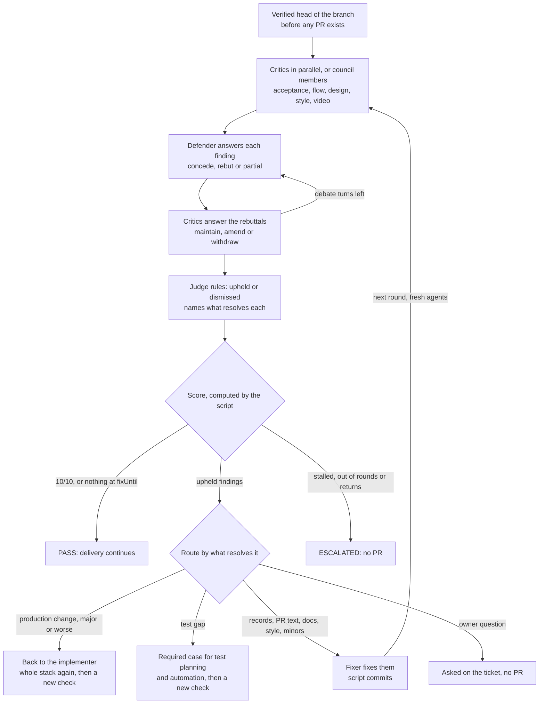

# PR check stage

**Who reads this:** C (operators), and reviewers who read its report in a PR. An adversarial review of a pull request against its story. Critics argue that the PR falls short, a defender argues that it doesn't, and a judge rules. The script scores the round, a fixer fixes whatever the judge upheld, and fresh agents review again. This repeats until the PR scores **10/10** or the loop escalates to a human.

It checks four things, plus video evidence:

| Lens | Agent | Runs when | Checks |
| --- | --- | --- | --- |
| Acceptance criteria | `pr-check-acceptance` | always | every rule and acceptance criterion in the story is implemented and tested |
| Flow | `pr-check-flow` | always | the end-to-end journey (UI, API, events, data) matches the story's flow, including sad paths |
| UI design | `pr-check-design` | frontend stories: `[FE` in the title, a mockup on the story's ticket, or a changed frontend file (see [Frontend files](#frontend-files)) | layout, components, states and copy match the mockup and the design system |
| Code style | `pr-check-style` | always | the code follows the repository's convention files (`prCheck.conventions`: by default `AGENTS.md`, `CONTRIBUTING.md`, `.editorconfig`, `.markdownlint.json` and the implementer's addendum `.factory/agents/implementer.md`) and the existing patterns |
| Video evidence | `pr-check-video` | a video was found | frames show the journey working, with no error banners, 500s, blank screens or broken layouts |

With `council.stages.prCheck` in `.factory/config.json`, a council of verifiers on several CLIs and models replaces the critics (the defender, judge and fixer stay), and its rounds replace the stage's round limit; see [council.md](council.md).

## Running it

```bash
factory pr-check run --pr 42                 # review PR 42 (checked out) and fix it until 10/10
factory pr-check run --pr 42 --no-fix        # one report-only round; the PR doesn't need to be checked out
factory pr-check run --story SHOP-12         # the current branch against a story, no PR needed
factory pr-check run --pr 42 --videos test-results,https://example.com/demo.webm --comment --push
factory pr-check status [pr-42]
factory pr-check resume [SHOP-12|pr-42] [--force]   # continue checks that died
factory pr-check metrics [--json] [--since 2026-01-01]
```

Or ask the `pr-check` agent (generated for Claude Code and Copilot by `factory render`) to check a PR; it runs the same command and summarizes the report.

| Option | Default | Meaning |
| --- | --- | --- |
| `--pr <n>` | none | PR to check. Metadata comes from `gh`, or the GitHub API with `GITHUB_TOKEN`/`GH_TOKEN` |
| `--story <KEY>` | from the PR branch, title, body, or the active story | the story the PR is held to |
| `--stories <KEY>,...` | none | hold the PR to several tickets (a branch that delivers them together); see [Several tickets](#several-tickets-an-epic) |
| `--epic <EPIC>` | none | hold the PR to every story and bug of the epic (or of `--stories`), and to the epic's journey |
| `--lenses <lens>,...` | all that apply | run only these lenses (`acceptance`, `flow`, `design`, `style`, `video`) |
| `--base <ref>` | the PR base, else `baseRef` (`PIPELINE_BASE_REF`) | what the diff is taken against |
| `--videos a,b` | links in the PR description, else the folders in `prCheck.video.defaultDirs` (`artifacts/e2e-videos`, `test-results`) | video files, folders or URLs |
| `--no-fix` | fix | report only, one round |
| `--max-rounds <n>`, `--debate-turns <n>` | `prCheck.maxRounds` 6, `prCheck.debateTurns` 2 | loop limits (`--no-fix` always runs one round) |
| `--comment`, `--push` | off | post the report on the PR; push the fix commits |
| `--json` | off | print `result.json` instead of the report |
| `--resume` | off | continue the interrupted run of the same check from its last saved round |

Exit code 0 means PASS (10/10); anything else is FAIL or ESCALATED. Fix mode needs the PR branch checked out at the PR head with a clean working tree; `--push` is skipped for PRs from forks. Report-only mode reviews a PR that isn't checked out in a temporary detached worktree.

## Static analysis

With an `analysis` section, each round's critics get the static analysis report of the head commit as evidence ([analysis.md](analysis.md)): the one the pipeline wrote for that commit, or the `prCheck` slot run once. The critics do not run the tools again, and the PR body's "Static analysis" section is regenerated like the council table.

## Several tickets (an epic)

An epic delivered on one branch is checked once against all of its tickets:

```bash
factory pr-check run --epic checkout-redesign --lenses design --no-fix --json
factory pr-check run --stories SHOP-12,SHOP-13 --epic checkout-redesign --pr 42
```

- **Tickets:** `--stories` names them; without it `--epic` takes the epic's stories and bugs (its sub-issues, in Blocked-by order). The first is the check's `story` (its id, lock and progress); with `--story` that one is.
- **Prompts:** every round header gets **Tickets in this check**: each ticket with its story file, whether it is frontend (`[FE` in the title or a mockup) and its absolute mockup paths, and the epic with its body and mockups. The critics hold the PR to every ticket and name the ticket key (or `journey`) in each finding's `requirement`.
- **Design lens:** runs when any ticket is frontend, any ticket or the epic has mockups, or the PR changes frontend files. The critic checks every frontend ticket against its own mockups (or its Outputs), then the journey across them against the epic's body and mockups.
- **Story guard:** the check's agents may read exactly these tickets' folders and the epic's.
- **Output:** `result.json` gains `stories`, `epic` and `lenses`; the id is the epic key (else `<first>+<n>`, or `pr-<n>` with `--pr`). Each `pr-checks.jsonl` record carries `stories` and `epic`, so [`implement decisions`](implement-reference.md#decision-log) credits upheld design findings to the right tickets.

The epic flow calls it like any other check; the exit code is 0 only at 10/10.

## Frontend files

The design lens runs when a ticket is marked frontend (`[FE` in its title, or it has a mockup) or the PR changes a frontend file. What counts as a frontend file:

- `prCheck.frontendPaths` when it is set: folders ending in `/`, extensions or suffixes starting with `.`, or globs (for example `["web/", ".css", ".vue"]`);
- otherwise the project model: `project.frontendPaths` plus the paths of the services with `"kind": "frontend"`.

With neither, only the ticket and its mockups decide.

## Mockup renders

When the design lens runs and the tickets have mockups, the check renders every mockup screen and state to PNGs before round 1 (the same renderer as the implement stage's UI verifier, see [Mockups](implement.md#mockups); cached by the mockups' sha under `.factory/state/pr-check/.mockup-cache/`) into `context/mockups/`, and the round header points at its `manifest.json`. A render that fails is logged; the critic then reads the `.dc.html` sources.

## Runs automatically from the Stop hook

The check runs from the agent Stop hook, after `review` and `feature-verification`. When the implementation agent stops after `factory done` and the architecture review has approved the code on disk:

1. The hook starts a background waiter and tells the agent so; the agent can finish its turn.
2. The waiter waits for feature verification to verify the tests for that exact implementation (`hook.waitForTestsMin`, checking every `hook.pollSec`). If feature verification ends without verifying them (a product bug, an escalation), or the code changes, it stops without checking.
3. It runs one report-only round against the story (no PR needed; uncommitted work counts). The agent is the fixer, so nothing is committed over its work. Under `implement run --pr`, the runner waits for this check to finish before it opens the PR, however long its agents take: a check whose process died is restarted (`pr-check resume`), and only a check that never finishes ends at its ceiling (`implement.prCheckWaitSec`, default 14400, times `agent.supervisor.ceilingFactor`). A check that did not complete (crashed, errored, skipped or past the ceiling) is never treated as a pass: the ticket ends `pr-check-incomplete`, the branch is pushed, no PR opens, and the ticket goes to Failed with questions. Otherwise the PR description gives the check's verdict, score and open findings.
4. **Fix mode** (`implement.prCheck.mode`, default `fix`): when that report round upholds a finding of `implement.prCheck.fixUntil` severity or worse (default `major`), or any finding on a lens listed in `implement.prCheck.fixLenses` (default `[]`; for example `["video"]` treats a demo video that does not show the case as a missing deliverable), the runner sends the story through the fixing loop on its branch before the PR opens: `pr-check run --story <KEY> --until major --max-rounds <implement.prCheck.fixRounds> --fix-first <the report round's result.json>` (default 3 rounds). For a bug fix (a bug ticket, or a bug group) the target is `implement.prCheck.bugFixUntil` (default `minor`: every upheld finding is fixed, aiming at 10/10), because the review gate auto-merges a Low fix only when its PR check scored 10/10. The fixer starts on exactly what the report round upheld (a fresh first critique could miss it); then, each round, the fixer fixes the upheld findings, feature verification re-verifies the plan and tests a fix made stale (recording again), the frames are extracted again, and the critics check the result. The loop ends `ACCEPTED` once nothing major or worse, and nothing on those lenses, is upheld (lesser findings are reported), `PASS` at 10/10, or `ESCALATED` at the round limit. For a single ticket the PR then opens with the final report (its production findings were already returned to implementation, [below](#findings-about-the-production-change-go-back-to-implementation)); for an epic unit (`implement.epic.prCheck`, default `fix`) an escalated check, or one still upholding findings at `fixUntil` or worse, opens no PR (`pr-check-escalated`).

   `implement.prCheck.mode: "report"` and `implement.epic.prCheck: "report"` put the report round's verdict into the PR as it is, majors included.
5. On the agent's next stop (or in the next session's start-up context) a failing result blocks with the open findings and the report path, once more if nothing changed, and then says so once. A pass is one notice.

Fixing the findings changes the code, so the review runs again, then feature verification, then the PR check. After `hook.maxRuns` failing checks for a story the hook escalates to a human (`.factory/state/escalations/<KEY>-pr-check.md`) instead of checking again; a pass resets the count, and so does `factory start`.

Hook runs are recorded in `.factory/metrics/pr-checks.jsonl` in the working tree, so they are committed with the story and feed the lessons like any other check. All of their findings are round-1 findings, so they teach the implementer.

`PR_CHECK_SKIP=1` (or `prCheck.hook.enabled: false` in `.factory/config.json`) turns the hook off; `PIPELINE_DISABLE=1` turns off every stage. The hook's settings (`prCheck.hook`):

| Setting | Default | Meaning |
| --- | --- | --- |
| `enabled` | true | `false` turns the Stop-hook check off |
| `requireTests` | true | wait for feature verification to verify the tests first |
| `waitForTestsMin`, `pollSec` | 1440, 20 | the ceiling and the polling interval of the waiter: it waits as long as feature verification is alive and working on this implementation, and stops at the ceiling only if it never ends |
| `maxRuns` | 3 | failing checks per story before escalating |
| `codeAgents` | `implementer` | subagents whose `SubagentStop` triggers the check (main-session stops always do) |

`factory pr-check status <KEY>` shows the last result.

## Interrupted checks

- **Stop-hook checks:** the waiter records its pid and boot in the story state. If it dies (crash, kill, reboot), the next session start, Stop or `factory pr-check resume` starts it again for the same code, or marks it `stale` if the code has changed. After `recovery.maxAttempts` (3) restarts, with growing delays, it is marked `crashed` and escalated; `resume <KEY> --force` retries it.
- **Manual checks (`run`):** the run keeps `.factory/state/pr-check/<id>/progress.json` up to date with its flags, its process and, in fix mode, the loop state after each critique and fix. The next session start lists interrupted runs, and `factory pr-check resume` (or `factory resume`) restarts each with `run --resume` in the background. It continues after the last finished round; a fix that was cut short runs again on the changes it left (a dirty tree is allowed for this), unless its commit was already made. Report-only runs are one round, so they start over. A run that fails rather than dies (bad flags, a dirty tree) is not resumed.

## The loop



Every agent call is a new headless process, so each round starts with a clean context. Critics see the previous round's upheld findings and re-raise any that are not fixed, under the same id.

**Scoring is done by the script, not the judge**, so no agent can talk its way to 10:

- An upheld finding caps its lens: blocking at 6, major at 8, minor at 9. The judge's lens score can only lower that.
- A finding the judge didn't rule on stands unless its critic withdrew it.
- Coverage gaps the judge finds without a finding (`<lens>-coverage-<n>`) count as upheld.
- A critic that fails to return a result scores its lens 0.
- The PR's score is the lowest lens score. 10 means nothing was upheld.

The loop escalates (`.factory/state/escalations/<id>-pr-check.md`) when the round limit is reached, when the same finding is upheld three rounds in a row, when the fixer says it can't fix any upheld finding without a human decision, or when the fixer changes nothing two rounds in a row.

## Videos

Videos come from `--videos`, else video links in the PR description (direct `.webm`/`.mp4`/`.mov`/`.mkv` links, `github.com/.../blob/...` file links, and GitHub `user-attachments`), else the folders in `prCheck.video.defaultDirs` (`artifacts/e2e-videos`, then Playwright's `test-results/`). The [demo videos](pr-demo-video.md) are recorded on the pipeline's machine before the PR opens, so a PR's description already links them. Each is turned into up to 48 frames (one per second at most; `prCheck.video.maxFrames`, `minIntervalSec`, `width`): with `ffmpeg` when installed, otherwise by playing the file in Playwright's Chromium and screenshotting it, which needs Playwright installed where the check runs. Chromium reads WebM, which is what Playwright records. A video that can't be read is listed in the report and handed to the video critic as an evidence gap.

## Models

The judge and critics run on the largest models. The engine's defaults (`prCheck.models.<cli>.<role>` in `scripts/pr-check/config.json`; a repository overrides them in `.factory/config.json`):

| Role | Claude Code | Copilot CLI |
| --- | --- | --- |
| Judge | `opus` | `claude-opus-5.5` |
| Acceptance, flow, design, video critics, fixer | `opus` | `claude-opus-5.5` |
| Defender | `opus` | `claude-sonnet-5.5` (a different model from the critics, so the debate isn't one model arguing with itself) |
| Style critic | `sonnet` | `claude-sonnet-5.5` |

Every model must be allowed by `agent.allowedModels` (an alias, or the CLI id an alias maps to in `agent.modelIds`; on Codex only `sol` has an id by default, so a PR check on Codex needs `prCheck.models.codex` naming `sol` for every role); see [feature-verification.md](feature-verification.md#models). Override one role with `PR_CHECK_MODEL_<ROLE>`, for example `PR_CHECK_MODEL_JUDGE=sonnet`.

## Files

Each run writes to `.factory/state/pr-check/<id>/` (`<id>` is `pr-<n>`, or the story key):

- `result.json` and `report.md`: the verdict, scores per round and lens, open findings with fixes, findings resolved during the loop, video evidence and what was not checked.
- `context/pr.md`, `context/frames.json`, `context/mockups/` (mockup renders) and `videos/`: what the agents were given.
- `round-<n>/`: `diff.patch`, every prompt and agent output, `debate.json` (each finding with its full thread), `coverage.json`, and `rulings.json`.

Every round is appended to `.factory/metrics/pr-checks.jsonl`, which `factory pr-check metrics` and `factory metrics` summarize. The [review gate](review-gate.md) reads it too: a bug fix has high confidence only when its PR check reached 10/10 in at most two rounds. Each record keeps the upheld findings (id, lens, severity, title, detail, requirement, evidence, and `repeat` when the finding survived a fix round) and the findings the judge dismissed, with the judge's reason. Commit it with the work it describes, like the other metrics.

## How agents improve

The PR check feeds the shared lessons process (the [retro](retro.md), `factory retro run`; see also [feature-verification](feature-verification.md#auto-improvement)). From `pr-checks.jsonl` it learns:

| Lessons file | Learns from | Category |
| --- | --- | --- |
| `implementer.md` | findings upheld in round 1, against the code as it was written | `pr-check-<lens>` |
| `pr-check-fixer.md` | findings upheld again after the fixer had a round to fix them | `not-fixed` (subtype = lens) |
| `pr-check-<lens>.md` (each critic) | its findings the judge dismissed (false positives) | `dismissed-finding` |

A mistake that recurs in 3 or more stories (`lessons.storyThreshold`) becomes a rule, proposed in a pull request; rules are strengthened, retired or reverted with the same measurements as every other agent. Each PR check agent gets its own lessons file appended to its prompt, the fixer also follows `implementer.md`, and the implementer reads `implementer.md` before it starts, so the next story avoids what the PR check caught in the last ones.

## In CI

The factory's PR check job (on GitHub Actions `.github/workflows/factory-pr-check.yml`, generated by `factory render`) runs a report-only check (`--no-fix --comment`) when a PR gets the `ai-pr-check` label, or on demand. It needs the chosen agent provider's credential (`ANTHROPIC_API_KEY` by default; see [CI setup](setup.md#ci) for Copilot, Codex and other CLIs). Fixing stays local, where a person can watch the loop and review its commits. For PRs from this repository, CI commits the run's new `.factory/metrics/*.jsonl` records to the PR branch (with `GITHUB_TOKEN`, so the push does not re-trigger workflows), and they count toward lessons once the PR merges. Fork PRs only get them in the run artifact.

## Settings

The defaults are the `prCheck` section of the engine's `scripts/pr-check/config.json`; a repository overrides them in `.factory/config.json` ([configuration](../configuration.md)): `maxRounds`, `debateTurns`, `timeoutSec` (each critic, defender and judge call), `fixTimeoutSec`, `maxDiffChars` (the diff is cut there and the agents read the remaining files directly), `exclude` (paths left out of the diff and of fix commits), `frontendPaths`, `conventions`, `hook`, `video` and `models`.

## Findings about the production change go back to implementation

When the report round upholds a finding at `fixUntil` or worse (`bugFixUntil` for a bug), the harness decides who fixes it from what it is about, never a model's choice (`lib/pr-check-return.mjs`):

| Finding | Goes to |
| --- | --- |
| lens `acceptance`, `flow`, `design`, `correctness`, `security`, `ui` or `rewrite` (a council member's critic by the member's lens), or `action: rewrite` | **the implementation stage** |
| the same, when every file it names is a test, spec, doc, plan, scenario or record (`lightPaths`) | the PR check's fixer |
| the same, `minor` (below `minSeverity`, default `major`) | the PR check's fixer (a bug's minors as before; a feature's become follow-ups) |
| lens `video`, `style` or `test-value` | the PR check's fixer |
| an unknown lens | the implementation stage (from `minSeverity` up) |

A return gives the implementer the upheld findings as its fix list ("the ticket is the answer: behaviour no line of the ticket asks for is removed, not defended"). Its change then passes the same stack as any implementation work: the static analysis fix loop, the pair verifier or council (step `pr-check-return-<n>`), the architecture review, feature verification (which updates the plan and tests when the behaviour they describe changed), and a new PR check on the new head. Only findings left for the light path go to the fixer. The PR does not exist yet during a return, so nothing can merge in between.

Bounds: `implement.prCheck.returnToImplementation.maxReturns` (2) per story. Each return also spends agent runs (`maxAgentRunsPerStory`) and wall clock. At the limit the story ends `unresolved` with the open findings and goes to Failed with questions, without a PR.

Records: the run record's `prCheckReturns` (which check round sent it back, its score and head, the findings and their routing), `pr-check-returns.jsonl`, `pr_check_returns` in `implement-runs.jsonl`, the pair council's `pr-check-return-<n>` sittings in the PR body's council table, and a "Sent back to implementation by the PR check" line in the PR body. A run that dies during a return is resumed with the same fix list (`phase: pr-check-return`).

**Routing by what resolves a finding.** The judge (or council member) fills `resolves` on every upheld finding: `code`, `tests`, `plan` or `records`, two for a mixed finding. Without it the harness reads the finding (`pipeline/lib/finding-route.mjs`: a missing test, a test to remove, the files it names). `code` returns to the implementer as above. `tests` or `plan` becomes a **required case** for feature verification (`feature-verification/lib/required.mjs`): the planner must add a case naming the finding id, test automation must implement it with a test that is new or changed since the finding, both verifiers see it, and the harness caps their verdict below the pass mark while it is unmet; the implementer and the review do not run, and the PR check sits again once the tests verify (`pr-check recheck`). A mixed finding is split, both parts keep its id. `records` stays with the PR check's fixer. **Returned, nothing addressed:** when the PR check upholds again a finding the last return was sent for, the harness compares it with what changed since: a finding sent where it cannot be resolved (a test gap to the implementer) is re-routed once without spending a return; one sent to the right place with nothing of what resolves it changed ends the story `unresolved` with "returned, nothing addressed". The same rule holds at the other hand-offs: the architecture review hands a test-only finding to feature verification instead of blocking the implementer on it; the automation verifier's gap marked `resolves: code` is a product bug for the implementer, not feedback to the test writer; a pair's finding about another subtask's files goes to the integration step and a pair's test gap to feature verification; the PR check's Stop-hook delivery gives the code agent only the findings it can resolve.

Owner questions remain only for what a person must decide about the ticket: the judge gives each question a `questionKind` (`ambiguous`, `contradiction`, `two-readings`, `impossible`). A dismissed acceptance finding with a question and no such kind ("is this limit acceptable?" about behaviour no line asked for) is upheld by the harness instead, and goes back to implementation.

Settings (governance, `.factory/config.json`): `implement.prCheck.returnToImplementation` with `enabled`, `maxReturns`, `minSeverity`, `implementationLenses`, `lightLenses`, `lightPaths`.

A finding that names no file is routed by the paths its text names ("copied from bug-44.spec.ts" is a spec's). Only major or worse findings return: a return to implementation costs a full pass through the stack, and each new PR check can find new minor polish, so minors returned that way would use up the returns.

## Before the PR exists

The PR check runs on the story branch, before any pull request exists ([implement.md](implement.md#the-pr-opens-finished)); the order is not a setting. It reviews the story, the diff against the base and the drafted PR body. Its production findings go back to implementation, its owner questions are asked on the ticket, and the fixer handles the rest; then the PR opens in its final state with the check's verdict in its body. Nothing of the PR check runs on an open, ready PR. A CI failure after the open puts the PR on hold before the CI fixing round runs ([after the open](implement.md#after-the-open)).

The opt-in `ai-pr-check` label job still checks an open PR in CI, report only, when a person asks for it ([In CI](#in-ci)).
