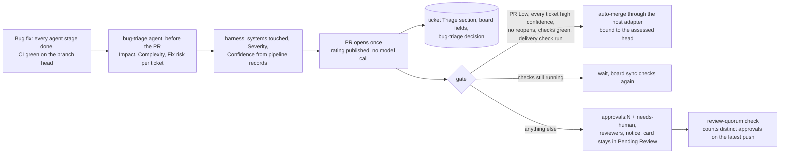

# Review gate for bug-fix PRs

**Who reads this:** C (operators), reviewers and repository owners. The gate rates **bug fixes**: a single-ticket bug PR (`implement run FIX-7 --pr`) or a bug-epic group PR ([PR groups](implement.md#how-an-epic-is-split-into-prs)). Its triage agent runs once the branch's CI is green, before the PR exists; at the open the saved rating is published with no model call, and the merge decision follows the PR's checks. Implementation, verifier pairs, architecture review, feature verification, the PR check and the grouping of bugs run exactly as before; feature stories and feature epics are never gated. Merges go through the code host's adapter ([providers](../providers/README.md)), so the same gate works on every supported host.

A group PR is gated once, by the run that delivers it, with **every ticket merged into the group**, including tickets an earlier run merged (a group can finish across restarts). A later run that re-delivers the group with its existing PR does not gate it again; a reopened ticket joining the open PR re-gates it with all the group's tickets.

The code is in `scripts/review-gate/`; its settings are `implement.reviewGate` and `implement.autoMerge` (engine defaults in `scripts/implement/config.json`, overridden in `.factory/config.json`), and the board field names are `board.fields`.



## Assessment

Before the PR exists, once CI is green on the branch head, the delivery runs `factory review-gate assess --tickets K1,K2 --base <ref> --out <file>`: the triage agent rates the change on the branch against the base, and the harness computes the rest. That is the gate's only model call. When the PR opens, `factory review-gate publish --assessment <file>` binds the saved assessment to the PR and its head and applies the decision with no model call. A delivery with no saved assessment (a resume included) assesses before the open; if the gate cannot, no PR opens (outcome `gate-assessment-failed`, [escalations](escalations.md#outcomes)). The pipeline publishes with `--no-agent`: without a readable assessment it publishes "not assessed" (review, `needs-human`, the approvals a Severe PR needs: 1 by default) and never starts an agent on the open PR. Publishing is a separate process. For a bug PR the delivery stops on a failed publication, and on a rating the host does not show for the PR's head (`review-gate publish` exits 3): the PR stays on hold and the ticket ends `gate-assessment-failed`, which a resume publishes again ([implement.md](implement.md#resume-and-interrupted-runs)).

1. **Triage agent.** `bug-triage` (`agents/bug-triage.agent.md`) is a fresh, read-only run, not the implementer. It gets every ticket's text, the systems the PR touches and the PR's actual diff, and rates each ticket on three separate fields, each **Low / Medium / High / Severe**, with a reason: **Impact** (what the bug does to users or data), **Complexity** (the size and entanglement of the fix) and **Fix risk** (the chance the fix breaks something else). It also names floor categories the fix touches (`auth`, `payments`, `migration`, `security`), its own confidence (0-100) and a one-line summary. An invalid result goes back once with the errors; a ticket that is still not rated counts as not assessed (and its PR can never auto-merge). Model: `agent.models.bugTriage` (`opus`: the ratings decide whether a PR merges without a person, and it runs once per PR).
2. **Systems touched.** Every changed file maps to its system: `reviewGate.systems` when it is set, otherwise one system per `project.services` entry. A `library` that exactly one service uses (through `dependsOn`, also via other libraries, or `partOf`) is part of that service's system: a service's own domain and infrastructure projects are not shared. A library several services use (or whose users are unknown) and a `host` (an orchestrator such as an Aspire AppHost) are **shared**. `reviewGate.sharedPaths` adds shared systems by name (the root build files; `factory init` drafts them from the language pack) and `reviewGate.contractPaths` contract systems (integration-event folders, which `init` finds in the code). The project's test roots and `reviewGate.ignore` (docs, metrics) touch no system; anything else is **Other**. In a group PR each ticket's files are the diff of its own `<KEY>: Merge into <group branch>` commit. `factory review-gate explain <file>...` shows the systems, floors and severity for a change, without an agent.
3. **Severity** (computed by the harness, never by the agent; `scripts/review-gate/lib/severity.mjs`):
   - base = max(Impact, Fix risk). Complexity is shown but feeds into Fix risk instead of counting directly;
   - a floor of **High** (`reviewGate.floor`) when the ticket's files hit an override path (`factory init` drafts the engine's own paths, the language pack's, such as `**/Migrations/**`, and the services whose names say identity, auth or payments; the onboarding confirms them), when they hit a governance path (the factory's settings, pin, app.json, policy, agents, lessons, hooks, launcher and stack compose file, the CI workflows and actions, CODEOWNERS and the agent tools' settings: always a floor, whatever `floor.paths` lists), or the agent named a floor category;
   - **+1 level per human reopen**, capped at Severe, stored apart so it can be recomputed and explained: "Impact Medium, Fix risk Low → Medium, +1 reopen → High".
4. **Confidence (0-100)** from the records the pipeline already keeps (`lib/confidence.mjs`). High confidence means all of: **no feature verification bug-fix cycles** (`bugFixCycles` = 0, feature verification's tests passed on the first try), every **verifier pair approved in ≤ 2 rounds** (`subtask-runs.jsonl`), the **PR check reached 10/10 in ≤ 2 rounds** (`pr-checks.jsonl`), **no edits outside `owns`**, and **CI green** (`gh pr checks`), plus a score of at least `confidence.highMin` (85). Each of the five criteria is worth 16 points; the agent's own estimate is worth the other 20 (`agentWeight` 0.2), so a doubtful agent can block high confidence but never create it. A criterion without a record (no PR check yet, a story run without verifier pairs) earns nothing and is not met; pending CI earns half.
5. **PR severity** = max ticket severity, **+1 level** when the PR touches **3 or more systems** (`manySystems`), and at least **High** (`sharedFloor`) when it changes shared infrastructure or an integration-event contract. The **PR class** is the PR severity, plus `+shared` for shared infrastructure or a contract; the approvals policy and the retro group PRs by it.

### Where it is recorded

| Where | What |
| --- | --- |
| Issue body, `## Triage` | Per ticket: each field with its reason, Severity with its explanation, Confidence with the signals that were not met, the systems, the floor, the human reopens, and a hidden copy of the data (`<!-- bug-triage:data:... -->`). The issue is the source of truth: reopens and bumps are read back from it on any machine. The section sits outside the story's source markers, so agents never read it as part of the story, and `board publish` keeps it |
| Board fields | **Impact**, **Complexity**, **Fix risk**, **Severity** (single-select Low / Medium / High / Severe; Severity is derived), **Confidence** (number) and **Human reopens** (number), created by `board setup` (names in `board.fields`) |
| `.factory/metrics/decisions.jsonl` | One `stage: "bug-triage"` decision per assessment: `pr`, `stories`, `pr_severity`, `pr_class`, `systems`, `shared`, `contract`, `ci`, and per ticket in `items` the three ratings, `severity` with its `severity_base` and `severity_bump`, the floor, `confidence`, `high_confidence`, `agent_confidence`, `reopens` and `systems`. Written in the main checkout (the PR branch gets no new commits for it), like the PR-group outcomes |
| `.factory/state/review-gate/pr-<n>.json` | This machine's copy of the assessment (`review-gate status`) |

The agent's usage is recorded like every other run (stage `bug-triage` in `token-usage.jsonl`, see [costs](costs.md)).

A bug-fix PR's body also shows the bug itself: for a bug visible in the browser, the demo video section opens with its **Before the fix** and **After the fix** videos under the ticket (the reproduction recorded against the merge base, then the same flow on the fix), before any other video; a bug in a service's answer gets a **Before the fix / After the fix** section with the requests of its reproduction and the responses before and after the fix, and a **Reproduction** comment on its ticket ([pr-demo-video.md](pr-demo-video.md#backend-bugs-the-requests-before-and-after-the-fix)).

## The gate

`lib/gate.mjs` decides from the assessment, then applies the decision to the PR.

| Decision | When | What happens |
| --- | --- | --- |
| **auto-merge** | the PR severity is **Low**, every ticket is assessed with **high confidence** and has no **human reopen** and no owner question, the delivery waits for no person, the PR's **checks pass** and the retry check has run on its head, nobody pushed since the assessment, and `implement.autoMerge.enabled` | see [Auto-merge](#auto-merge) |
| **wait** | everything qualifies but the checks are still running (or none reported yet) | the label `approvals:0` and the notice; `board sync` evaluates the PR again ([Re-evaluation](#re-evaluation)) |
| **review** | anything else: Medium, High or Severe, low confidence, a human reopen, an owner question, a delivery waiting for a person, failing checks, a push after the assessment, a ticket that was not assessed, auto-merge switched off | **1 required approval** (the [approvals policy](#approvals-policy) table; never fewer than 1), the labels `approvals:N` and `needs-human`, review requests, and the notice. The card stays in Pending Review |

Reviewers are requested from each ticket's **assignees**, or, for a ticket without one, the **CODEOWNERS** of the files it touches (`.github/CODEOWNERS` as on the PR's base branch, as GitHub reads it, so a fix branch cut before the file existed still gets owners); never the PR's author. The pipeline's PRs are authored by the developer's [PR bot](setup.md#the-pipelines-pr-bot) `dev-bot-<login>`, so the developer who ran the pipeline is not the author and can be requested like anyone else. CODEOWNERS stay optional reviewers on every PR, and the team can bring in more reviewers themselves: the gate only sets the **number** of required approvals.

The **review notice** is one PR comment, edited in place. It has a row per ticket (the three fields, Severity, Confidence, systems), each ticket's reasoning and confidence signals collapsed, the PR severity with its explanation, and says exactly what triggered review, for example "**What triggered review:** FIX-7 is Medium (auth-service; Impact Medium, Fix risk Low → Medium). FIX-3 and FIX-9 would have auto-merged." Its hidden marker (`<!-- review-gate:{...} -->`) carries the gate's state on the PR: the decision, the approvals, the triggers, the head it was assessed on and the "changes requested" reviews already counted as reopens.

A PR that needed people stays that way: later evaluations never auto-merge it, even if the trigger went away.

### Enforcement: the review-quorum check

GitHub rulesets set one approval count per branch, not per PR, so the `review-quorum` job (`.github/workflows/factory-review-quorum.yml` on GitHub Actions) enforces the count per PR. It runs on `pull_request` (opened, pushed, labeled, ...) and `pull_request_review` (submitted, edited, dismissed), and passes when approvals from **distinct people**, not the author, given on the **latest push** (an approval from before it is stale), reach the PR's `approvals:N` label. The author of a pipeline PR is the [PR bot](setup.md#the-pipelines-pr-bot) `dev-bot-<login>`, so the developer who ran the pipeline approves it with GitHub's normal review flow and that approval counts. (A PR opened before the bot was set up keeps the developer as its author, and GitHub will not let them approve it.) Each reviewer's latest approving or "changes requested" review counts; a comment does not change a verdict. A PR without the label, or with `approvals:0`, passes. The check runs `factory review-quorum` with the factory version pinned on the **base branch**, so a PR cannot change how its own approvals are counted; changes to `.github/workflows/`, `CODEOWNERS` and the factory's settings are governance floor paths for the same reason.

**Making it required is a repository setting**, the repository owner's call: `factory review-gate enforce` creates the ruleset (`--dry-run` shows it first). By hand: Settings → Rules → Rulesets → the ruleset for `main` → "Require status checks to pass" → add `review-quorum`, and under "Require a pull request before merging" turn on "Require review from Code Owners" (the factory writes a `CODEOWNERS` block for `.factory/` and its generated files from the pin's `owners`). Until then both are visible but advisory; `factory doctor` warns, naming which one is missing, or that GitHub cannot require them on this repository. Rulesets and branch protection need a public repository or a paid plan for a private one. The gate itself never changes a repository setting; only `enforce`, run by a person, does. On GitLab `enforce` turns on "Pipelines must succeed" (the review-quorum job runs in the merge request pipeline) and code owner approval on the protected default branch (Premium); on Azure DevOps it adds a blocking Status policy for `factory/review-quorum` and lists the Required reviewers policy a person adds ([hosts-and-trackers.md](../hosts-and-trackers.md)). `factory doctor` reads rulesets and classic branch protection on GitHub, the protected branch and merge checks on GitLab, and the branch policies on Azure DevOps.

## Static analysis jobs

With analysis CI jobs ([analysis.md](analysis.md#ci)), the rendered `factory-analysis` workflow runs on every pull request, so the expected-CI list and the default required checks include its jobs: the gate does not call a head green or auto-merge it before the secret scan, dependency audit and the other analysis jobs have passed. An explicit `implement.reviewGate.ci.expected` or `requiredChecks` list gets them added; `ignore` cannot drop the workflow.

## Auto-merge

A PR the gate clears is merged through the code host's adapter, bound to the assessed head (on GitHub `gh pr merge --squash --match-head-commit <head>`; a host that cannot bind a merge to a commit, such as Bitbucket Cloud, re-reads the head just before merging and refuses if it moved). It uses `implement.autoMerge.method`, is labeled `auto-merged` (and `approvals:0`), and its notice says so. Its issues close through `Closes #N`, and the cards reach Done through the existing `closed` event of `board sync`. Every merge goes through **one function**, `mergePr` in `lib/github.mjs`, with the identity in `implement.autoMerge.identity`:

| Identity | Who merges | When |
| --- | --- | --- |
| `gh-user` (default) | the `gh` CLI's logged-in user on the pipeline machine | today: `main` requires no approvals from people |
| `app` | a GitHub App with a ruleset bypass, its installation token in the variable named by `appTokenEnv` (`REVIEW_GATE_APP_TOKEN`) becomes `GH_TOKEN` for the merge | once `main` requires approvals from people, a PR that needs none can only merge through a bypass |
| `bot` | the developer's [PR bot](setup.md#the-pipelines-pr-bot) `dev-bot-<login>`, with an installation token it mints itself; a merge is refused (and the PR reviewed) when the bot is not set up | the bot is on the ruleset's bypass list |

`implement.autoMerge.enabled` is the **kill switch**, **on** (`true`). Set it to `false` in `.factory/config.json` to stop all auto-merges: every PR that would auto-merge is then reviewed instead, and its notice says "auto-merge is switched off; it would have auto-merged".

How the merge happens on GitHub (`mergePr`, `scripts/review-gate/lib/github.mjs`; other hosts report the same states through their adapter):

- GitHub reports nothing pending (`CLEAN`, `HAS_HOOKS`, `UNSTABLE`): the gate merges at once (`gh pr merge --squash`).
- Something is pending (checks restarted after the base moved, `BLOCKED`, `BEHIND`, a mergeability GitHub is still computing): the PR **waits** (`approvals:0`, notice "waiting for GitHub to clear the merge"), and the next `board sync` checks the head again and merges it. GitHub's own auto-merge (`gh pr merge --auto`) is **not** used by default: once armed, GitHub merges whatever head the branch has when the ruleset's required checks pass, including a head pushed after the gate's decision whose CI has not run. `implement.autoMerge.native: true` turns it back on; the gate then disarms it (`--disable-auto`) every time it evaluates a head it does not clear to merge (see [human reopens](#human-reopens) for what that leaves open).

### What "the checks pass" means

Green is never "nothing is red" (a fast check that passes while the application workflows have not registered yet would let a Low PR merge before its CI ran). The gate, `board sync`, `pr-check ci-gate` and implement's CI wait all read the same evidence (`lib/expected-ci.mjs`):

- **The head's expected workflows,** derived from the workflow files **at that head**: every workflow a `pull_request` (or `pull_request_target`) event for this PR triggers, after its `types`, `branches`, `branches-ignore`, `paths` and `paths-ignore` filters. A workflow whose `types` leave out `opened` (one on `labeled` or `synchronize` only) is not required, because it never runs on a PR's first head; if it runs, it must pass. The review-quorum workflow is not CI.
- **Each expected workflow has a run for that head that completed** with `success`, `skipped` or `neutral`. A workflow with no run yet, a run still going, an unreadable workflow file, evidence the gate cannot read, or a head that moved since the assessment: not green. A repository with no pull-request workflow is never green (`implement.reviewGate.ci.allowNoWorkflows: true` changes that).
- **The PR's checks:** none red, none pending, at least one that ran and passed.
- **The retry check** (no test passed only on a retry) needs a successful run to read; an empty run list is "not checked".

`implement.reviewGate.ci.expected` (workflow paths) replaces the derived list; `implement.reviewGate.ci.ignore` leaves workflows out.

### The hard guard: required checks

`factory review-gate enforce` writes one ruleset on the default branch that requires `review-quorum` **and the CI checks** (with `review-quorum` alone GitHub would merge a head whose CI has not run). The checks are `implement.reviewGate.requiredChecks`, or by default the jobs of every pull-request workflow that runs for every pull request (no `paths` or `branches` filter, `opened` among its types; a reusable workflow's jobs as `<caller job> / <job>`). A check that does not run for some PRs is never required, or GitHub would block those PRs forever. `factory doctor` warns when the ruleset requires fewer than these.

## Re-evaluation

`board sync` evaluates every open gated PR again (it finds them by their `approvals:N` label, `approvals:0` included), from what GitHub holds (the PR's gate state, each ticket's `## Triage`, the PR's checks), so any machine can do it:

- a PR **waiting** for its checks (or for GitHub to clear its merge), or whose **merge failed**, is merged once it can be; it goes to review when its checks fail, and when someone **pushed** to it after it was assessed (the assessment no longer matches the diff). The pipeline's own base merges (`board sync` keeping the PR mergeable) are not such a push. A bug PR's rating is bound to the PR's own change: a digest of the diff between its merge base with the target branch and its head (the content the triage read; the pipeline's records excluded), saved with the rating as `ratedDiff`. The digest holds each file's path, the header lines of a new or deleted file, a mode change, a rename or copy, every added and removed line and the line of context on each side of a change (line numbers and blob ids left out, so the host's diff and a local one agree): a moved line, a `chmod`, a rename or an added empty file changes it. The merge base is the newest of the target fetched from the remote now (with no remote, the local branch) and the base side of the PR's own base merges, never a stale remote-tracking ref alone; when it cannot be told (the remote cannot be fetched and the PR has no base merge) the key is unknown and the PR is rated again, never taken as the same change. A base merge by the pipeline leaves that diff, so the rating holds; any commit that changes it (a person's, or a base merge whose conflict was resolved differently) voids it, and the PR is "not assessed" (review) until the change is rated. The same key decides whether a held bug PR may be released after a fixing round (read from the host's head, not this checkout's);
- a PR an earlier gate version sent to review only because a merge attempt failed is evaluated again and merged;
- a PR whose checks fail is in review while they fail; the notice names the failing tests and, from their story tags, whether the pipeline wrote them (`lib/ci-origin.mjs`): such a failure is a defect in the pipeline's own tests to diagnose, never an infrastructure failure to re-run. Once the checks pass, that trigger no longer holds;
- a PR with a new human reopen goes back to review (see below);
- a PR that needs people stays that way.

## Human reopens

A **human reopen** is a person rejecting a delivery of a bug fix, rated by the gate or not yet. It is counted apart from feature verification's `bugFixCycles` (those are the pipeline's own tests failing before the PR existed). Once a person has rejected a ticket, every later delivery of it needs a person's review and never merges itself, whatever its new rating says. `board sync` and `implement requeue` find them (`lib/sync.mjs`, `lib/reopens.mjs`):

| Source | Detected when |
| --- | --- |
| `card` | the card moved back to **In Progress**, **Ready** or **Backlog** from Pending Review or Done with **no pipeline event behind it**: the last pipeline event on the card (its hidden marker) left it in review or done. The board is a user project, so `projects_v2_item` webhooks don't fire and GitHub Actions can't watch lane moves; the sync compares the card with that last event instead |
| `issue` | the issue was reopened (open, closed earlier, its card in any column); an issue that stands reopened is one reopen until it is closed again, not one more at each later pipeline event |
| `changes-requested` | a "changes requested" review on an open gated PR, against the tickets it **names** (in its body or inline comments), or against **every ticket in the PR** when it names none. Each review counts once (the PR's gate state keeps the ids); an assessment also counts the ones on its own PR that no sync has recorded yet |
| `pr-closed` | a gated PR closed without merge by a close that is not one of the pipeline's own recorded holds (below): a rejection of each of its tickets. The close is marked handled only after every ticket's rejection is stored; until then the next sync tries again. A close whose history cannot be read is stored as nothing yet (the gate reads it as unknown, so review) and tried again at the next sync |
| `requeue` | `implement requeue` running a ticket again after a person resolved an escalation of a delivery that had a PR. Stored before `escalation-resolved` is cleared; if it cannot be, the label stays and the ticket waits for the next requeue |

Each reopen:

- bumps the ticket's severity **+1 level**, capped at Severe, recomputed from the stored ratings and floor ("Impact Medium, Fix risk Low → Medium, +1 reopen → High"), and **blocks auto-merge for that ticket for good**, and so for any PR that delivers it, a group PR included (the reopen stays in its `## Triage`, written there for a ticket the gate never rated too);
- updates the `## Triage` section and the **Severity** and **Human reopens** fields, labels the issue `reopened`, and appends a `type: "reopen"` record to `decision-outcomes.jsonl` (`story`, `pr`, `source`, `detail`, `by`, `afterMerge`, `reopens`, `severity`);
- adds the reason (the reviewer's comments, or the people's comments on the issue since the last pipeline event) as a new round under **`## Decisions`** in the issue body, so every agent of the re-run gets it as a binding requirement, like a human's answers to escalation questions;
- posts a `reopened` board event (Pending Review or Done → In Progress), which also keeps the next sync from counting the same move again.

What happens next depends on the PR:

- **Before the PR merges:** the PR's auto-merge is turned off (`gh pr merge --disable-auto`), its gate goes back to **review** (`approvals:N`, `needs-human`, the notice names the reopen), and the ticket re-runs **on its PR's branch**: a single-ticket PR's branch (fetched from origin when this machine has none, fast-forwarded to a person's commits on it), or its bug-epic **PR group's branch** (it joins the delivered group while the group PR is open). The push updates the PR, the ticket goes back to Pending Review with it, and the gate assesses the PR again.
- **After it merged:** the fix runs as a **follow-up** on a new branch from the base (`<branch>-r<n>`), and its new PR goes through the same gate; the ticket's reopens keep it from auto-merging.

**Positive proof before any merge.** Every path that can merge a PR on its own (the gate at the open, a regate from
`board sync`, after the CI wait or by hand, a retried merge) decides through one read of each ticket's history at that
moment (`lib/rejections.mjs`), and `decideGate` merges no ticket that read did not clear. The read takes:

- the reopens the ticket's `## Triage` section and the metrics (this checkout's and its main checkout's) record (a
  triage written again never drops one), and its issue standing reopened now; the count of rejections the gate stored
  on the PR must not be more than the read finds;
- every PR of the ticket: those its records name (the triage's `prs` and `pr`, written by every publication; its run
  record's PR, its earlier runs' PRs and attempts), those the code host finds by targeted queries read to the end (the
  PRs on its branches, the PRs with its key, quoted, in their title; up to 1,000 PRs are read per query and the cap of
  500 applies to the PRs kept after the key filter: a query that fills either is unknown, so review), and the PR being
  decided. On each, every page of its reviews and close and reopen events: a person's "changes requested" stays live
  until the same person approves later (a dismissal or a comment does not clear it). A dismissed review counts by what
  it was (GitHub's timeline names it): a dismissed "changes requested" is one, a dismissed approval or comment is not,
  and one whose earlier state the host does not tell makes the history unknown (review, nothing stored). On GitLab a
  reviewer's "requested changes" is read beside their approval, by time, and one with no time wins. Every close or
  reopen that is not one of the pipeline's own holds is a person's. A strict read takes every page and refuses an
  answer that is not a list of pages, or a row without its fields (unknown, so review); the PR's comments (where the
  hold records and the gate notice are) are read on every page too.

**The pipeline's own holds.** A `close-reopen` hold records its close, and later its reopen, on the PR once the host has
made it: a comment naming that exact event, by the host's event id (else the exact time and actor the host returned),
and only an event that is new since a read of the PR's events taken right before its own update. An update that threw,
did nothing (the PR already closed, or already open) or made no new event records nothing. The record is written after
the close, so a person using the pipeline's own login who closes or reopens the PR between that read and the update is
taken for the pipeline (a record of the intent written before the close is not kept).
The gate trusts a record only when the comment's author is the identity the pipeline acts as on the host (resolved once
per run), and only for an event that identity made: one record, one event, no time window. A record written by anyone
else is ignored, and a close the host refused leaves no record. An event with no record is a person's, so a run that
stops between the close and its record costs review, never a wrong merge: a close or reopen made by the pipeline's own
login that no record names has an unknown provenance (an interrupted hold, or a person using that same login); it is
never stored as a person's rejection, and the gate reads the ticket as unknown, so review, until it can be told apart.
A host that gives neither event ids nor actors, or an identity that cannot be read, makes every close and reopen a
person's. A merge's own close (the same
commit, or the same time and actor as the merge event) is no rejection.

**Unknown is review:** a ticket with no issue, an issue, PR list or PR history that cannot be read in full (a denied or
failed read, a page that is not a list), a code host that does not report a PR's closes and reopens (the `stateEvents`
capability: GitHub and GitLab do; Azure Repos and Bitbucket do not, so a bug fix there never merges itself), more
rejections stored on the PR than the read finds, or a run that may have missed one (`implement run --force`, or a run
whose board sync failed before it claimed the card) leaves the ticket unchecked, and the PR goes to a person ("could
not be checked for a rejection by a person earlier", with why). The gate comment and a section of the PR description,
rebuilt from this read every time the gate decides, say why a person reviews it and what settles it: a person's approval
of this PR, or the number of approvals of its head the PR needs when that is more than one.

**At the merge.** A decision to merge reads every ticket's history once more immediately before the host's merge call,
in one place for every route (after the PR's merge state was read and waited for, nothing else in between), and any
rejection that arrived since (or a read that fails now) decides again: review. The merge itself is bound to the head the gate
assessed (the host's head guard). The host is not asked to refuse a merge with an outstanding "changes requested" (the
factory's ruleset requires no approvals), so a rejection made between that last read and the host's merge call is not
covered.

**The host's own auto-merge** (`implement.autoMerge.native: true`, off by default) is armed only when the gate decides
to merge, and cancelled every time a later decision does not, also when a merge attempt ends waiting or failed; a cancel
the host refuses is reported. A host that cannot
cancel it never arms it. Between a person's action and the next decision (`board sync`), an armed auto-merge can still
merge: with native auto-merge on, that window is outside the guarantee.

Not covered: a card moved back and forth between two syncs is not seen (a run started without a sync reads the history
as unknown, as above); a PR on another branch, without the key in its title and in no record of the ticket.

The re-runs start from [`implement requeue`](escalations.md#requeue-on-a-timer) (by hand or on its timer): `board sync --json` lists the reopened tickets (`reopened`), and requeue runs them with `--force`, apart from the tickets a human resolved. The run removes the `reopened` label (`board clear-reopened`) once the open PR's hold is confirmed, or when it starts if it has no open PR to hold (a follow-up, or a run without `--pr`); the reopen itself stays on the ticket.

## Review data for the retro

When a gated PR closes (merged or not), `board sync` writes one `type: "pr-review"` record to `.factory/metrics/decision-outcomes.jsonl` in the main checkout, next to the `late` records (`lib/pr-review.mjs`):

| Part | Fields |
| --- | --- |
| PR class features | `class`, `severity`, per ticket in `tickets` the three ratings, `severity`, `confidence`, `high` and `reopensBeforeMerge`; `systems`, `systemCount`, `shared`, `contract`, `overridePaths` hit, `ticketCount`, `diff` {`additions`, `deletions`, `files`}, `confidence` (the lowest ticket's) |
| Review | `gate` {`action`, `autoMerged`}, `requiredApprovals` and actual `approvals`; per reviewer in `reviewers`: `login`, `order`, the `verdicts` sequence, `substantiveComments` (at least `substantiveCommentChars`, 20, and not a plain "LGTM" or nit), `ledToCommits` (a commit followed their feedback) and `foundNew`; `changesRequestedRounds`, `timeToFirstReviewMin`, `timeToMergeMin`, `commitsAfterOpen`, `humanCommits` |
| Outcome | known at close (`reopensAfterMerge` 0, no `followUpBugs`, no `reverts`); the later outcome is **joined in** from the `reopen` records (after the merge), the `late` records' `bugStories` (BUG-* tickets naming these keys) and `type: "revert"` records (the sync looks for `This reverts commit <merge sha>` on the base branch) |

`foundNew` is a heuristic the retro reads as a rate over many PRs, never a verdict on one reviewer: the reviewer left a substantive comment on a file no earlier reviewer commented on, or their substantive feedback led to a commit when the earlier reviewers left none.

The [factory retro](feature-verification.md#auto-improvement) groups these records by PR class (`reviews` in its digest, `lib/review-retro.mjs`):

- how often the **2nd and 3rd reviewers** found something the earlier ones didn't (`secondReviewerFound`, `thirdReviewerFound`);
- **escapes by approval count** (`escapesByApprovals`: merged PRs reopened after merge, named by a follow-up BUG ticket, or reverted);
- **review latency per extra reviewer** (`latencyByReviewers`: median minutes to the first review and to merge).

From them it **proposes** changes to the approvals policy table, computed in code with guards: nothing for a class with fewer than `retro.minSample` (5) PRs reviewed by people; one more approval when the next reviewer keeps finding new things (`raiseFindRate` 0.3) or merged PRs escape (`raiseEscapeRate` 0.2); one fewer when the last required reviewer rarely does (`lowerFindRate` 0.05) and nothing escaped; **never fewer than 1** for a PR that is not auto-merged. The lessons run writes the proposals into `implement.reviewGate.approvals` on its branch and opens its usual PR with a "Proposed approvals policy changes" section, which a person approves or closes; the retro never changes the policy itself, and the `retro` agent cannot edit that file. The same data backs a proposal to **widen auto-merge beyond Low** (a class whose reviewers find nothing and whose PRs never escape); that is only ever written in the PR, because the gate's rule is code a person changes.

## Approvals policy

`implement.reviewGate.approvals` maps a PR class to its required approvals (the [retro](#review-data-for-the-retro) proposes changes as a PR): the entry for the class (`High+shared`), else for its severity (`High`), else `default`. Today every class needs **1**. A PR that does not auto-merge never needs fewer than 1, whatever the table says.

```json
"approvals": { "default": 1, "Low": 1, "Medium": 1, "High": 1, "Severe": 1 }
```

## Switches

| Switch | Effect |
| --- | --- |
| `implement.reviewGate.enabled: false`, or `REVIEW_GATE=0` | The gate does nothing; PRs stay as the pipeline opened them |
| `implement.autoMerge.enabled` (default `true`) | The auto-merge kill switch: off, a PR that qualifies is reviewed (1 approval) instead |
| `implement.autoMerge.identity` | `gh-user`, `app` or `bot` ([Auto-merge](#auto-merge)) |
| `PIPELINE_NO_PR=1` (experiments) | No PRs, so nothing to gate |
| board inactive (no project, a fork, a test repo, `PIPELINE_BOARD=0`) | The gate does nothing |

## Commands

```bash
factory review-gate publish --pr <url> --tickets FIX-1,FIX-2 --base origin/main [--assessment <file>] [--no-agent]
                           # implement run passes both; by hand without them, it runs the triage agent
factory review-gate status [--pr <url>]
factory review-quorum <pr number> --repo owner/name    # what the review-quorum check runs
factory board setup        # creates the triage fields on the board
factory board sync         # reopens, gated PRs evaluated again
factory implement requeue   # re-runs reopened bug fixes (and resolved tickets)
```

## Which checks a head owes

The expected pipelines are owed by the events that happened to the head. This is the CI evidence every CI adapter inherits (`scripts/pipeline/lib/ci/evidence.mjs`):

- **Before the PR**, a push of the story branch owes the pipelines its push trigger runs. A pipeline only a PR runs is listed as such and is what is pending at the open. A skipped run is never a pass here.
- **On the PR**, a head owes a pipeline for the activities it went through: `opened` for the first head, `synchronize` for a replacement head, `ready_for_review`, `labeled`, `reopened`. The pipeline records them in its head ledger (`.factory/state/review-gate/heads-pr-<n>.json`) as it performs them; a head it did not push is a `synchronize`. So a `synchronize`-only workflow is owed by a replacement head (its absence is pending, never green), and not by the first one. A PR the pipeline did not open has no ledger and owes every pipeline of `opened`, `synchronize` and `reopened` (fail closed: a person decides).
- **A skipped run never supersedes a run that executed.** Per pipeline, the newest run that executed decides; a newer skipped run (the gate's own label edit) cannot hide a failing or running one. Only skipped runs count as before.

## The application's own checks

`factory doctor` and `review-gate enforce` name every job of the repository's own pull-request workflows that the host does not require, and why (the CI contract's `uncoveredChecks`): a paths filter (a required check the filter skips would hold that pull request forever), a job that does not run when a PR opens, a matrix job, or a job name another workflow also uses (a required check by that name is ambiguous; a required name shared with another workflow's job can be satisfied by either). A person merging by hand is not stopped by those jobs; the gate itself still waits for every expected workflow of the head. To require one, give it a distinct job name and run its workflow for every pull request.
