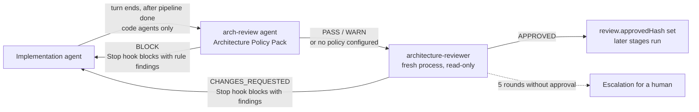

# Review stage

Part of the [AI development pipeline](README.md). Once the implementation agent runs `factory done`, the review stage runs an architecture review of its work each time the agent's turn ends, and loops with the agent until the code is approved.



- Each round has two steps:
  - The `arch-review` agent (`architecture-policy/agents/arch_review.py review` in the factory install) evaluates the repository's architecture policy on the changed files, as requester `implementer`. A `BLOCK` ends the round with changes requested and its rule findings (fix, approved patterns, `explain_finding` command) without an LLM call. `WARN` findings ride along as non-blocking notes. Each later round is linked to the previous policy review with `previous_review_id`, so it reports resolved and persisting findings.
  - Otherwise the `architecture-reviewer` agent reviews the diff.

  Set `review.policy.enabled` to `false` to skip the policy step. If the engine or Python is unavailable, the step is skipped with a note and the LLM review still runs.

With `council.stages.review` in `.factory/config.json`, a council of verifiers on several CLIs and models replaces the LLM reviewer (the policy step still runs first), and its rounds replace the stage's round limit; see [council.md](council.md).

## The policy step: engine and policy

The step has two parts in two places ([Architecture Policy Pack](../architecture-policy.md)):

| | Where | Setting |
| --- | --- | --- |
| Engine (no rules of its own) | `architecture-policy/` in the factory install | `review.policy.agent`, a path looked up in the install root first, then in the repository; an absolute path is used as is |
| Policy (the rules of this codebase) | `.factory/policy/` in the repository under review | `review.policy.dir`, relative to the checkout being reviewed, so a story worktree is checked against its own copy; `ARCH_POLICY_DIR` overrides it |

The stage runs `review.policy.command` (default `python {agent} review -`, falling back to `python3` when `python` is not installed) in the checkout under review, with `ARCH_POLICY_DIR` and `ARCH_WORKSPACE` set to the policy folder and the checkout. A custom command can also use the placeholders `{agent}`, `{policyDir}` and `{workspace}`.

- **No policy.** A repository without `.factory/policy/policy.yaml` has no architecture policy. The engine answers `NOT_CONFIGURED` (exit 0), the step is skipped, the reviewer's summary ends with `(Architecture Policy Pack skipped: no architecture policy configured ...)`, and the LLM review runs as usual. Start a policy from `templates/policy/` with the `author-architecture-policy` skill.
- **Categories.** A policy names its own rule categories. `review.policy.categories` maps them to the reviewer's finding categories (`security`, `data`, `resilience`, `correctness`, `fit`, `maintainability`); an unmapped category counts as `fit`.
- **Python.** The engine needs Python 3 with `pyyaml` and `jsonschema` (`python3 -m pip install -r <factory>/"$(factory version --path)/architecture-policy/requirements.txt"`).
- Only code agents are reviewed: the main session's `Stop`, or a `SubagentStop` whose `agent_type` is listed in `review.codeAgents` (default `implementer`).
- The reviewer sees only the story and the implementation diff against the merge base (tests, plans and scenarios excluded, see `implExclude` in `scripts/pipeline/config.json`), plus the repository conventions (`AGENTS.md`, `CONTRIBUTING.md`). It never sees the implementation agent's reasoning.
- Changes requested block the stop and send the findings to the agent as its next instruction. Each correction triggers a new round with a fresh reviewer, up to `review.maxRounds` (5). An approval with blocking findings counts as changes requested.
- If the agent stops again without changing the code, the hook blocks once more, then lets the turn end with a message so it cannot loop forever.
- On approval it records the approved implementation hash in `review.approvedHash` in the story state. The `feature-verification` stage starts automation only for that exact hash, so code changed after an approval is reviewed again first.
- `pipeline start <KEY>` resets the review rounds.

## Static analysis evidence

With an `analysis` section, the reviewers (a single reviewer or a council) get the static analysis report of the commit under review as evidence ([analysis.md](analysis.md)); they do not run the tools again or raise what the report already holds.

## Interrupted reviews

A round records itself in `review.inProgress` (code hash, round, pid and boot) and holds `.factory/state/locks/<KEY>-review.lock` while it runs. If the round dies (crash, kill, reboot, or the hook timing out), the next session start says so and the next Stop runs the round again. After `recovery.maxAttempts` (3) dead rounds for the same code the review escalates with verdict `CRASHED` instead; `node scripts/review/review.mjs resume <KEY> --force` (or `pipeline resume <KEY> --force`) clears it so the next Stop retries. A second Stop while a round is running gets a notice instead of a second reviewer.

Every round is appended to `.factory/metrics/arch-reviews.jsonl` (story, round, verdict, and each finding's severity, category, file, line and issue). Rounds blocked by the policy pack carry `reviewer: arch-review-agent`, the `review_id` and each finding's `rule`. Every round of both reviewers, approvals included, is also written to the [decision log](feature-verification.md#decision-log) (`stage: review`) with the reviewer's summary and each finding's issue and fix, which the weekly factory retro reads.

## How the implementer improves

Review denials feed back into the code agents at two speeds:

- **Across stories (shared, reviewed):** `node scripts/feature-verification/feature-verification.mjs lessons` (weekly in `retro.yml`) treats every blocking finding in `arch-reviews.jsonl` as an `implementer` denial, grouped by category and, for policy-pack findings, by rule id. A mistake that recurs in 3 or more stories becomes a rule in `.factory/lessons/implementer.md`, proposed in a pull request; rules are strengthened, retired or reverted with the same measurements as the feature verification agents ([feature-verification](feature-verification.md#auto-improvement)). The `implementer` agent reads that file before it starts, and the session-start hook adds it to the main session's context while a story is active. Findings the [PR check](pr-check.md#how-agents-improve) upholds in its first round, and implementation bugs the integration tests find (`product-bug`), feed the same file.
- **Within a story (team-wide):** when the policy pack flags a finding as a repeat mistake (the requester was denied for that rule before), the block message also includes `get_lessons` guidance from the agent's failure history (`review.policy.lessonsCommand`; set it to `null` to turn it off). Each policy-pack run and review is also written to `.factory/metrics/arch-history/` in the repository under review (one JSON file per event, committed with the story; `history.ledger.path` in the policy's `policy.yaml`), and every local history store imports those files first, so these lessons include teammates' denials once their work is merged.

`.gitattributes` merges `.factory/metrics/*.jsonl` with `merge=union`, so teammates appending to the same log keep both sides instead of conflicting.

## Commands

```bash
node scripts/review/review.mjs run [SHOP-3]       # one review round now, printed
node scripts/review/review.mjs status [SHOP-3]
node scripts/review/review.mjs resume [SHOP-3] [--force]   # report interrupted rounds; --force retries a CRASHED review
node scripts/review/review.mjs metrics [--json] [--since 2026-01-01]
```

Settings: `scripts/review/config.json` holds the defaults (`review.maxRounds`, `review.timeoutSec`, `review.codeAgents`, `review.policy` including `agent`, `dir`, `command`, `categories`, `lessonsCommand` and `maxLessons`, `agent.models.reviewer`); a repository overrides them in the `review` section of its `.factory/config.json` (the `review` section of `examples/eshop/.factory/config.json` is eShop's). Lesson thresholds are shared with feature verification in `scripts/feature-verification/config.json` (`lessons`).
